### AD5X

1. [Důležité zvláštnosti](#1-důležité-zvláštnosti)
2. [Jak připravit soubor v Orca](#2-jak-připravit-soubor-v-orca)
3. [Jak používat menu pro výběr barvy (makro `COLOR`)](#3-jak-používat-menu-pro-výběr-barvy-makro-color)
4. [Menu tisku (`PRINT`)](#4-menu-tisku-print)
    - [Globální parametry AD5X](#globální-parametry-ad5x)
5. [Jak ručně sdělit tiskárně, která cívka je vložena](#5-jak-ručně-sdělit-tiskárně-která-cívka-je-vložena)
6. [Jak nastavit odpad při výměně filamentu](#6-jak-nastavit-odpad-při-výměně-filamentu)

    - 🔧 [Základní parametry (nejčastěji upravované)](#základní-parametry-nejčastěji-upravované)
       - ⚙️ [Pokročilé parametry (neupravujte, pokud si nejste jisti výsledkem)](#pokročilé-parametry-neupravujte-pokud-si-nejste-jisti-výsledkem)

7. [Přidat nebo odebrat typy filamentů](#7-přidat-nebo-odebrat-typy-filamentů)
8. [Přidat vlastní barvy](#8-přidat-vlastní-barvy)
9. [Oprava práce s odpadním košem a nožem na filament](#9-oprava-práce-s-odpadním-košem-a-nožem-na-filament)

    - [Nastavení koše v továrním firmwaru AD5X](#nastavení-koše-v-továrním-firmwaru-ad5x)
       - [Přes USB disk v továrním firmwaru](Setup.md#varování-ad5x)

10. [Příkazy IFS](#10-příkazy-ifs)
11. [Obnova firmwaru IFS](#11-obnova-firmwaru-ifs)

### [Pluginy](Plugin.md)

- [**bambufy**](https://github.com/function3d/bambufy) - Kompatibilita s Bambu Studio, lepší správa čisticí věže, přesné odhady, méně odpadu
- [**lessWaste**](https://github.com/Hrybmo/lessWaste/) - fork pluginu Bambufy
- [**nopoop**](https://github.com/ghzserg/nopoop) - Maximální snížení odpadu od ninjamida
- [**IFS Jacker**](https://github.com/ninjamida/ifs_jacker_plugin) – Doplněk pro podporu [hardwarového modu IFS Jacker](https://github.com/ninjamida/ifs_jacker)

---

## **1. Důležité zvláštnosti**

Rozdíly oproti AD5M:

*   Žádná podpora `Entware`
*   **Vždy používejte** `FAST_CLOSE_DIALOGS` (rychlé zavírání) místo `CLOSE_DIALOGS` (pomalé zavírání).
*   Makro `NEW_SAVE_CONFIG` **nefunguje**.
*   Pro zapnutí kamery použijte ```CAMERA_ON VIDEO=video3``` nebo ```CAMERA_ON VIDEO=video0``` nebo ```CAMERA_ON VIDEO=video99```.
*   Klipper může spadnout. Řešení: `Process Profile` -> `Other` -> `G-code output` -> zrušte zaškrtnutí `Exclude objects`.

---

## **2. Jak připravit soubor v Orca**

[Odesílejte soubory k tisku přes „Octo/Klipper“](Recommendations.md#odeslání-souborů-k-tisku-prostřednictvím-octoklipper)

**Odstraňte nepoužívané cívky ze seznamu v Orce.**

**Příklad:**
Tiskárna má 4 cívky (č. 1, č. 2, č. 3, č. 4). K tisku jsou potřeba pouze cívky č. 1 a č. 3.

*   V souboru budou pojmenovány **T0** (první barva) a **T1** (druhá barva).
*   V menu vyberte:
    - **T0** → cívka č. 1
    - **T1** → cívka č. 3

---

## **3. Jak používat menu pro výběr barvy (makro `COLOR`)**

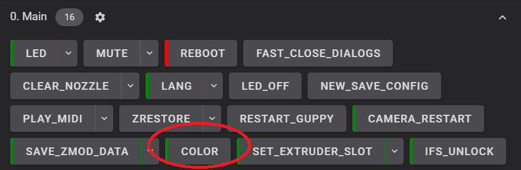

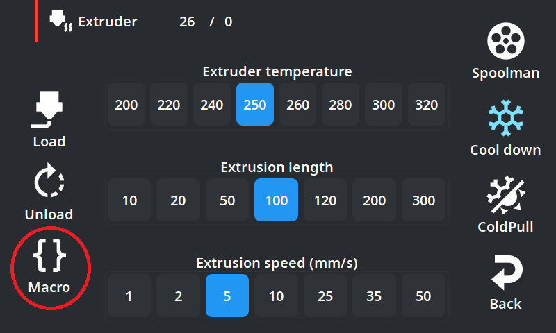

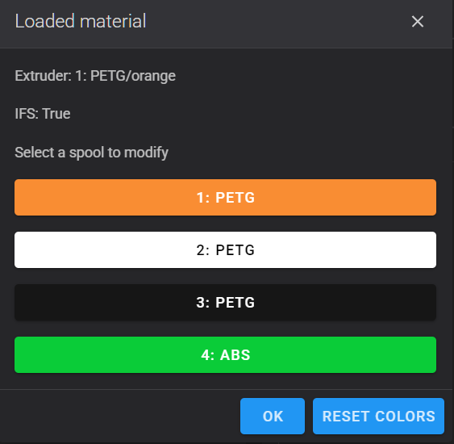

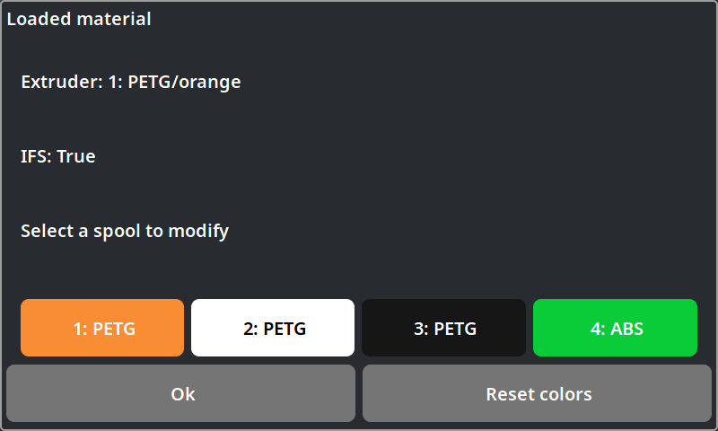

*   `Extruder: 1 (PETG/Orange)` – v tiskárně je aktuálně zaveden oranžový PETG z cívky č. 1.
*   `IFS: True` – automatický systém podávání filamentu je aktivní.

**Nyní vyberte cívku, se kterou chcete pracovat (např. cívka 2):**

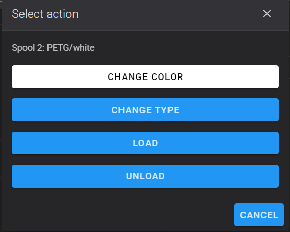

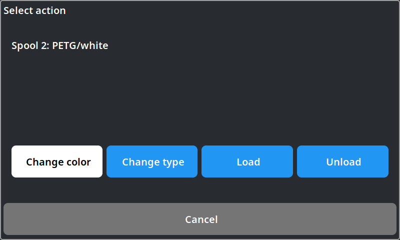

Můžete provést čtyři akce:

1.  **Změnit barvu** cívky.
2.  **Změnit typ materiálu** (např. z PLA na PETG).
3.  **Zavést** tento filament do tiskárny.
4.  **Vysunout** filament z tiskárny.

**Jak změnit barvu:**

1.  Klikněte na „Change Color“.
2.  **Vyberte barvu ze seznamu.** Tak barvu nejlépe rozpozná tiskárna i nativní obrazovka.

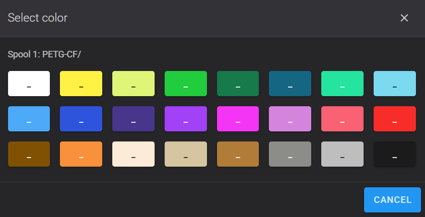

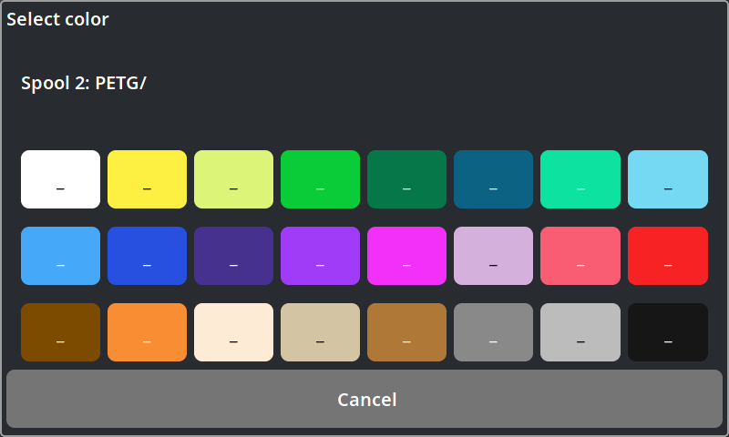

3.  Po výběru se vrátíte do menu a barva cívky **se změní**.
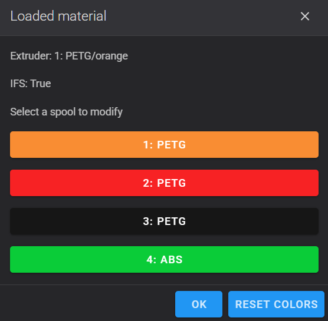

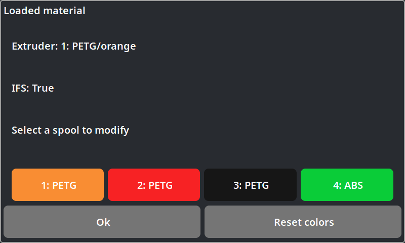

**Pokud se barva nezmění:** Zavřete okno tlačítkem „X“ a restartujte makro `COLOR`. Někdy se obrazovka neobnoví okamžitě.

**Jak změnit typ materiálu:**

1.  Klikněte na „Change Type“.
2.  **Vyberte typ materiálu ze seznamu.**

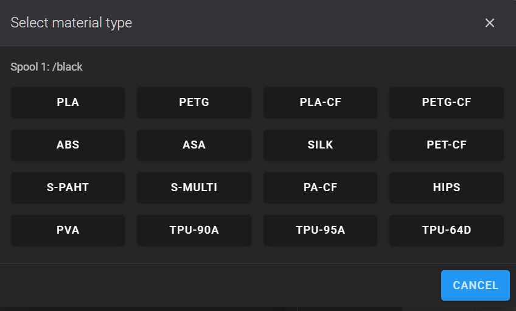

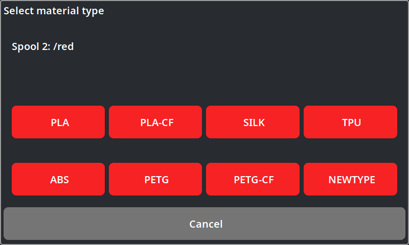

**Pokud se typ nezmění:** Zavřete okno tlačítkem „X“ a restartujte makro `COLOR`. Někdy se obrazovka neobnoví okamžitě.

**Tip:** Pokud je více cívkám přiřazena **stejná barva a typ materiálu**, tiskárna se automaticky přepne na další cívku, když současná dojde. Tomu se říká **„režim nekonečné cívky“**.

---

## **4. Menu tisku (makro `PRINT`)** {#4-menu-tisku-print}

Toto okno se otevře **samo**, když spustíte tisk.

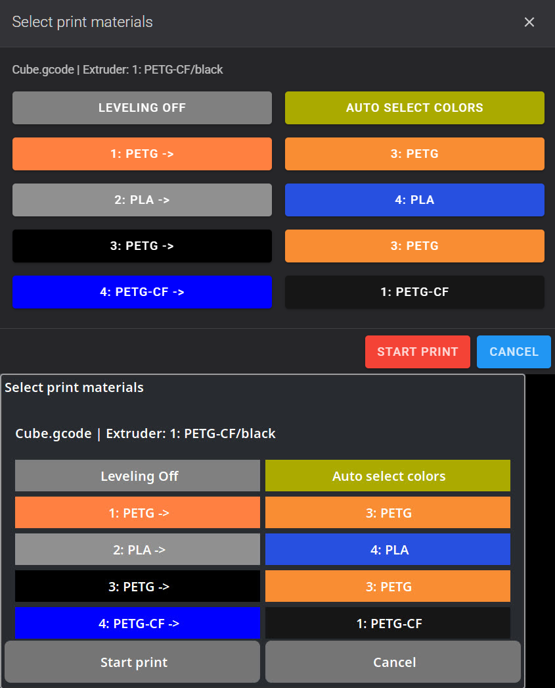

**Co se zde zobrazuje:**

- V levém sloupci jsou čísla nástrojů a barvy ze souboru předané ze sliceru.
- V pravém sloupci jsou čísla cívek a barvy načtené/použité na tiskárně.
- `Cube.gcode` – to je název souboru, který se tiskne.
- `1: PETG ->` – to je první barva ze souboru (oranžový PETG). Tiskne se filamentem z cívky 3 (oranžový PETG).
- `2: PLA ->` – to je druhá barva (šedý PLA). Tiskne se filamentem z cívky 4 (modrý PLA), protože v tiskárně není žádný jiný PLA.
- `3: PETG ->` – třetí barva (černý PETG), tiskne se z cívky 3 (oranžový PETG), protože v tiskárně není žádný jiný PETG.
- `4: PETG-CF ->` – čtvrtá barva (modrý PETG-CF), tiskne se z cívky 1 (černý PETG-CF), protože v tiskárně není žádný jiný PETG-CF.

Pokud obrázek vypadá takto:

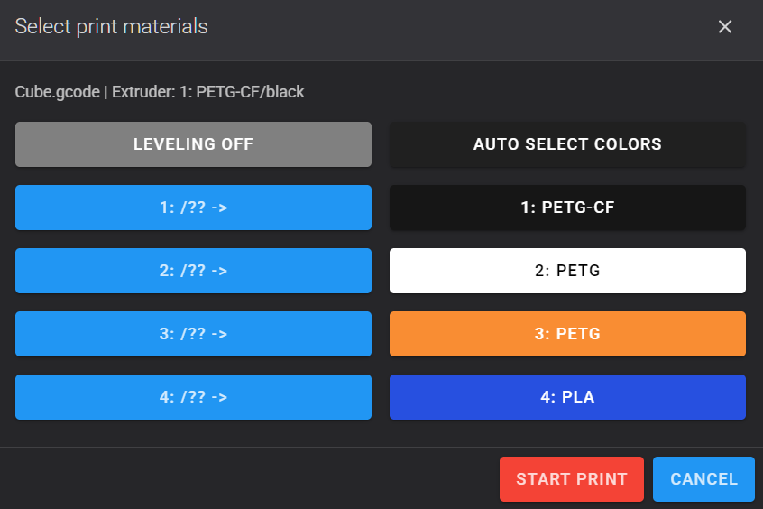

znamená to, že máte vypnutou volbu automatického přiřazení barev a/nebo skenování souborů. Můžete kliknout na tlačítko `AUTO_SELECT_COLORS` nebo ji zapnout v globálních parametrech:
```
SAVE_ZMOD_DATA SCAN_FILE_COLORS=1 AUTO_ASSIGN_COLORS=1
```

[Důrazně doporučujeme zapnout preprocesor](/cs/Global/#force_md5)

**Jak před tiskem změnit cívku pro barvu:**

*   Jednoduše **klikněte na cílové T** (např. T1) a vyberte jinou cívku ze seznamu.
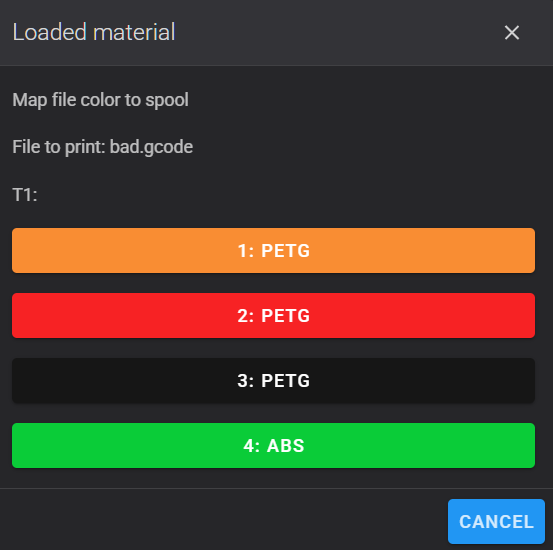

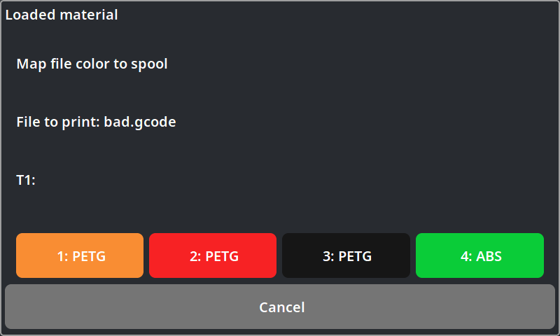

---

### Globální parametry AD5X

Zda se na začátku tisku zobrazí dialog výběru barvy, určuje globální parametr [SILENT](Global.md#silent):

- 0 – zobrazit dialog (výchozí)
- 1 – nezobrazovat dialog, použít dříve nastavené barvy
- 2 – nezobrazovat dialog, nepoužívat IFS

```gcode
SAVE_ZMOD_DATA SILENT=1
```

Pro vypnutí automatického zavádění filamentu do extruderu použijte globální parametr [AUTOINSERT](Global.md#autoinsert):

```gcode
SAVE_ZMOD_DATA AUTOINSERT=0
```

Chcete-li při tisku vypnout vytlačování filamentu do koše, použijte parametr [USE_TRASH_ON_PRINT](Global.md#use_trash_on_print).

- 0 - K čištění do odpadu nedojde. Tisková hlava přesto při změnách barvy v první vrstvě přejede k odpadnímu žlabu, aby se omezil výskyt shluků plastu. Pokud k tomu dochází v každé vrstvě, zkontrolujte svůj startovací G-code a G-code pro změnu vrstvy!
- 1 - Během změn barev dojde k vyčištění do odpadního žlabu. Při každé změně barvy proběhnou dvě čištění o délce rovné `filament_drop_length` ve filament.json (plus `filament_drop_length_add`, pokud jsou materiály odlišné).
- 2 - Po zavedení nové barvy tisková hlava přejede k odpadnímu žlabu a odtud vrátí řízení sliceru. Používejte jen s profilem sliceru, který je pro tento režim připraven.

```gcode
SAVE_ZMOD_DATA USE_TRASH_ON_PRINT=0
```

Chcete-li po dokončení tisku vysunout filament, použijte parametr [REMOVE_FILAMENT](Global.md#remove_filament).

```gcode
SAVE_ZMOD_DATA REMOVE_FILAMENT=1
```

Chcete-li nastavit, kolik nástrojů se zobrazí v okně pro výběr barvy (pokud tuto informaci nelze ze souboru zjistit), použijte parametr [ALLOWED_TOOL_COUNT](Global.md#allowed_tool_count).

[Viz nastavení předzpracování](/cs/Recommendations/#povolit-kontrolu-kontrolního-součtu-md5)

```gcode
SAVE_ZMOD_DATA ALLOWED_TOOL_COUNT=16
```

Chcete-li zapnout prohledávání G-code souborů kvůli informacím o nástrojích, barvách a materiálech, použijte parametr [SCAN_FILE_COLORS](Global.md#scan_file_colors). Hodnota 2 načte jen data připravená skriptem sliceru, bez prohledávání celého souboru.

[Viz nastavení předzpracování](/cs/Recommendations/#povolit-kontrolu-kontrolního-součtu-md5)

```gcode
SAVE_ZMOD_DATA SCAN_FILE_COLORS=1
```

Chcete-li automaticky přiřadit barvy z G-code souboru k fyzickým cívkám, použijte parametr [AUTO_ASSIGN_COLORS](Global.md#auto_assign_colors). Aby fungoval, musí být zapnuté prohledávání souborů. Použití hodnoty 30 přeruší tisk v tichém režimu, pokud dojde k jakémukoli problému s automatickým přiřazením.

Vlastní podmínky přerušení v tichém režimu nastavíte sečtením následujících hodnot:

* 2 (Alespoň jeden materiál nelze spárovat; např. G-code soubor uvádí ABS, ale máte vložený pouze PLA; nebo data o materiálu nelze načíst)
* 4 (Alespoň jednu barvu nelze vůbec spárovat, obvykle kvůli zakázanému nebo neúspěšnému prohledávání souborů)
* 8 (Alespoň jedna barva odpovídá špatně)
* 16 (Alespoň jedna fyzická cívka byla přiřazena k více než jednomu indexu nástroje v souboru)

[Viz nastavení předzpracování](/cs/Recommendations/#povolit-kontrolu-kontrolního-součtu-md5)

```gcode
SAVE_ZMOD_DATA AUTO_ASSIGN_COLORS=30
```

Pokud příkaz ke změně barvy přepíná na již zavedenou barvu, výměna se obvykle přeskočí jako zbytečná. Pokud přesto chcete provádět plnou výměnu barvy, použijte parametr [ALWAYS_FULL_COLOR_CHANGE](Global.md#always_full_color_change).

```gcode
SAVE_ZMOD_DATA ALWAYS_FULL_COLOR_CHANGE=0
```


---

## **5. Jak ručně sdělit tiskárně, která cívka je vložena**

Někdy ručně změníte cívku, ale tiskárna to nerozpozná a zobrazuje zastaralé informace.

K nápravě slouží speciální příkaz.

**Zadejte do konzole:**

```gcode
SET_EXTRUDER_SLOT SLOT=1
```

**Co to znamená:**

*   `SET_EXTRUDER_SLOT` – Příkaz, který tiskárně říká: „Zapamatuj si tuto cívku!“
*   `SLOT=1` – Číslo cívky, kterou jste právě vložili. **Toto číslo můžete změnit!**

**Příklady:**

*   Pokud jste vložili filament z cívky č. 3: `SET_EXTRUDER_SLOT SLOT=3`
*   Pokud z cívky č. 2: `SET_EXTRUDER_SLOT SLOT=2`

Po tomto příkazu bude tiskárna vědět, která cívka je aktivní, a nebude míchat barvy.

---

## **6. Jak nastavit odpad při výměně filamentu**

Tato nastavení pomáhají snížit plýtvání plastem při přepínání cívek. Chcete-li je upravit, nejprve **vypněte nativní obrazovku tiskárny** pomocí makra `DISPLAY_OFF`.

V režimu bez nativní obrazovky jsou dostupné a aktivní tyto senzory:

- `Head Switch Sensor` – Detekuje přítomnost filamentu v extruderu
- `Ifs Motion Sensor` – Sleduje pohyb filamentu v IFS


**Jak najít tato nastavení:**

1.  Otevřete kartu **„Konfigurace“**.
2.  Přejděte do složky **`mod_data`**.
3.  Otevřete soubor **`filament.json`**.

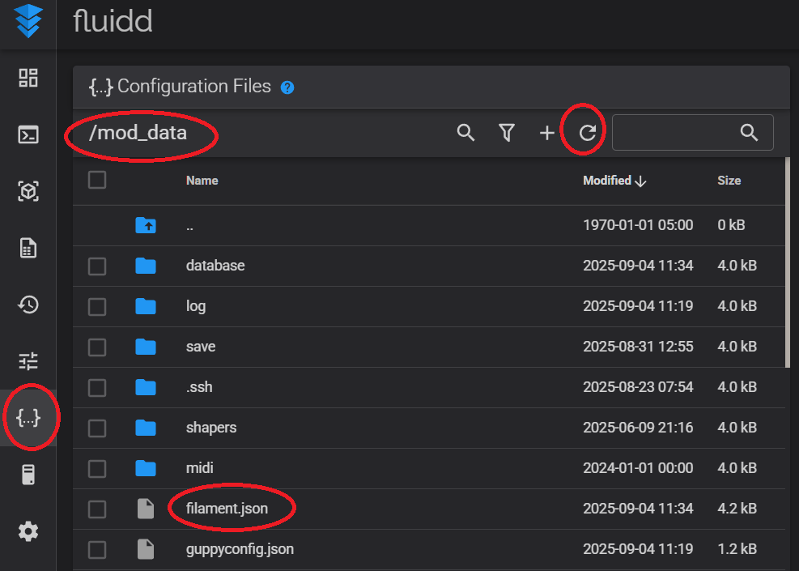

V tomto souboru má každý typ materiálu (PLA, ABS, PETG atd.) seznam hodnot. Zde je jejich význam:

---

#### **Základní parametry (nejčastěji upravované):**

Aby tato nastavení fungovala, musíte **vypnout nativní obrazovku tiskárny** pomocí makra `DISPLAY_OFF`.

1.  **`temp`** — Teplota trysky pro výměnu filamentu. **Výchozí hodnota závisí na typu materiálu.**
2.  **`filament_drop_length` (délka čištění)**

    *   **Jednoduše řečeno:** Kolik milimetrů filamentu tiskárna vytlačí do odpadního koše, aby **vyčistila trysku** od předchozí barvy. Toto platí při zavádění barev mimo tisk nebo před tiskem, nebo při změně barev, když je USE_TRASH_ON_PRINT nastaveno na 1.
    *   **Tip:** Zvyšte tuto hodnotu, pokud se barvy míchají při výměně cívek. Snižte ji, abyste snížili odpad.

3.  **`filament_drop_length_add` (dodatečné čištění)**

    *   **Jednoduše řečeno:** Extra délka čištění při přechodu mezi **typy materiálů** (např. z PLA na PETG), nejen barvami. Toto platí při zavádění barev mimo tisk nebo před tiskem, nebo při změně barev, když je USE_TRASH_ON_PRINT nastaveno na 1.
    *   **Proč je to potřeba:** Různé materiály se špatně mísí, proto je nutné hlubší čištění trysky.

4.  **`nozzle_cleaning_length`** — délka (v mm) filamentu vytaženého z extruderu při vysouvání, když se cívka již nepoužívá. **Výchozí: 60 mm.**

5.  **`filament_unload_into_tube`** — o kolik se filament zatáhne zpět do modulu 4 v 1, když se extruder již nepoužívá. **Výchozí: 70 mm.**

    *   Pokud máte modul 4 v 1 nové verze, zvyšte `filament_unload_into_tube` nebo v krajním případě `nozzle_cleaning_length`.

---

##### **Pokročilé parametry (neupravujte, pokud si nejste jisti výsledkem):**

Aby tato nastavení fungovala, musíte **vypnout nativní obrazovku tiskárny** pomocí makra `DISPLAY_OFF`.

*   **`filament_tube_length`** — Celková délka PTFE hadičky od modulu IFS k extruderu. Užitečné pro nestandardní hadičky. **Výchozí: 1000 mm.**
*   **`filament_unload_before_cutting`** — zatažení filamentu **před** řezáním. **Výchozí: 0 mm.**
*   **`filament_unload_after_cutting`** — zatažení filamentu **po** řezání, před přesunem do odpadního koše. **Výchozí: 5 mm.**
*   **`filament_unload_after_drop`** — Vzdálenost retrakce po čištění, aby se zabránilo odkapávání. **Výchozí: 3 mm.**
*   **`filament_extruder_speed`** — Rychlost (v mm/min), kterou je filament zaváděn do extruderu. **Výchozí: 300 mm/min (5 mm/s).**
*   **`filament_ifs_speed`** — Rychlost (v mm/min), kterou pracuje modul IFS. **Výchozí: 1200 mm/min (20 mm/s).**
*   **`filament_fan_speed`** — Rychlost ventilátoru (0–255) během čištění pro chlazení vytlačeného plastu. **Výchozí: 102.**
*   **`filament_autoinsert_empty_length`** — Délka filamentu taženého při automatickém vkládání do prázdného extruderu. **Výchozí: 600 mm.**
*   **`filament_autoinsert_full_length`** — Délka filamentu taženého při výměně stávajícího filamentu. **Výchozí: 550 mm.**
*   **`filament_autoinsert_ret_length`** — Vzdálenost retrakce po spuštění senzoru extruderu (pouze prázdný extruder). **Výchozí: 90 mm.**
*   **`filament_autoinsert_speed`** — Rychlost automatického vkládání (mm/min). **Výchozí: 1200 mm/min (20 mm/s).**

**Varování!** Úprava pokročilých parametrů může způsobit poruchy tiskárny, ucpání filamentu nebo poškození hardwaru. Upravujte pouze tehdy, pokud plně rozumíte účelu a potenciálním následkům každého parametru.

**Důležité:** Chcete-li snížit odpad, začněte snížením **`filament_drop_length`** a **`filament_drop_length_add`** pro váš materiál. Nezapomeňte po změnách soubor uložit!

---

#### **Čištění řízené slicerem (Slicer-controlled purge)**

Čištění může místo tiskárny řídit slicer, pokud pro `USE_TRASH_ON_PRINT` použijete jinou hodnotu než výchozí `1`.

##### Režim Nopoop (`SAVE_ZMOD_DATA USE_TRASH_ON_PRINT=0`)

V tomto režimu tiskárna během výměny barev neprovádí žádné čištění. Tiskárna odstřihne filament, poté se vrátí k čisticí věži (prime tower), aby vyjmula a zavedla filament, a následně odtud ihned pokračuje v tisku.

V první vrstvě tiskárna při výměně filamentu namísto toho přejede k odpadní šachtě, ale poté se vrátí k čisticí věži, aniž by vyprodukovala jakýkoli odpad (poop).

Aby bylo možné v tomto režimu řádně vyčistit starý filament, doporučeným přístupem je povolit volbu „Čištění v čisticí věži“ (Purge into prime tower) v nastavení OrcaSliceru. Toto nastavení naleznete v nastavení tiskárny na kartě „Multimaterial“. Poté můžete použít nastavení „Flush Volumes“ pro úpravu množství čištění. Pokud si přejete přidat fixní množství k automaticky vypočítaným objemům propláchnutí, můžete tak učinit nastavením „Objem trysky“ (Nozzle Volume) v záložce „Obecné“ (General) v nastavení tiskárny.

Je normální, že vaše čisticí věž bude při použití této volby výrazně větší než obvykle, zejména při práci s malou výškou vrstvy.

V tomto režimu můžete navíc použít volby jako „Čištění do výplně“ (Purge to infill), „Čištění do tohoto objektu“ (Purge to this object) atd., abyste snížili množství odpadu vyčištěného do čisticí věže.

Tato volba je podporována pouze v OrcaSliceru; nelze ji použít v Bambu Studio kvůli absenci funkce „Čištění v čisticí věži“.

##### Režim odpadu řízený slicerem (`SAVE_ZMOD_DATA USE_TRASH_ON_PRINT=2`)

V tomto režimu tiskárna během výměny barev sama neprovádí žádné čištění. Tiskárna odstřihne filament, přejede k odpadní šachtě a předá řízení zpět sliceru.

Tento režim vyžaduje řádnou podporu ze strany profilu tiskárny ve sliceru, zejména je nutný gcode pro výměnu filamentu, který obstará vyhození odpadu a následný návrat k čisticí věži. Nepoužívejte tento režim s žádným gcode souborem, který pro něj nebyl specificky připraven (sliced).

Při použití OrcaSliceru nelze v tomto režimu použít volby jako „Čištění do výplně“. Jedná se o chybu v OrcaSliceru a nelze ji opravit pomocí Z-Mod. V Bambu Studio tyto volby fungují správně.

##### Profily tiskáren

Profily tiskáren nastavené pro čištění řízené slicerem jsou k dispozici pro [OrcaSlicer](https://github.com/ghzserg/zmod_preprocess/tree/main/profiles/orcaslicer) a [Bambu Studio](https://github.com/ghzserg/zmod_preprocess/tree/main/profiles/bambustudio). Tyto profily se blíží výchozím profilům AD5X s výjimkou:
- Přidány všechny vlastní gcode Z-Mod, včetně příslušného gcode pro výměnu filamentu pro USE_TRASH_ON_PRINT=2
- Povoleno „Čištění v čisticí věži“ (pouze OrcaSlicer)
- Automaticky nastaví správnou hodnotu USE_TRASH_ON_PRINT na začátku tisku
- Typ Z-Hop nastaven na Normální (Normal)
- Objem trysky nastaven na 144
- Čas vyjmutí filamentu nastaven na 66 s pro přesnější odhady (na základě výchozího nastavení filament.json)
- Čas rozběhu ventilátoru nastaven na 1,5 s a kickstart na 0,5 s (pouze OrcaSlicer)

Při použití OrcaSliceru můžete přepínat mezi těmito dvěma režimy změnou nastavení „Čištění v čisticí věži“. Pokud je povoleno, použije se režim nopoop. Pokud je zakázáno, použije se režim odpadu (poop mode). Profil pro vás na začátku tisku automaticky nastaví správnou hodnotu USE_TRASH_ON_PRINT.

Při použití Bambu Studio je podporován pouze režim odpadu (poop mode).

**Pokud tisknete z těchto profilů v režimu odpadu řízeném slicerem, nezapomeňte před tiskem jakéhokoli vícebarevného gcodu, který nebyl připraven pomocí těchto profilů, změnit nastavení USE_TRASH_ON_PRINT zpět na 0 nebo 1.**

## **7. Přidat nebo odebrat typy filamentů**

Aby tato nastavení fungovala, musíte **vypnout nativní obrazovku tiskárny** pomocí makra `DISPLAY_OFF`.

Chcete-li přidat nový typ filamentu, přidejte do `mod_data/user.cfg`:
```
[zmod_ifs]
filament_NEWTYPE: 300
```
Kde `NEWTYPE` nahraďte požadovaným typem filamentu (např. HIPS) a číslo je teplota extruderu pro zavádění, vysouvání a proplach tohoto filamentu.

Chcete-li skrýt typ filamentu, přidejte do `mod_data/user.cfg`:
```
[zmod_color]
hide_filament_types: XXX,YYY,ZZZ
```
Kde `XXX`, `YYY`, `ZZZ` nahraďte požadovanými typy filamentů (např. `PLA-CF,PETG-CF,SILK`). Tuto možnost můžete použít ke skrytí výchozích typů nebo typů, které jste ručně přidali pomocí výše uvedeného nastavení. Tím se typ filamentu nezakáže; pouze se skryje z nabídky výběru typu.

```IFS_PRINT_DEFAULTS``` - zobrazí dostupné typy filamentů a jejich teploty tání


---

## **8. Přidat vlastní barvy**

Aby tato nastavení fungovala, musíte **vypnout nativní obrazovku tiskárny** pomocí makra `DISPLAY_OFF`.

Chcete-li přidat nebo přejmenovat barvu, otevřete `mod_data/color/cs.json` (místo `cs` použijte svůj jazyk) a přidejte novou barvu nebo přejmenujte stávající.

Aby se název barvy zobrazil na tlačítkách, musí začínat podtržítkem `_`.

Příklad:
```
{
"ffffff": "bílá",
"fffff1": "_průhledná",
"fef043": "jasně žlutá",
"dcf478": "světle zelená",
"0acc38": "zelená",
"067749": "tmavě zelená",
"0c6283": "modrozelená",
"0de2a0": "tyrkysová",
"75d9f3": "azurová",
"45a8f9": "modrá",
"2750e0": "tmavě modrá",
"46328e": "fialová",
"a03cf7": "jasně fialová",
"f330f9": "purpurová",
"d4b0dc": "lila",
"f95d73": "růžová",
"f72224": "červená",
"7c4b00": "hnědá",
"f98d33": "oranžová",
"fdebd5": "béžová",
"d3c4a3": "světle hnědá",
"af7836": "terakotová",
"898989": "šedá",
"bcbcbc": "světle šedá",
"161616": "černá"
}
```

Text `_průhledná` se zobrazí na tlačítkách.

---

## 9. Oprava práce s odpadním košem a nožem na filament

[Alternativní verze pokynů](Setup.md#varování-ad5x)

Různé tiskárny AD5X mohou mít různé souřadnice pro odpadnímu koši a nůž. Někdy může být rozdíl až 4 mm.

Kvůli tomu:

- filament se nemusí dostat do odpadního koše;
- nůž filament nepřeřízne;
- hlava tiskárny může narazit do stěny.

Náprava:

1. Aktualizujte Z-Mod.
2. Otevřete soubor `/rw/Adventurer5M.json`.
3. Najděte tyto řádky:
```json
{
        "CutXOffset" : 0.5,
        "CutYOffset" : -0.20000001788139343,
        "xOffset" : 0.0,
        "yOffset" : -0.20000001788139343,
        "zOffset" : 0.0,
        "zProbeOffset" : 0.004999995231628418
},
```
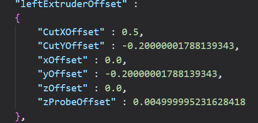

Nahraďte **pouze** tyto hodnoty:
```json
"CutXOffset": 0.0,
"CutYOffset": 0.0,
"xOffset": 0.0,
"yOffset": 0.0,
```

4. Zadejte příkaz `UPDATE_FF_OFFSET` (tím se aktualizují nastavení).
5. Poté zadejte `_GOTO_TRASH` (tím se přesune k odpadní nádobce).

---

### Kalibrace odpadního koše

[Alternativní verze pokynů](Setup.md#varování-ad5x)

1. Zadejte příkaz `_GOTO_TRASH` — hlava tiskárny se přesune k odpadní nádobce.
2. Pokud se koš nezavře, opatrně posouvejte hlavu, dokud se nezavře. Použijte GCODE: ```G1 Y230.2```
3. Zkontrolujte, jakou máte nyní souřadnici **Y**.
4. Odečtěte od tohoto čísla 229. Výsledek bude váš `yOffset`.
5. Zkontrolujte, jakou máte nyní souřadnici **X**.
6. Odečtěte od tohoto čísla 52.5. Výsledek bude váš `xOffset`.

Příklady:

- Pokud Y = 230.2, pak `yOffset = 230.2 - 229 = 1.2`
- Pokud Y = 228.4, pak `yOffset = 228.4 - 229 = -0.6`
- Vzorec: `yOffset = Y - 229`

Zapište toto číslo do souboru `/rw/Adventurer5M.json`. Koš je zkalibrován.

7. Zadejte příkaz: `UPDATE_FF_OFFSET` (tím se aktualizují nastavení).
6. Poté zadejte: `_GOTO_TRASH` (tím se přesune k odpadní nádobce).

---

### Kalibrace nože

[Alternativní verze pokynů](Setup.md#varování-ad5x)

1. Zadejte příkaz `_CUT_PRUTOK` — hlava se přesune k noži.
2. Pomocí obrazovky posouvejte hlavu, dokud se nůž neaktivuje. Použijte GCODE: ```G1 Y-7.7``` ```G1 X-1.7```
3. Zkontrolujte, jaké máte souřadnice X a Y.
4. Pro **Y**:

    - Odečtěte absolutní hodnotu vaší souřadnice Y od **7.5**.
        - Příklad: pokud Y = -7.7, pak `CutYOffset = 7.5 - 7.7 = -0.2`
        - Příklad: pokud Y = -5.9, pak `CutYOffset = 7.5 - 5.9 = 1.6`
        - Vzorec: `CutYOffset = 7.5 + Y`

5. Pro **X**:

    - Odečtěte absolutní hodnotu vaší souřadnice X od **2.5**.
        - Příklad: pokud X = -1.7, pak `CutXOffset = 2.5 - 1.7 = 0.8`
        - Příklad: pokud X = -2.8, pak `CutXOffset = 2.5 - 2.8 = -0.3`
        - Vzorec: `CutXOffset = 2.5 + X`

Zapište tato čísla do souboru `/rw/Adventurer5M.json`. Nůž je zkalibrován.

6. Zadejte příkaz: `UPDATE_FF_OFFSET` (tím se aktualizují nastavení).
7. Poté zadejte: `_GOTO_TRASH` (tím se přesune k odpadní nádobce).

Restartujte tiskárnu — vše je připraveno.

---

## Nastavení koše v továrním firmwaru AD5X

1. Přejděte na kartu „i“ a stiskněte tlačítko `Status`
   
   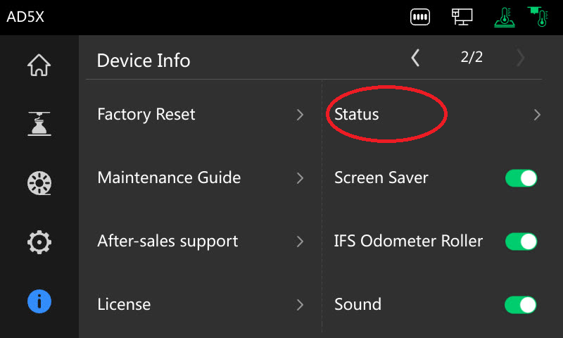
   
2. Přejděte na 6. kartu
   
   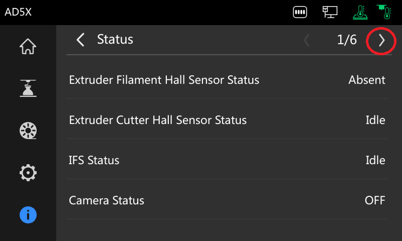
   
3. Stiskněte a podržte `Move the extruder to waste tray position` po dobu 20 sekund
   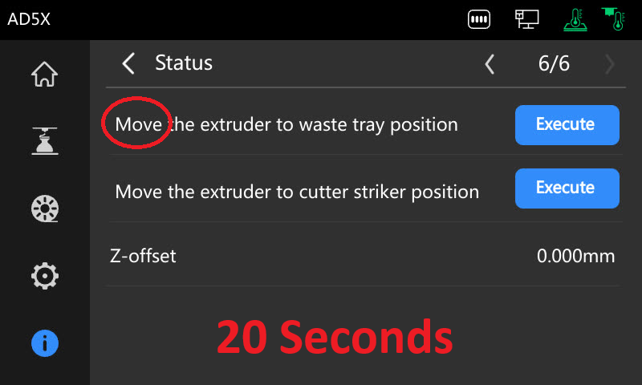
   
4. Upravte polohu hlavy v odpadní nádobce tak, aby se zavřela. Pomocí šipek zaparkujte tiskovou hlavu u koše tak, aby dostatečně stlačila páčku uzávěru, tryska byla za pohyblivým uzávěrem a uzávěr byl v jedné rovině s přední plochou koše.
   
   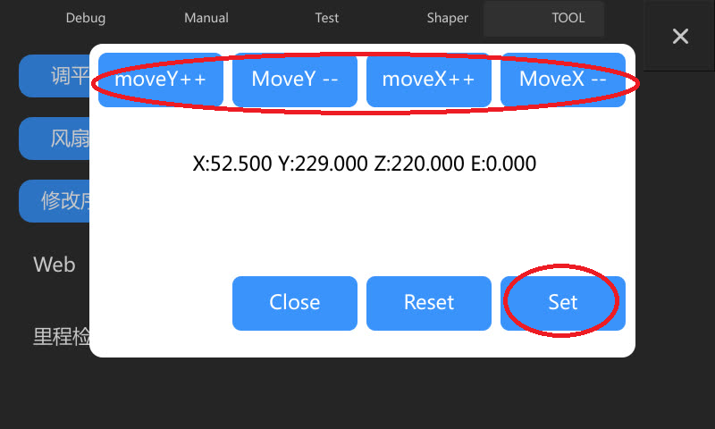
   
   Stiskněte tlačítko `Set`.
   
5. Stiskněte a podržte `Move the extruder to cutter striker position` po dobu 20 sekund
   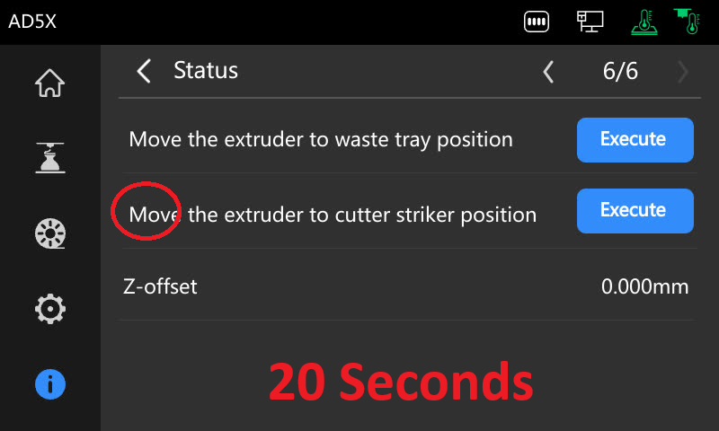
   
6. Upravte nůž. Stiskněte `CutX` — nůž by měl řezat filament bez prokluzování nebo nárazů.
   
   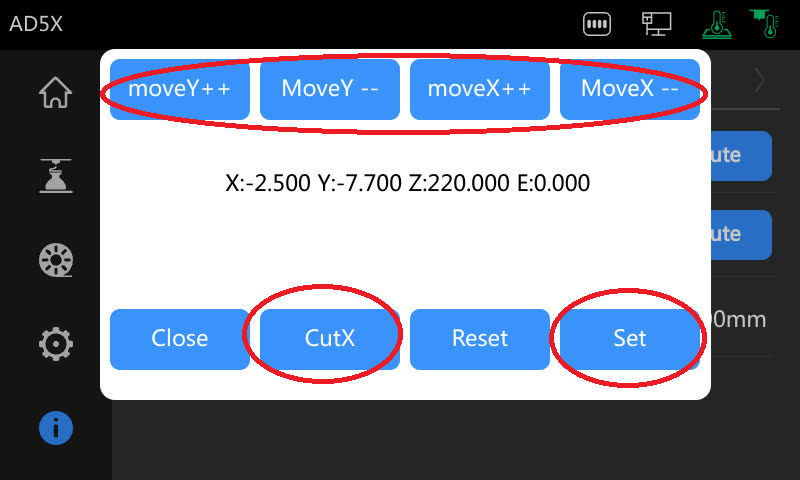
   
   Stiskněte tlačítko `Set`.

---

## **10. Příkazy IFS**

Aby tato nastavení fungovala, musíte **vypnout nativní obrazovku tiskárny** pomocí makra `DISPLAY_OFF`.

- `IFS_F10` - Vložit filament
- `IFS_F11` - Odebrat filament
- `IFS_F13` - Stav IFS
- `IFS_F15` - Resetovat ovladač
- `IFS_F18` - Uvolnit filament ve všech kanálech
- `IFS_F23` - Označit filament jako vložený
- `IFS_F24` - Přitlačit filament
- `IFS_F39` - Uvolnit filament
- `IFS_F112` - Zastavit podávání filamentu
- `PURGE_PRUTOK_IFS` - Čištění filamentu z IFS do extruderu
- `REMOVE_PRUTOK_IFS` - Odebere filament podle čísla filamentu
- `INSERT_PRUTOK_IFS` - Vloží filament do IFS podle čísla filamentu
- `SET_CURRENT_PRUTOK` - Sdělí Klipperu, který filament je aktuálně aktivní
- `ANALOG_PRUTOK` - Zavést rovnocenný filament
- `IFS_MOTION` - Zkontrolovat, zda se filament zastavil nebo došel

Parametry modulu IFS:

- debug - ladění (True, *False*)
- silk_count - od kolikátého pokusu se filament považuje za zavedený v IFS (*1*)
- stall_count - od kolikátého pokusu se filament považuje za zastavený (*1*)
- retry_count - počet opakování příkazu při chybě (*3*)
- next_cmd_delay - doba čekání mezi zpracováním odpovědi IFS a odesláním dalšího příkazu (*0.2*)
- send_ff_terminator - povoluje nebo zakazuje zpoždění 0,2 s + odeslání 0xFF po příkazu IFS; může být vyžadováno velmi starým firmwarem IFS (True, *False*)
- filament_NEWFILAMENT - Přidat nový typ filamentu. Parametr - teplota pro zavádění a vyjímání tohoto materiálu.

Nastavte přes `mod_data/user.cfg`:
```
[zmod_ifs]
debug: True
silk_count: 1
stall_count: 1
filament_NEWTYPE: 300
```

## **11. Obnova firmwaru IFS**

K obnově firmwaru IFS potřebujete programátor **ARM J-LINK V9**.

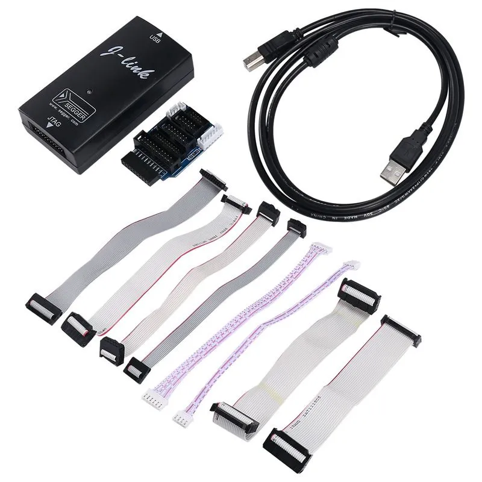

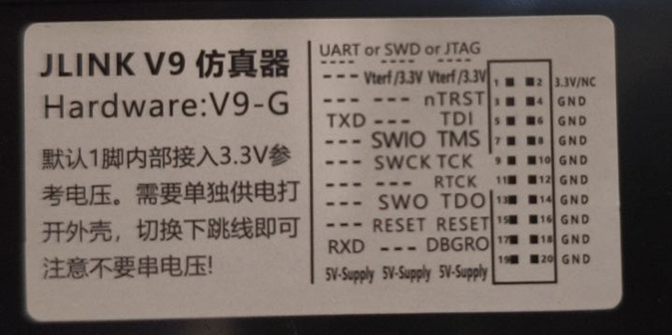

Připájejte dráty k desce IFS.

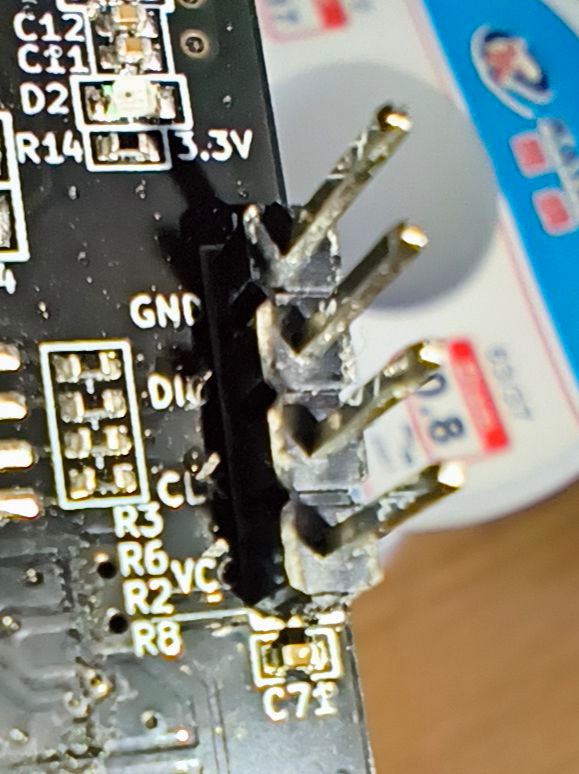

Připojte:

- CLK k SWCK
- DIO k SWIO
- VCC k 3.3
- GND k GND

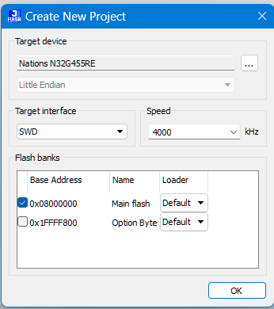

- Cílové zařízení - `Nations N32G455RE`
- Cílové rozhraní: `SWD`
- Rychlost: `4000`
- Zaškrtněte první políčko.
- Zrušte zaškrtnutí druhého políčka.

1. Připojte.
2. Vyberte [soubor firmwaru](Native_FW.md#5x-ifs). **Nezapomeňte jej rozbalit**.
3. Stiskněte **F7** a počkejte na dokončení flashování.

## IFS: sensor error: Serial communication error: read failed: device reports readiness to read but returned no data (device disconnected or multiple access on port?)

Tato chyba nastává, když nativní obrazovka a mod přistupují k IFS současně.

Doporučujeme zkrátit dobu vypnutí nativní obrazovky na 10 sekund: ```SAVE_ZMOD_DATA DISPLAY_OFF_TIMEOUT=10```
