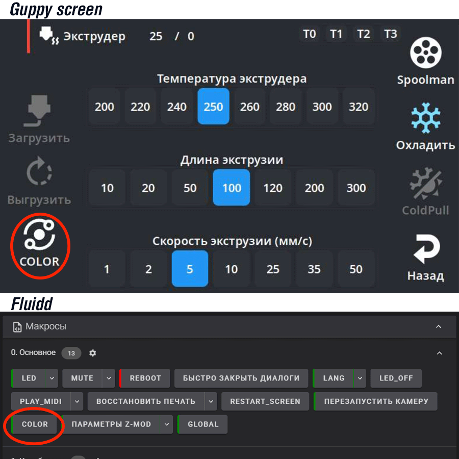
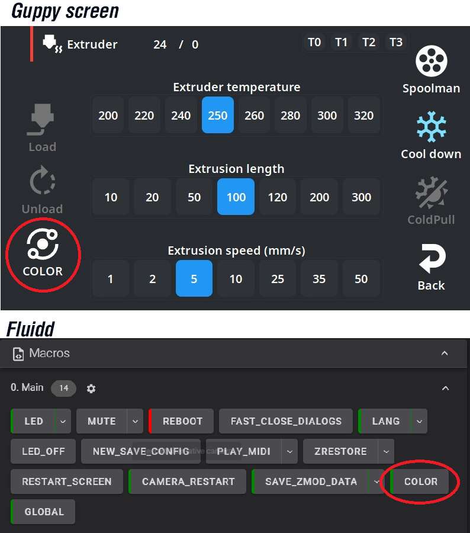
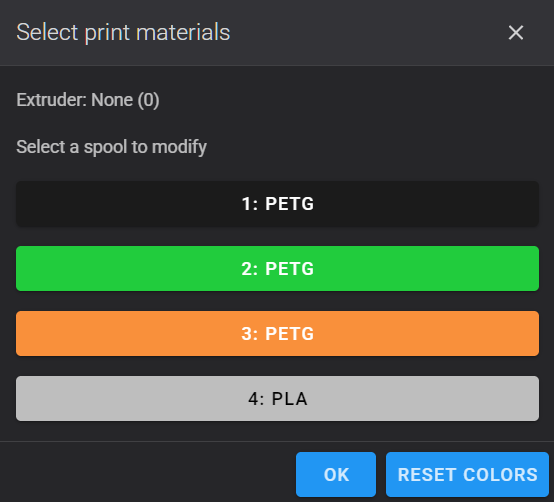
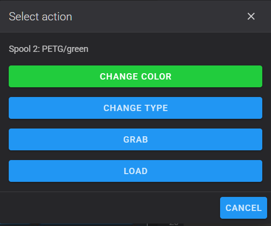
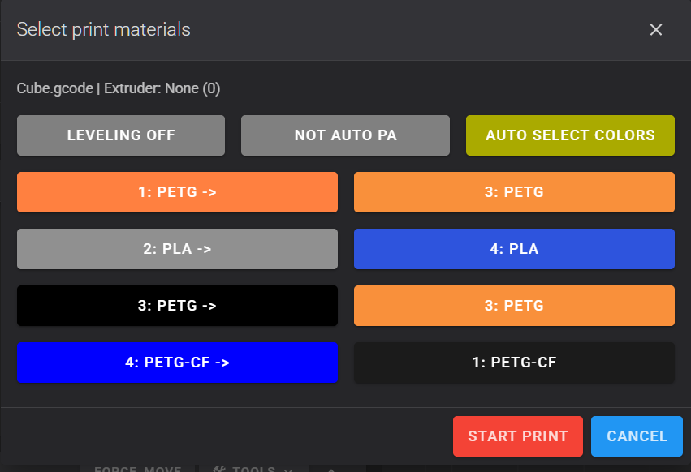
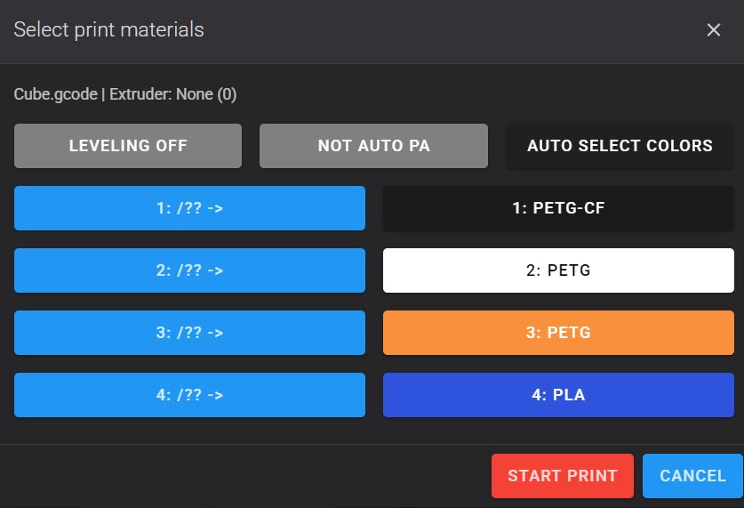
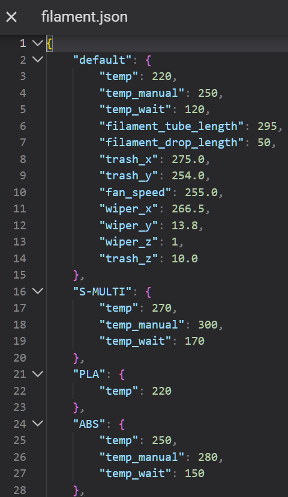
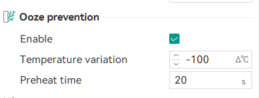

# Creator5
# Creator5 Pro

!!! note
    Tento dokument je relevantní pro Creator 5 a Creator 5 Pro

## Důležité zvláštnosti

- Tiskárna vždy pracuje se **4 barvami** (T0, T1, T2, T3). Všechny čtyři sloty jsou dostupné v menu výběru.
- Pro zapnutí kamery použijte `CAMERA_ON VIDEO=video67`.
- Možný pád Klipperu. Řešení: `Profil procesu` -> `Ostatní` -> `Výstup G-code` -> zrušte zaškrtnutí `Vyloučení objektů`.
- Místo makra `CLOSE_DIALOGS` (pomalé zavírání) vždy používejte `FAST_CLOSE_DIALOGS` (rychlé zavírání).
- Makro `NEW_SAVE_CONFIG` nefunguje.
- Klipper 13 není podporován; pomoc s vývojem je vítána.
- U Creator 5 / Creator 5 Pro je Z-offset s nativní obrazovkou i v režimu bez nativní obrazovky stejný – oba jsou plně synchronizované. Pokud je nativní obrazovka vypnutá, můžete Z-offset měnit během tisku přes GuppyScreen, HelixScreen, Fluidd nebo Mainsail – uloží se.

---

## Jak připravit soubor v Orca

- [Odesílejte soubory k tisku přes Octo/Klipper.](Recommendations.md#odeslání-souborů-k-tisku-prostřednictvím-octoklipper)
- [Profily pro Orca Slicer](https://github.com/ghzserg/zmod_preprocess/tree/main/profiles/)
- [Důrazně doporučujeme zapnout preprocesor](/cs/Global/#force_md5)

---
## COLOR
## Jak používat menu pro výběr barvy a typu filamentu







Vyberte cívku, se kterou chcete pracovat (například cívka 2):



Můžete provést pět akcí:

- Změnit barvu cívky.
- Změnit typ plastu (PLA, PETG, ABS, ...).
- Nasadit tento extruder na vozík.
- Načíst nový filament do extruderu.
- Sundat tento extruder z vozíku.

**Jak změnit barvu:**

Klikněte na „Změnit barvu“. Vyberte barvu ze seznamu. Tak barvu nejlépe rozpozná tiskárna i nativní obrazovka.


Po výběru se vrátíte zpět a barva cívky v seznamu se změní.

Pokud se barva nezměnila: zavřete okno křížkem a spusťte makro `COLOR` znovu. Někdy se obrazovka nestihne aktualizovat.

**Jak změnit typ:**
Klikněte na „Změnit typ“. Vyberte typ ze seznamu. Typy lze upravit pro režim bez nativní obrazovky.


Pokud se typ nezměnil: zavřete okno křížkem a spusťte makro `COLOR` znovu. Někdy se obrazovka nestihne aktualizovat.

**Tip:** Pokud pro několik cívek zadáte stejnou barvu a typ, tiskárna automaticky přepne na další cívku, když první dojde. Tomu se říká „režim nekonečné cívky“.

---

## PRINT
## Menu tisku

Toto okno se otevře samo, když začnete tisknout, pokud je nastaven parametr `SAVE_ZMOD_DATA SILENT=0` (výchozí).



**Co se zde zobrazuje:**

- V levém sloupci jsou čísla nástrojů a barvy ze souboru předané ze sliceru.
- V pravém sloupci jsou čísla cívek a barvy načtené/použité na tiskárně.
- `Cube.gcode` – to je název souboru, který se tiskne.
- `1: PETG ->` – to je první barva ze souboru (oranžový PETG). Tiskne se filamentem z cívky 3 (oranžový PETG).
- `2: PLA ->` – to je druhá barva (šedý PLA). Tiskne se filamentem z cívky 4 (modrý PLA), protože v tiskárně není žádný jiný PLA.
- `3: PETG ->` – třetí barva (černý PETG), tiskne se z cívky 3 (oranžový PETG), protože v tiskárně není žádný jiný PETG.
- `4: PETG-CF ->` – čtvrtá barva (modrý PETG-CF), tiskne se z cívky 1 (černý PETG-CF), protože v tiskárně není žádný jiný PETG-CF.

Pokud obrázek vypadá takto:



znamená to, že máte vypnutou volbu automatického přiřazení barev a/nebo skenování souborů. Můžete kliknout na tlačítko `AUTO_SELECT_COLORS` nebo ji zapnout v globálních parametrech:
```
SAVE_ZMOD_DATA SCAN_FILE_COLORS=1 AUTO_ASSIGN_COLORS=1
```

[Důrazně doporučujeme zapnout preprocesor](/cs/Global/#force_md5)

---

### Vytvoření sítě podložky a AUTO PA

V menu tisku jsou dvě důležitá tlačítka:

**Leveling (síť podložky):**

- `Snímat síť podložky` — před tiskem se automaticky změří síť podložky.
- `Nesnímat síť podložky` — použije se dříve uložená síť.

**Auto PA (automatické určení Pressure Advance):**

- Pokud je tlačítko `Auto PA` aktivní (zelené), tiskárna **před začátkem tisku** automaticky určí optimální hodnotu Pressure Advance pro každý použitý extruder.
- Proces trvá několik minut, ale výrazně zlepšuje kvalitu rohů a tenkých prvků.
- Pokud je `Auto PA` vypnuté, použijí se hodnoty PA ze sliceru.

!!! note
    Automatická kalibrace probíhá v rozsahu 0.01–0.04 a pro viskózní plasty, jako je PETG, je nepoužitelná.


**Profouknutí všech extruderů bez Auto PA.** Ve výchozím stavu se při startu tisku profoukne pouze první extruder. Aby se profoukly všechny použité extrudery, zapněte globální parametr [PURGE_ALL_EXTRUDERS](Global.md#purge_all_extruders): `SAVE_ZMOD_DATA PURGE_ALL_EXTRUDERS=1`

---

## Jemné ladění

Nefunguje s tovární obrazovkou, proto je nejprve třeba [vypnout nativní obrazovku tiskárny](/cs/System/#display_off) pomocí makra `DISPLAY_OFF`.

**Jak najít tato nastavení:**

1. Klikněte na kartu „Konfigurace“.
2. Najděte a otevřete složku `mod_data`.
3. V této složce najděte a otevřete soubor `filament.json`.



V tomto souboru je pro každý typ plastu (PLA, ABS, PETG atd.) seznam čísel. Zde je jejich význam:

| Parametr | Výchozí | Popis |
|---|---|---|
| `temp` | 220 | Teplota, na kterou se tryska zahřeje pro výměnu filamentu. Hodnota závisí na typu materiálu. |
| `temp_manual` | 250 | Teplota proplachu v ručním režimu (při načítání přes menu). |
| `temp_wait` | 120 | Teplota nečinnosti — na tuto teplotu tryska vychladne po proplachu. |
| `filament_drop_length` | 50 | **Délka odpadu.** Kolik milimetrů plastu tiskárna vytlačí do odpadního koše před začátkem tisku; `0` vypne přejezd k odpadnímu koši. |
| `filament_full_length` | 600 | **Délka trubice.** Kolik milimetrů plastu tiskárna vytlačí po sepnutí senzoru konce filamentu. |
| `filament_tube_length` | 295 | Délka načtení filamentu při vložení nové cívky. |

**Výchozí teploty pro různé materiály:**

| Materiál | `temp` | `temp_manual` | `temp_wait` |
|---|---|---|---|
| PLA | 220 | 250 | 120 |
| PETG | 240 | 270 | 140 |
| PLA-CF | 220 | 250 | 120 |
| PETG-CF | 240 | 270 | 140 |
| ABS | 250 | 280 | 150 |
| ASA | 250 | 280 | 150 |
| SILK | 220 | 250 | 120 |
| PET-CF | 270 | 300 | 170 |
| S-PAHT | 280 | 310 | 180 |
| S-MULTI | 270 | 300 | 170 |
| PA-CF | 270 | 300 | 170 |
| HIPS | 250 | 280 | 150 |
| PVA | 220 | 250 | 120 |
| TPU-90A | 220 | 250 | 120 |
| TPU-95A | 220 | 250 | 120 |
| TPU-64D | 220 | 250 | 120 |

### Rozšířené parametry

| Parametr | Výchozí | Popis |
|---|---|---|
| `trash_x` | 275.0 | Souřadnice X odpadního koše. |
| `trash_y` | 254.0 | Souřadnice Y odpadního koše. |
| `trash_z` | 10.0 | Souřadnice Z odpadního koše. |
| `wiper_x` | 266.50 | Souřadnice X místa pro čištění trysky (gumová stěrka). |
| `wiper_y` | 13.80 | Souřadnice Y místa pro čištění trysky. |
| `wiper_z` | 1.0 | Souřadnice Z místa pro čištění trysky. |
| `fan_speed` | 255.0 | Rychlost ventilátoru (od 0 do 255) při chlazení trysky po proplachu. |

> **Pozor!** Změna parametrů v rozšířené sekci může vést k nesprávnému fungování tiskárny, ucpání filamentu nebo poškození. Měňte je pouze tehdy, pokud plně rozumíte tomu, za co každý parametr odpovídá a jaké mohou být následky.

---

## Globální parametry

Zda se při začátku tisku zobrazí okno výběru barvy, určuje globální parametr
**SILENT**:
- `0` — zobrazit okno (výchozí)
- `1` — nezobrazovat okno, použít dříve nastavené barvy
- `2` — nezobrazovat okno, při selhání automatického přiřazení zobrazit menu výběru
```
SAVE_ZMOD_DATA SILENT=1
```

---

Chcete-li zapnout skenování G-code souborů na přítomnost informací o nástrojích, barvách a materiálech, použijte parametr
**SCAN_FILE_COLORS**.
```
SAVE_ZMOD_DATA SCAN_FILE_COLORS=1
```
Možné hodnoty:
- `0` — parametr vypnout
- `1` — plné skenování G-code souboru
- `2` — kontrolovat pouze data připravená skriptem sliceru, bez skenování celého souboru
**!Pokud je skenování souborů vypnuté**, tiskárna neví, kolik extruderů se používá, a proto **bude Auto PA spuštěno pro všechny cívky**

!!! note
    U souborů 3MF se automatické přiřazení a skenování zapínají automaticky

---

Chcete-li zapnout **automatické přiřazení barev** z G-code souboru k fyzickým cívkám, použijte parametr
**AUTO_ASSIGN_COLORS**. Aby tato funkce fungovala, musí být zapnuto skenování souborů.
```
SAVE_ZMOD_DATA AUTO_ASSIGN_COLORS=30
```
Můžete nastavit vlastní hodnoty pro přerušení tisku v tichém režimu sečtením následujících čísel:
- `1` — tisk pokračuje, i když automatické přiřazení barev selhalo
- `2` — alespoň jeden materiál neodpovídá (například v G-code je uveden ABS, ale máte načtený pouze PLA)
- `4` — alespoň jedna barva vůbec neodpovídá (obvykle proto, že je vypnuté skenování souborů)
- `8` — alespoň jedna barva odpovídá špatně
- `16` — stejná fyzická cívka byla přiřazena více než jednomu indexu nástroje v souboru
Například použití hodnoty `30` povede ke zrušení tisku v tichém režimu, pokud nastanou jakékoli problémy s automatickým přiřazením, a `AUTO_ASSIGN_COLORS=6` (2+4) zruší tisk, pokud alespoň jeden materiál neodpovídá + alespoň jedna barva neodpovídá vůbec.

!!! note
    U souborů 3MF se automatické přiřazení a skenování zapínají automaticky

---

Chcete-li automaticky vypnout ohřev nepoužívaných extruderů při vícebarevném tisku, použijte parametr **unused_extruders_off_time**. Nastavuje dobu čekání (v minutách), po které bude nečinný nástroj vypnut, aby se zabránilo degradaci filamentu a zbytečnému ohřevu.

```
SAVE_ZMOD_DATA unused_extruders_off_time=5
```

Podrobnosti: [UNUSED_EXTRUDERS_OFF_TIME](Global.md#unused_extruders_off_time).

Můžete nastavit následující hodnoty (v minutách):
* `0` — funkce vypnuta (extrudery se během nečinnosti nevypínají)
* `5`, `10`, `20`, `40`, `60` — doba, po které bude nepoužívaný extruder vypnut

**Důležité:** Pro správnou funkci této volby musí být ve sliceru zapnuta funkce **Ooze prevention** (Prevence vytékání plastu) (`Nastavení tisku` > `Multimateriál` > `Ooze prevention`). Bez ní tiskárna nedokáže správně zpracovat teplotní režimy nečinných hotendů během výměny filamentu.



---

## Změna počtu pokusů o uchopení nebo odložení nástroje

Ve webovém rozhraní Fluidd otevřete v levém sloupci „Konfigurace“ soubor `mod_data/user.cfg` a přidejte:

```
[zmod_color]
retry: 3
```

Výchozí je 5. `[Sekce]` a makra v tomto souboru se aktualizací firmwaru nemění.

---

## Přidání vlastních typů filamentu

Aby tato nastavení fungovala, je třeba vypnout nativní obrazovku tiskárny pomocí makra `DISPLAY_OFF`.

Pro přidání nového typu filamentu přidejte do `mod_data/user.cfg`:

```
[zmod_color]
filament_NEWTYPE: 300
```

Kde `NEWTYPE` nahraďte požadovaným typem filamentu (například `HIPS`) a číslo je teplota extruderu pro zavedení, vysunutí a proplach tohoto filamentu. Na základě této hodnoty se automaticky vypočítají `temp_manual` (+30) a `temp_wait` (−100).

Pro skrytí typu filamentu přidejte do `mod_data/user.cfg`:

```
[zmod_color]
hide_filament_types: XXX,YYY,ZZZ
```

Kde `XXX`, `YYY`, `ZZZ` nahraďte požadovanými typy filamentu (například `PLA-CF,PETG-CF,SILK`). To lze použít pro skrytí výchozích typů nebo typů, které jste přidali ručně. Typ filamentu se přitom nevypne, pouze se skryje v menu výběru typu.

---

## Přidání vlastních barev

Aby tato nastavení fungovala, je třeba vypnout nativní obrazovku tiskárny pomocí makra `DISPLAY_OFF`.

Pro přidání nebo přejmenování barvy otevřete `mod_data/color/cs.json` (místo `cs` použijte svůj jazyk) a přidejte novou barvu nebo přejmenujte existující.

Aby se název barvy zobrazoval na tlačítkách, musí začínat podtržítkem `_`.

**Příklad:**
```json
{
   "ffffff": "bílá",
   "fffff1": "_průhledná",
   "fef043": "jasně žlutá",
   "dcf478": "světle zelená",
   "0acc38": "zelená",
   "067749": "tmavě zelená",
   "0c6283": "modrozelená",
   "0de2a0": "tyrkysová",
   "75d9f3": "světle modrá",
   "45a8f9": "modrá",
   "2750e0": "tmavě modrá",
   "46328e": "fialová",
   "a03cf7": "jasně fialová",
   "f330f9": "purpurová",
   "d4b0dc": "lila",
   "f95d73": "růžová",
   "f72224": "červená",
   "7c4b00": "hnědá",
   "f98d33": "oranžová",
   "fdebd5": "béžová",
   "d3c4a3": "světle hnědá",
   "af7836": "terakotová",
   "898989": "šedá",
   "bcbcbc": "světle šedá",
   "161616": "černá"
}
```

Nápis `_průhledná` se zobrazí na tlačítkách.

---

## Kalibrace extruderů

Díky kalibraci extruderů tiskárna zná přesnou vzájemnou polohu všech čtyř trysek. To je nezbytné pro kvalitní vícebarevný tisk.

**Kdy je třeba kalibrovat:**
- Po výměně nebo opravě extruderu.
- Pokud si všimnete, že se barvy na modelu neshodují (posun v X, Y nebo Z).

**Jak spustit:**

1. **Sejměte tiskovou desku** z podložky!
2. Spusťte makro `CALIBRATE_EXTRUDERS` z menu nebo zadejte do konzole:
   ```
   CALIBRATE_EXTRUDERS
   ```
3. Zobrazí se potvrzovací okno. Klikněte na `OK`.

**Co se stane:**

- Tiskárna provede najetí do výchozí polohy (G28).
- Zahřeje podložku na 65 °C.
- Postupně nasadí každý ze 4 extruderů (T0–T3).
- Pro každý extruder: zahřeje trysku, provede proplach, očistí ji o gumovou stěrku a poté pomocí senzorů určí přesné souřadnice X, Y a Z.
- Výsledky se automaticky zapíší do souboru `rw/extruder.json`.
- Na konci tiskárna vypíše do konzole nalezené posuny pro každý extruder.

**Další parametry** (pro pokročilé):

| Parametr | Výchozí | Popis |
|---|---|---|
| `BED_TEMP` | 65.0 | Teplota podložky při kalibraci |
| `SEARCH` | 14.0 | Poloměr hledání senzoru (mm) |
| `HOVER` | 0.6 | Výška nad měřeným bodem |
| `SAFE_Z` | 10.0 | Bezpečná výška Z |

**Příklad s parametry:**

```
CALIBRATE_EXTRUDERS BED_TEMP=70 SEARCH=12
```

> **Pozor!** Nepřerušujte kalibraci. Proces trvá několik minut.

---

## Kalibrace VFA

Kalibrace VFA (Vertical Fine Artifacts) umožňuje omezit vertikální artefakty na povrchu tisku způsobené rezonancemi krokových motorů.

**Jak spustit:**

Zadejte do konzole:
```
CALIBRATE_VFA T=0
```

Kde `T=0` je číslo extruderu (0–3), který bude během kalibrace použit.

**Co se stane:**

- Tiskárna nasadí zadaný extruder.
- Vynuluje všechny G-code posuny.
- Přesune hlavu do středu podložky (X130 Y130).
- Spustí automatickou kalibraci rezonancí (`STEPPER_RESONANCE_FACTORY_CALIBRATE`).
- Odloží extruder zpět.
- Uloží konfiguraci (`SAVE_CONFIG`).

> **Tip:** Kalibraci VFA doporučujeme provést, když se na povrchu tisku objeví viditelné vertikální pruhy.

---

## Makro `T_INFO`

Makro `T_INFO` zobrazuje aktuální stav všech extruderů a senzorů tiskárny.

**Jak spustit:**
```
T_INFO
```

**Co se vypíše do konzole:**

```
// T0: home
// T1: HEAD
// T2: home
// T3: home
// Door: Close
// Top: Close
// Offset: X=0.000 Y=0.000 Z=0.061 (0.000)
```

**Jak to číst:**

- `home` — extruder je na svém místě (v parkovací kapse).
- `HEAD` — extruder je nasazen na tiskové hlavě.
- `?` — neurčitý stav (senzory nezareagovaly).
- `ERROR (both)` — chyba: extruder je současně hlášen jako zaparkovaný i na hlavě (senzory nejsou synchronní).
- `Door` — stav předních dvířek (`Close` / `Open`).
- `Top` — stav horního krytu (`Close` / `Open`).
- `Offset` — aktuální G-code posuny podél os X, Y, Z.

---

## Režimy ventilace

Creator 5 Pro je vybaven systémem ventilace komory s několika ventilátory. Správné řízení ventilace je kriticky důležité pro kvalitu tisku různých materiálů.

**Vnější ventilace (PLA, TPU):**

Makro `AIR_CIRCULATION_EXTERNAL` zapíná odsávání z komory a přívod čerstvého vzduchu. Je potřeba pro PLA a TPU, aby plast rychle chladl a nezměkl teplem komory.
```
AIR_CIRCULATION_EXTERNAL
```
| Ventilátor | Rychlost |
|---|---|
| `chamber_fan` (odsávání) | 0.5 |
| `chamber_cool_fan` (chlazení) | 0.7 |
| `chamber_heat_fan` (ohřev) | 0.0 |
| `chamber_loop_fan` (cirkulace) | 0.0 |

**Vnitřní cirkulace (ABS, ASA):**

Makro `AIR_CIRCULATION_INTERNAL` zapíná vnitřní cirkulaci a ohřev komory. Je potřeba pro ABS a ASA, aby se zabránilo delaminaci a kroucení vlivem teplotních rozdílů.
```
AIR_CIRCULATION_INTERNAL
```
| Ventilátor | Rychlost |
|---|---|
| `chamber_fan` (odsávání) | 0.0 |
| `chamber_cool_fan` (chlazení) | 0.0 |
| `chamber_heat_fan` (ohřev) | 0.9 |
| `chamber_loop_fan` (cirkulace) | 0.3 |

**Zastavení ventilace:**
Makro `AIR_CIRCULATION_STOP` zcela vypne všechny ventilátory komory.
```
AIR_CIRCULATION_STOP
```

### Kam přidat makra ventilace

> **Doporučení:** Nejlepší je přidat volání maker ventilace do **kódu filamentu** ve sliceru. Tím se zajistí automatické přepnutí režimu při změně materiálu.

**V OrcaSliceru:**

1. Otevřete nastavení filamentu.
2. Přejděte na kartu „Nastavení filamentu“.
3. Do pole **Počáteční G-code filamentu** přidejte potřebné makro:
   - Pro PLA: `AIR_CIRCULATION_EXTERNAL`
   - Pro ABS: `AIR_CIRCULATION_INTERNAL`
   - Pro TPU: `AIR_CIRCULATION_EXTERNAL`

**Příklad pro PLA:**
```
; Filament start gcode
AIR_CIRCULATION_EXTERNAL
```

**Příklad pro ABS:**
```
; Filament start gcode
AIR_CIRCULATION_INTERNAL
```

Takto se při vícebarevném tisku s různými materiály ventilace automaticky přepne do potřebného režimu pro každý extruder.

---

## Zrychlení tisku

Pro vypnutí zpomalování firmwaru na krátkých perimetrech otevřete webové rozhraní Fluidd -> levý sloupec -> karta `Konfigurace` -> `mod_data`/`user.cfg` a přidejte tři řádky:

```
[printer]
short_move_limit: False
short_extrude_move_limit: False
```

Počínaje továrním firmwarem 1.9.9 toto nastavení výrazně zrychluje tisk, ale může způsobit pády tiskárny při tisku s fuzzy skin.

---

## Vypnutí rychlého návratu hlavy a předehřevu

Přidejte do `mod_data/user.cfg`:

```
[virtual_sdcard]
enable_speed_return: False
enable_preheat: False
```

- **enable_speed_return**:
    - `enable_speed_return: False` — hlava se z oblasti uchopení hotendu vrací k modelu rychlostí a po trajektorii nastavené ve sliceru.
    - `enable_speed_return: True` — hlava se z oblasti uchopení hotendu vrací k modelu rychlostí 600 mm/s po trajektorii zvolené firmwarem tiskárny (možné jsou nárazy do okrajů prime tower).
- **enable_preheat**:
    - `enable_preheat: False` — vypne prediktivní skenování G-code souboru na pozadí během tisku a odlehčí procesoru i disku. Prediktivní ohřev přesněji spočítá OrcaSlicer.
    - `enable_preheat: True` — používá prediktivní skenování G-code souboru na pozadí k předehřevu další trysky. Zrychluje ohřev při použití více než dvou trysek v krátkém intervalu, protože tiskárna nedokáže ohřívat více než dvě trysky současně.

---

## Vypnutí oznámení o otevřených dvířkách

Chcete-li odstranit oznámení o otevřeném krytu nebo dvířkách v režimu bez nativní obrazovky:

Přidejte do `mod_data/user.cfg`:

```
[gcode_button topDoor]
press_gcode:
release_gcode:

[gcode_button frontDoor]
press_gcode:
release_gcode:
```
