# Instalace

---

## Obnovení továrního nastavení tiskárny (nutné pro instalaci modifikace)

0. [Odinstalujte KlipperMod](https://github.com/xblax/flashforge_ad5m_klipper_mod/blob/master/docs/UNINSTALL.md), pokud byl dříve nainstalován.
1. Obnovte výchozí nastavení tiskárny.
2. Naformátujte USB disk na FAT/FAT16/FAT32 (MBR).
3. Zkopírujte příslušný soubor z [nativního firmwaru](/cs/Native_FW/) do kořenového adresáře USB:

    - [Adventurer5M-3.1.9-2.2.3-20250807-Factory.tgz](https://github.com/ghzserg/FF/releases/download/R/Adventurer5M-3.1.9-2.2.3-20250807-Factory.tgz) pro FF5M
    - [Adventurer5MPro-3.1.3-2.2.3-20250107-Factory.tgz](https://github.com/ghzserg/FF/releases/download/R/Adventurer5MPro-3.1.3-2.2.3-20250107-Factory.tgz) pro FF5M **Pro**
    - [AD5X-1.1.7-1.1.0-3.0.6-20250912-Factory.tgz](https://github.com/ghzserg/FF/releases/download/R/AD5X-1.1.7-1.1.0-3.0.6-20250912-Factory.tgz) pro AD5X
    - [Creator5-1.9.9-1.3.0-20260907.tgz](https://github.com/ghzserg/FF/releases/download/R/Creator5-1.9.9-1.3.0-20260907.tgz) pro Creator 5
    - [Creator5Pro-1.9.9-1.3.0-20260907.tgz](https://github.com/ghzserg/FF/releases/download/R/Creator5Pro-1.9.9-1.3.0-20260907.tgz) pro Creator 5 Pro

4. Vypněte tiskárnu.
5. Vložte USB disk do tiskárny.
6. Zapněte tiskárnu.
7. Počkejte, až se dokončí instalace standardního firmwaru. _Pokud to trvá příliš dlouho nebo se firmware vůbec nenainstaluje, použijte jiný flash disk._
8. Nakonfigurujte Wi‑Fi nebo LAN.
9. Získejte nejnovější aktualizace tiskárny nebo nainstalujte firmware 1.1.7 pro AD5X nebo 3.2.3 pro [AD5M](https://github.com/ghzserg/FF/releases/download/R/Adventurer5M-3.2.3-2.2.3-20251016-Factory.tgz)/[AD5M Pro](https://github.com/ghzserg/FF/releases/download/R/Adventurer5MPro-3.2.3-2.2.3-20251017-Factory.tgz), pokud nechcete, aby tiskárna [před každým tiskem měřila střed podložky](/cs/FAQ/#před-každým-tiskem-tiskárna-měří-střed-podložky).

---

## Instalace modifikace

[Video](https://www.youtube.com/watch?v=2sfb2OtY7wM)

<div class="video-embed">
    <iframe width="560" height="315" src="https://www.youtube.com/embed/2sfb2OtY7wM" title="Install zmod to AD5X / AD5M / AD5M Pro @Belovv_ilya" frameborder="0" allow="accelerometer; autoplay; clipboard-write; encrypted-media; gyroscope; picture-in-picture; web-share" allowfullscreen></iframe>
</div>

1. **[Obnovte tovární nastavení tiskárny](#obnovení-továrního-nastavení-tiskárny-nutné-pro-instalaci-modifikace).** [Varování pro AD5X](#varování-ad5x)
2. Naformátujte USB disk na FAT/FAT16/FAT32 (MBR).
3. Zkopírujte [soubor modu](https://github.com/ghzserg/zmod/releases/) do kořenového adresáře USB:

    - Pro FF5M: Adventurer5M-**zmod**-\*.tgz
    - Pro FF5M Pro: Adventurer5MPro-**zmod**-\*.tgz
    - Pro [AD5X](AD5X.md): AD5X-**zmod**-\*.tgz
    - Pro Creator 5: Creator5-**zmod**-\*.tgz
    - Pro Creator 5 Pro: Creator5Pro-**zmod**-\*.tgz

    _Ještě lepší je dát na flash disk všech 5 souborů — tiskárna si sama vybere ten správný._

    > Důležité: **Soubory nerozbalujte!**

4. Vypněte tiskárnu.
5. Vložte USB disk.
6. Zapněte tiskárnu.
7. Počkejte, až se dokončí instalace modu.

   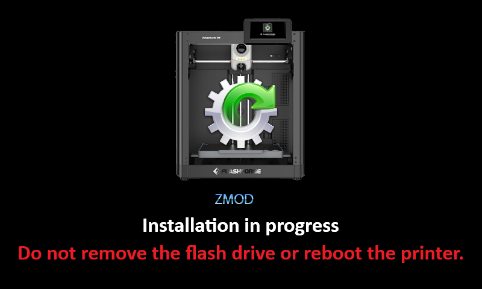
   
   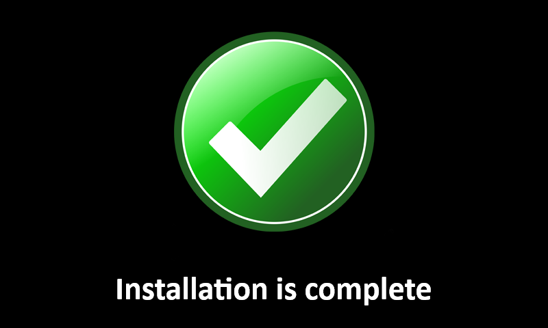
   
   Instalace na AD5X/Creator 5/Creator 5 Pro může trvat až 40 minut. _Pokud to trvá příliš dlouho nebo se mod vůbec nenainstaluje, použijte jiný flash disk._

   Pokud jste propásli okno se zeleným zatržítkem a tiskárna se automaticky restartovala, načte se standardní obrazovka; v tom případě můžete přejít rovnou ke kroku 11.

8. Odpojte USB disk.
9. Vypněte tiskárnu.
10. Zapněte tiskárnu.
11. **Otevřete IP adresu tiskárny v prohlížeči**.
    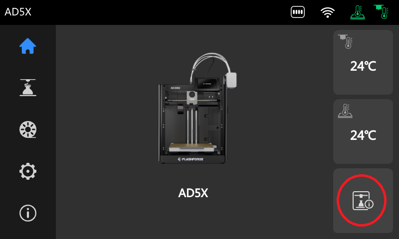
    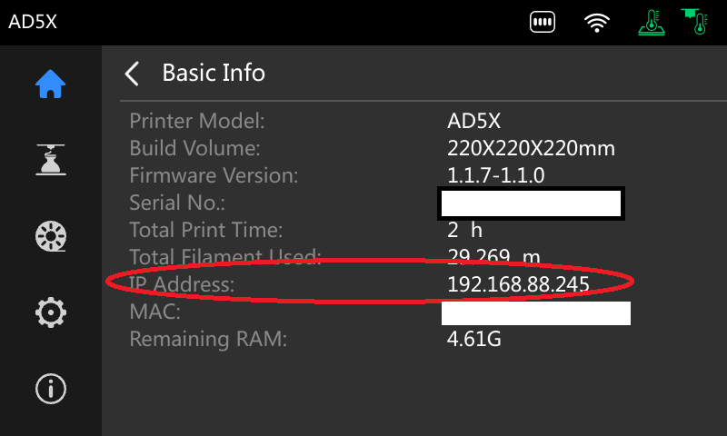
    
    Pokud se webové rozhraní neotevře, nativní firmware mod deaktivoval. Chcete-li ho znovu zapnout, zkopírujte na USB flash disk soubor a [aktivujte mod](/cs/Native_FW/#aktivace-z-mod-na-ad5xcreator-5creator-5-pro).

    - [AD5X-enable-zmod.tgz](https://github.com/ghzserg/FF/releases/download/R/AD5X-enable-zmod.tgz)
    - [Creator5-enable-zmod.tgz](https://github.com/ghzserg/FF/releases/download/R/Creator5-enable-zmod.tgz)
    - [Creator5Pro-enable-zmod.tgz](https://github.com/ghzserg/FF/releases/download/R/Creator5Pro-enable-zmod.tgz)

12. Nastavte jazyk modu.

    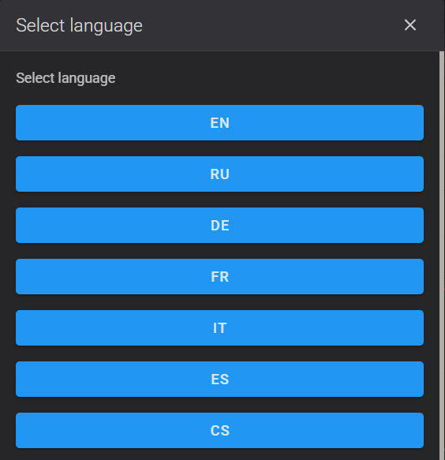
    
    Nebo zadejte do konzole: ```LANG LANG=cs```
    
    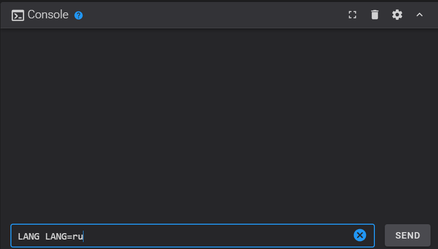
    
    Nastavte časové pásmo: ```SET_TIMEZONE ZONE=Europe/Prague``` (seznam pásem: `SET_TIMEZONE` bez parametrů). [Podrobnosti](/cs/System/#set_timezone)

13. Nakonfigurujte mod

    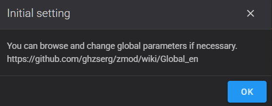
    
    Zde jsou uvedeny parametry pro začátek a konec tisku a globální parametry. Doporučujeme je zatím jen pročíst a neměnit. Popis jednotlivých parametrů naleznete [zde](/cs/Global/).

    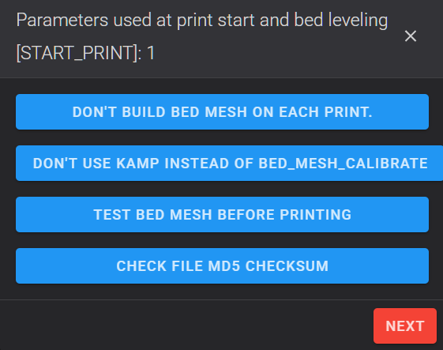

    Projděte až na poslední obrazovku a stiskněte „OK“ nebo „Reboot“. Jinak se toto okno bude zobrazovat při každém spuštění.
    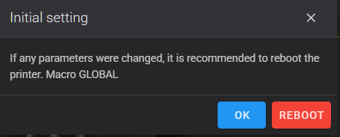

    Chcete-li toto okno později znovu zobrazit, zadejte do konzole: `GLOBAL`

14. Přejděte do „Nastavení“ → „Aktualizace softwaru“.
15. Klikněte na „Zkontrolovat aktualizace“ a počkejte, až se kontrola dokončí.
16. Klikněte na „Aktualizovat“ a aktualizujte všechny komponenty.

    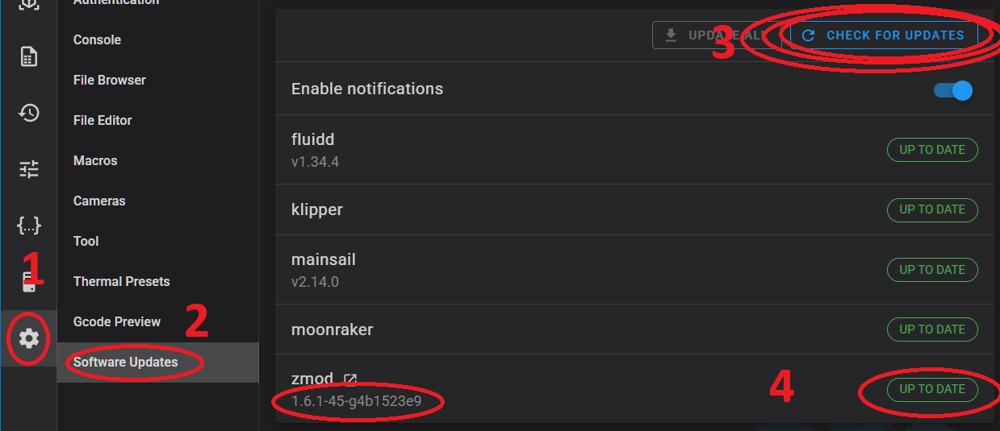

    Pokud se objeví mnoho chyb, je to normální. Pluginy nejsou součástí firmwaru a stahují se samostatně. Klikněte znovu na „Zkontrolovat aktualizace“ a poté pluginy postupně obnovte a aktualizujte. Během tohoto procesu se tiskárna restartuje.

    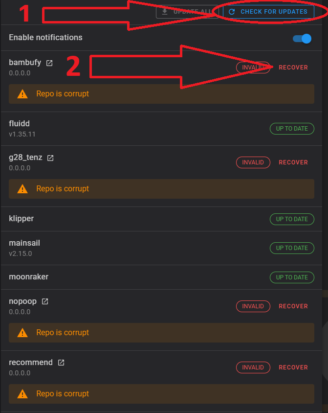

17. Zapněte [plugin s doporučeními](https://github.com/ghzserg/recommend/blob/main/Readme.md)

    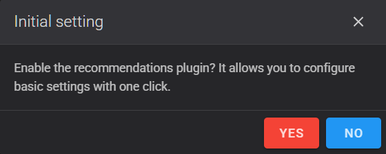

    Nebo zadejte do konzole: ```ENABLE_PLUGIN name=recommend```

    

18. [Odesílání souborů k tisku pomocí „Octo/Klipper“](/cs/Recommendations/#odeslání-souborů-k-tisku-prostřednictvím-octoklipper)

    **Přepněte na protokol Octo/Klipper**:
    
    - **Host Type**: `Octo/Klipper`
    - **Printer Agent**: `Moonraker`

    Pro Creator 5 / Creator 5 Pro / AD5X:

    - **Hostname**: `IP_printer`

    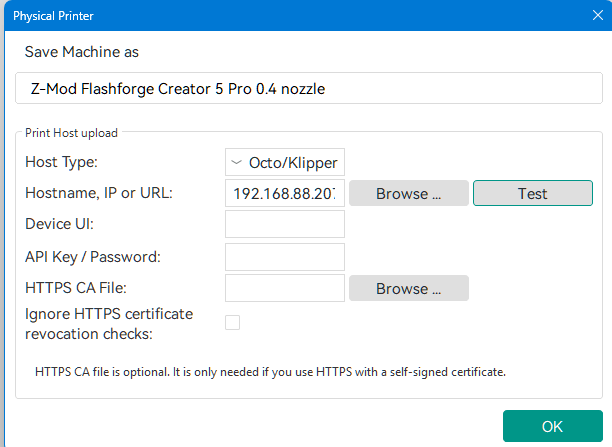

    Pro FF5M / FF5M Pro:

    - **Hostname**: `IP_printer:7125`
    - **Device UI**: `IP_printer` nebo `IP_printer:80`
    
    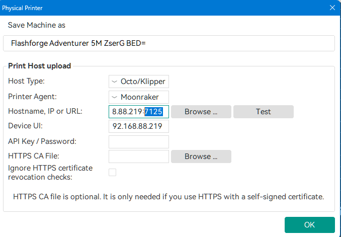
    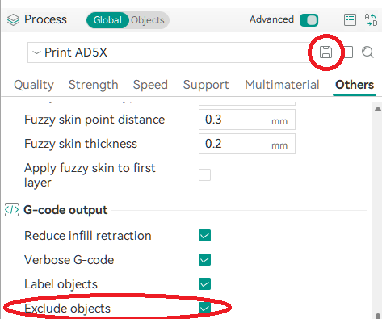
    

19. [Hotové profily](https://github.com/ghzserg/zmod_preprocess/tree/main/profiles/)

    Celý startovací kód nahraďte tímto:
    ```
    START_PRINT EXTRUDER_TEMP=[nozzle_temperature_initial_layer] BED_TEMP=[bed_temperature_initial_layer_single]
    M190 S[bed_temperature_initial_layer_single]
    M104 S[nozzle_temperature_initial_layer] T{single_extruder_multi_material ? 0 : initial_extruder}
    SET_PRINT_STATS_INFO TOTAL_LAYER=[total_layer_count]
    ```
    
    ```START_PRINT EXTRUDER_TEMP=... BED_TEMP=...``` musí být na jednom řádku
    
    Koncový kód nahraďte tímto:

    ```END_PRINT```
    
    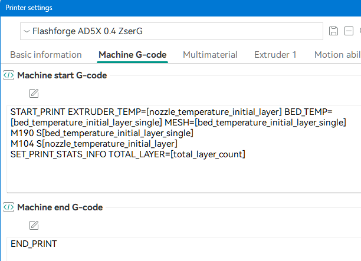 
    
    G-code před změnou vrstvy nahraďte tímto:

    ```SET_PRINT_STATS_INFO CURRENT_LAYER={layer_num + 1}``` 
    
    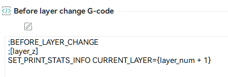

20. [Povolit ověření MD5](/cs/Recommendations/#povolit-kontrolu-kontrolního-součtu-md5)

    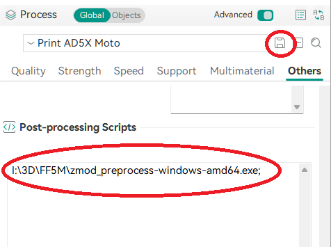

21. [Přečtěte si doporučení](/cs/Recommendations/)
22. [Přečtěte si často kladené otázky](/cs/FAQ/)
23. [Zkalibrujte tiskárnu](/cs/SetupCalibrations/)
24. Přečtěte si zvláštnosti [AD5X](AD5X.md) a [Creator 5 Pro](C5PRO.md)

### Varování AD5X

[@Khamai](https://t.me/Khamai)

Po instalaci nativního firmwaru nemusí být tisková hlava správně umístěna u odpadního koše (uzávěr koše se nemusí úplně zavřít, filament může být vytlačován na podložku atd.).
[Přes servisní menu nativního firmwaru](AD5X.md#nastavení-koše-v-továrním-firmwaru-ad5x)

V takovém případě kalibrujte parkovací polohu takto:

1. Stáhněte archiv [Set.XY.Offset.zip](https://github.com/ghzserg/FF/releases/download/R/Set.XY.Offset.zip) a rozbalte jej do kořenového adresáře flash disku.
2. Vložte flash disk do vypnuté tiskárny a zapněte ji.
3. Na displeji tiskárny se zobrazí kalibrační rozhraní. Stiskněte tlačítko Reset.
4. Pomocí šipek zaparkujte tiskovou hlavu u koše tak, aby dostatečně tlačila na páčku uzávěru, tryska byla za pohyblivým uzávěrem a uzávěr byl v jedné rovině s přední plochou koše.
5. Stiskněte tlačítko Set (Nastavit) pro potvrzení výsledku kalibrace.
6. Vyjměte flash disk a restartujte tiskárnu.

---

## Aktualizace modu

Pokud se zobrazí hlášení `Aktualizujte Z-Mod přes USB`, musíte aktualizovat přes USB, i když jste aktualizovali nedávno.

**Aktualizace přes USB zachová všechna data.**

**Nejjednodušší metoda:** Použijte makro [ZFLASH](/cs/Zmod/#zflash). Vložte USB disk, restartujte tiskárnu a spusťte `ZFLASH`. Makro provede následující:

- Zkontroluje nejnovější verzi.
- Stáhne nejnovější verzi pro váš model tiskárny.
- Ověří kontrolní součty.
- Restartuje tiskárnu.
- Automaticky nainstaluje aktualizaci (USB disk nechte zasunutý pro budoucí aktualizace).

Po instalaci:

1. Přejděte do Fluidd/Mainsail → „Nastavení“ → „Aktualizace softwaru“.
2. Klikněte na „Zkontrolovat aktualizace“ a nainstalujte nejnovější aktualizace Z-Mod.


Pokud se zobrazí mnoho chyb, je to normální.

Pluginy nejsou součástí firmwaru a stahují se samostatně.

Klikněte na `Zkontrolovat aktualizace`. Poté pluginy postupně obnovte a aktualizujte. Během tohoto procesu se tiskárna restartuje.

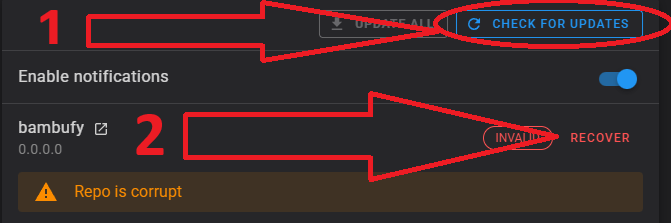

**Kompatibilita verzí:**

- Verze operačního systému (v menu `System` → `Distribution`) musí odpovídat prvním dvěma číslicím verze Z-Mod (v menu `Settings` → `Updates` → `Z-Mod`).
- **Nesoulad verzí způsobuje nestabilitu.**

**Manuální aktualizace přes USB:**

1. Naformátujte USB disk na FAT/FAT16/FAT32 (MBR).
2. Zkopírujte [soubor modu](https://github.com/ghzserg/zmod/releases/) do kořenového adresáře USB.
3. Vypněte tiskárnu.
4. Vložte USB disk.
5. Zapněte tiskárnu.
6. Počkejte na restart tiskárny (USB disk nevyjímejte).
7. Počkejte, až tiskárna oznámí úspěšnou instalaci.
8. Vyjměte USB disk.
9. Vypněte a znovu zapněte tiskárnu.
10. Přejděte do Fluidd/Mainsail → „Nastavení“ → „Aktualizace softwaru“, klikněte na „Zkontrolovat aktualizace“ a nainstalujte nejnovější aktualizace Z-Mod.

---

## Odstranění nebo dočasné vypnutí modu

- **[SKIP_ZMOD](/cs/Zmod/#skip_zmod)**: Restartuje tiskárnu bez spuštění Moonraker/Fluidd.
- **[REMOVE_ZMOD](/cs/Zmod/#remove_zmod)**: Kompletně odinstaluje mod.

**Doporučená metoda:** Použijte makro `REMOVE_ZMOD`. Odstranění přes USB použijte pouze v případě, že makra nejsou dostupná (_po odstranění přes USB může zůstat logo Z-Mod při spuštění_).

Pozor!

- Pokud používáte Klipper 13, spusťte ```UPDATE_MCU```. Tím zabráníte tomu, aby MCU a Klipper měly různé verze.
- Pokud máte zapnuté pluginy, nejprve je vypněte pomocí ```DISABLE_PLUGIN name=g28_tenz```.

Úplné odstranění modu: ```REMOVE_ZMOD FULL=1```

**Odstranění přes USB:**

1. Naformátujte USB disk na FAT/FAT16/FAT32 (MBR).
2. Zkopírujte [flashforge_init.sh](https://github.com/ghzserg/zmod/blob/main/Native_firmware/rem_zmod/flashforge_init.sh) do kořenového adresáře USB.
3. Vypněte tiskárnu.
4. Vložte USB disk.
5. Zapněte tiskárnu.
6. Počkejte na tři restarty.
7. Vyjměte USB disk a používejte standardní firmware.

---

## Aktualizace nativního firmwaru

1. Deaktivujte všechny aktivní pluginy kromě `recommend`, `timelapse` a `notify`:
   ```DISABLE_PLUGIN name=plugin_name```

2. Pokud používáte **Klipper 13**, spusťte ```UPDATE_MCU``` *před* aktualizací nativního firmwaru. Tím předejdete problémům s nekompatibilitou verzí mezi MCU a Klipperem.
3. Zapněte čínské cloudové služby (pokud chcete aktualizovat přes nativní obrazovku):
   ```SAVE_ZMOD_DATA CHINA_CLOUD=1```

Pokud nativní obrazovka aktualizace nenajde:

- Vaše sériové číslo zatím nebylo zahrnuto do distribuce aktualizace
- [Nainstalujte aktualizaci nativního firmwaru z USB disku](/cs/Native_FW/)

**U [AD5X](AD5X.md)/Creator 5/Creator 5 Pro je po aktualizaci nativního firmwaru nutná [aktivace Z-Mod](/cs/Native_FW/) z USB disku.**

- [AD5X-enable-zmod.tgz](https://github.com/ghzserg/FF/releases/download/R/AD5X-enable-zmod.tgz)
- [Creator5-enable-zmod.tgz](https://github.com/ghzserg/FF/releases/download/R/Creator5-enable-zmod.tgz)
- [Creator5Pro-enable-zmod.tgz](https://github.com/ghzserg/FF/releases/download/R/Creator5Pro-enable-zmod.tgz)

Pokud však aktualizujete z nativní obrazovky, a ne z USB disku, spusťte před vypnutím tiskárny makro ```RESET_PASSWD```.

---

## Podpořte vývoj modu

[SBP, bankovní karta, T-pay](https://pay.cloudtips.ru/p/3cbf9e9f)


BTC `17wXTd9BqYp1K3zCLTxVyGLEXUDjf7XNLL`

<a href="https://boosty.to/ghzserg">Podpora přes Boosty (mezinárodní Visa/Mastercard)</a>


---

## Obnova po selhání při startu

*Průvodce od [@darksimpson](https://t.me/darksimpson), [Alexander](https://github.com/DrA1ex), [@Ikaros413](https://t.me/Ikaros413), [@SoloMen88](https://t.me/SoloMen88)*

**Příznaky:** Tiskárna se zasekne na úvodní obrazovce a není dostupná přes LAN.

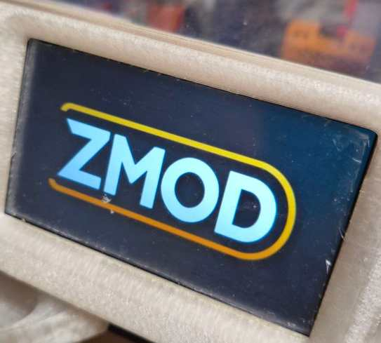


Zkuste obnovit firmware instalací plného firmwaru:

- [AD5M / AD5M Pro](/cs/Native_FW/#instalace-úplného-firmwaru-na-ad5m--ad5m-pro)
- [AD5X](/cs/Native_FW/#instalace-úplného-firmwaru-na-ad5x)

**Postup:**

1. **Odpojte tiskárnu od napájení.**
2. Připravte si **3,3V UART/USB převodník** (ujistěte se, že je nastaven na 3,3V).


3. Otevřete zadní kryt tiskárny.
4. Připojte se k UART pinům (RX, TX, GND — **NEPŘIPOJUJTE 3,3V napájení**).

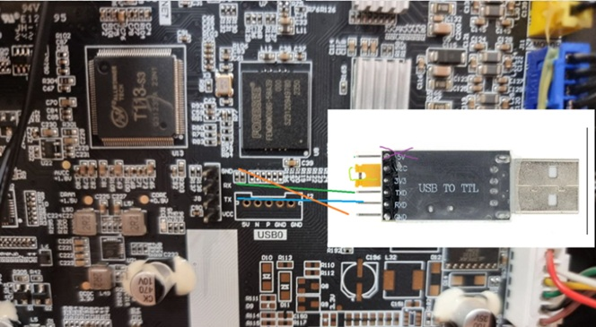

**VAROVÁNÍ:** Převodník musí pracovat s 3,3 V. Při 5 V shoří procesor a bude nutné vyměnit základní desku! Pokud má převodník propojku, POVINNĚ ji přepněte z 5V na 3,3V.

5. Připojte převodník křížem:

    - Převodník RX → TX tiskárny
    - Převodník TX → RX tiskárny
    - Převodník GND → GND tiskárny

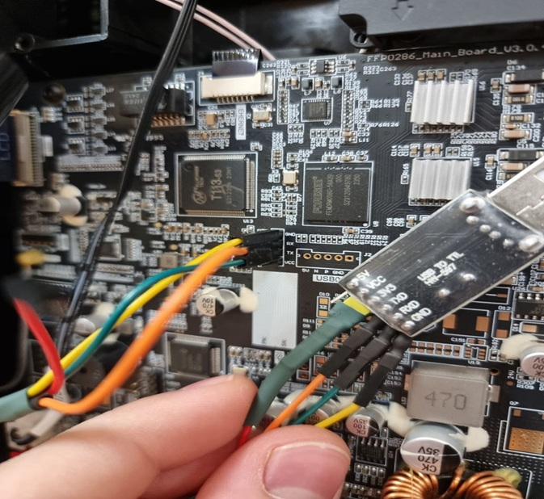

6. Identifikujte nově přidaný COM port ve vašem operačním systému.

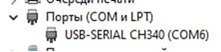

7. Otevřete [PuTTY](https://www.chiark.greenend.org.uk/~sgtatham/putty/latest.html):

    - **Typ připojení**: Serial
    - **Rychlost**: 115200
    - **COM port**: (např. COM6)

8. Zapněte tiskárnu.
9. Když se objeví hláška `Hit any key to stop autoboot`, stiskněte **Enter**.

10. V U-Bootu spusťte:
    ```
    setenv init /bin/sh
    boot
    ```

11. Po nabootování Linuxu přepněte souborový systém do zápisu:
    ```
    mount -t proc proc /proc
    mount -o remount,rw /
    ```

12. Opravte, co je rozbité, např. smažte chybný skript nebo skript kamery, pokud start selhává kvůli kameře:
    ```
    rm -f /etc/init.d/S01bad_script
    rm -f /usr/data/zmod/zmod/.shell/S98camera
    ```

13. Uložte změny a restartujte:
    ```
    sync
    reboot
    ```
