# VFA u Creator 5 Pro: srovnání standardního algoritmu a algoritmu z OpenCreator

*Výzkum Z-Mod, 26. listopadu 2026.*

## Co to znamená pro běžný tisk?

**Kalibraci VFA se vyplatí používat, alternativní algoritmus z OpenCreator však většina uživatelů nepotřebuje.** Kompenzace VFA pomáhá omezit jemné svislé proužky na stěnách výtisku způsobené vibracemi motorů a mechaniky. Zvláště dobře jsou vidět na hladkých površích.

- Pokud na stěnách vidíte pravidelné jemné proužky, spusťte standardní kalibraci příkazem `CALIBRATE_VFA T=0`. Na našem C5 Pro trvala přibližně 21 minut. Před každým tiskem ji není třeba opakovat: uložená kompenzace se používá automaticky. Kalibraci zopakujte po změně napnutí řemenů či mechaniky nebo pokud se proužky znovu objeví.
- V OrcaSliceru používejte své obvyklé rychlosti a zrychlení. VFA nezvyšuje povolené rychlosti, nemění profil sliceru a nenahrazuje Input Shaper. Pokud proužky přetrvávají při určité rychlosti, zkuste změnit rychlost vnější stěny a porovnat stejné zkušební výtisky. V náhledu OrcaSliceru zkontrolujte skutečnou rychlost; může se lišit od hodnoty nastavené v profilu.
- Algoritmus z OpenCreator má smysl vyzkoušet, pokud nejste spokojeni se standardním výsledkem a můžete výsledky porovnat. Na našem stroji byl v průměru lepší při rychlostech 60–220 mm/s, standardní algoritmus při 20–50 mm/s. Vzhledem k rozptylu měření není rozdíl dostatečně přesvědčivý a alternativní kalibrace trvala asi 80 minut.

**Závěr:** pokud nemáte konkrétní důvod experimentovat, ponechte standardní algoritmus. Při standardní kompenzaci klesl celkový medián amplitudy vibrací asi o 81 % u motoru X a o 66 % u Y. Jde o měření akcelerometru, nikoli o příslib stejně velkého procentuálního úbytku proužků na výtisku.

## Výsledek výzkumu

Na jedné tiskárně Flashforge Creator 5 Pro jsme otestovali opravenou standardní kalibraci Flashforge a adaptovaný algoritmus z OpenCreator. Oba výrazně snížily vibrace. Algoritmus z OpenCreator poskytl o něco lepší výsledky při středních a vyšších rychlostech, ale neprokázal výhodu přesahující pozorovaný rozptyl opakovaných měření. Při nízkých rychlostech měla standardní kompenzace menší medián zbytkového posunutí.

Standardní kalibrace trvala přibližně 21 minut, alternativní asi 80 minut. **Z-Mod proto ponechává standardní algoritmus jako výchozí**, s algoritmem z OpenCreator jako volitelnou možností.

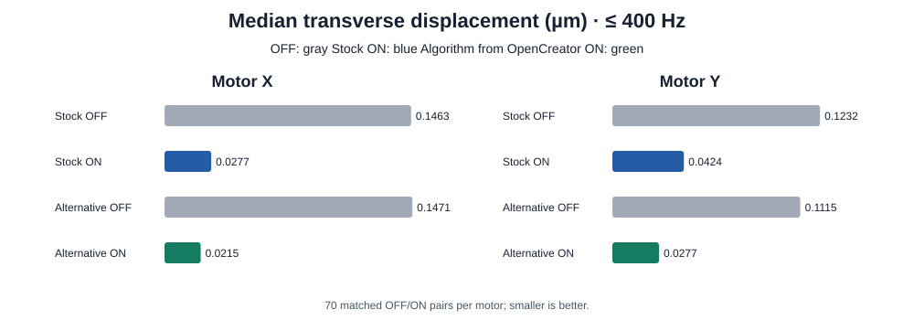

Jde o výzkum jedné tiskárny, nikoli o statistiku celé řady Creator 5. Měří se pohyb akcelerometru, ne drsnost povrchu vytištěného dílu.

## 1. Co je VFA a co měří Z-Mod

VFA (Vertical Fine Artifacts) jsou jemné opakující se svislé proužky na stěnách výtisku. Mezi jejich příčiny patří periodické poruchy způsobené motory, řemeny a mechanikou tiskárny. Creator 5 používá kompenzaci motorů přes `mclib`: pro každou harmonickou TD1, TD2 a TD4 se nastavuje jedna amplituda a dvě fáze, jedna pro každý směr otáčení. Jde o samostatné nastavení, nikoli náhradu Input Shaperu.

Testovaná tiskárna má kinematiku CoreXY, `rotation_distance=40.4` mm a pohyb po úhlopříčce 45°. Jeden motor se otáčí, druhý je v ideální kinematice nehybný. Přepočet frekvence používaný v Klipperu:

`f(TD) = 50 × sqrt(2) × v × TD / 40.4 ≈ 1.750264 × v × TD`,

kde v je rychlost tiskové hlavy v mm/s a f frekvence harmonické v Hz. Koeficient závisí na kinematice a parametrech motoru; není univerzální.

Například standardní frekvence 200 Hz odpovídá třem různým rychlostem:

| Harmonická | Rychlost tiskové hlavy, mm/s |
|---|---:|
| TD1 | 114,27 |
| TD2 | 57,13 |
| TD4 | 28,57 |

**Frekvence v Hz a rychlost v mm/s jsou různé veličiny.** LIS2DW má nominální vzorkovací frekvenci 1600 Hz. Jeho filtr může při vyšších frekvencích tlumit měřené amplitudy, proto hlavní analýzu omezujeme na 400 Hz. Nezávislý test uchovává platná data CSV do 720 Hz (nejvýše 45 % skutečné vzorkovací frekvence); grafy končí na 400 Hz. Je to konzervativní hranice srovnání, nikoli tvrzení, že při 401 Hz snímač přestává měřit.

Na této tiskárně odpovídá 400 Hz přibližně rychlosti 228,5 mm/s u TD1, 114,3 u TD2 a 57,1 u TD4. `MAX_SPEED=400` tedy neznamená, že jsou při 400 mm/s spolehlivě změřeny všechny tři harmonické.

Zrychlení převádíme na odhad amplitudy posunutí snímače. Pro harmonickou s frekvencí f a amplitudou zrychlení A platí:

`d [µm] = 1000 × A [mm/s²] / (2πf)²`.

Tak lze srovnávat zbytkové vibrace v jednotkách posunutí místo směšování zrychlení na různých frekvencích. Hlavní metrikou je složka příčná ke směru pohybu hlavy; grafy obsahují také podélnou a celkovou složku XY.

## 2. Nezávislý test VFA_GRAPH

Před srovnáním kalibračních algoritmů jsme vytvořili samostatný měřicí nástroj. Kalibrace hledá koeficienty na továrních drahách; `VFA_GRAPH` nezávisle hodnotí výslednou kompenzaci uprostřed pracovního prostoru.

```gcode
VFA_GRAPH T=0 MAX_SPEED=400 SHAPER=0
```

Ve výzkumu jsme použili T0, oba motory a směry, rozsah 20–400 mm/s s krokem 10 mm/s, zrychlení 5000 mm/s², adaptivní délku měřicí dráhy a jedno opakování každé kombinace. Input Shaper byl vypnutý. Metadata testů v 13:10 a 22:21 se shodují kromě koeficientů kompenzace. Mezi průjezdy se pohyb zcela zastaví; pořadí OFF/ON se střídá, aby se omezil vliv pořadí měření.

Adaptivní délka je volena tak, aby poskytla 0,6 sekundy použitelného měření a nejméně 20 period TD1, pokud to dráha dovolí. Analyzuje se pouze úsek s konstantní rychlostí bez přechodových dějů. Společná sinusová aproximace na známých frekvencích harmonických je odděluje od konstantní složky a lineárního trendu. Neúplná, poškozená nebo příliš krátká měření se vyřazují. Limity zrychlení a stav shaperů se po testu obnoví. Test neprovádí SAVE_CONFIG.

Porovnáváme `before` (kompenzace vypnutá) a `after` (uložené koeficienty). Bod je určen rychlostí, směrem, harmonickou, frekvencí a číslem opakování. Při jednom opakování máme do 400 Hz 70 platných dvojic na motor: TD1 — 42, TD2 — 20, TD4 — 8. Vyšší frekvence zůstávají k dispozici, ale nejsou součástí hlavního závěru.

Používáme dvě různé metriky:

- **Pokles celkového mediánu:** `1 − median(after)/median(before)` v rámci jednoho průběhu. Pro srovnání algoritmů používáme místo toho jejich dva mediány zbytkových hodnot.
- **Medián párových poměrů:** `median(after_alternative / after_stock)` pro shodné body. Poměr menší než jedna znamená zlepšení. Jde o hlavní metriku srovnání algoritmů doplněnou počtem lepších bodů a opakovatelností.

Nižší celkový medián neznamená stejné zlepšení v každém bodě. Různá rozdělení amplitud mohou dát nižší medián, i když oba algoritmy vyhrávají v přibližně stejném počtu bodů.

Pro spolehlivější srovnání použijte `REPEAT=3`; grafy ukazují mediány platných dvojic. Samotný výzkum používal `REPEAT=1` na každý průběh, opakovatelnost byla hodnocena oddělenými měřeními.

## 3. Oprava standardní kalibrace a opakovatelnost

Před změnou vyhledávacího algoritmu jsme opravili měřicí část kalibrace Flashforge: využití celého úseku konstantní rychlosti místo krátkého okna, kontrolu délky měření a integrity vzorků, strojní souřadnice, obnovu limitů a shaperů a zpracování výsledků v obou směrech. Standardní vyhledávání amplitudy a fáze zůstalo zachováno.

Vyhledávání pracuje na nastavené frekvenci (obvykle 200 Hz): výchozí amplituda bez kompenzace, čtyřbodová sonda fáze, zpřesnění fáze, výběr amplitudy a závěrečné ověření. Společná amplituda je maximum obou individuálních amplitud a v případě potřeby je ověřena dalším průjezdem. Výsledek se zamítne, pokud se jeden směr proti OFF zhorší o více než 20 % nebo pokud se nezlepší ani jeden směr.

Nezávislá měření do 400 Hz:

| Čas testu | Shapery | X, OFF → ON, µm | Y, OFF → ON, µm |
|---|---|---:|---:|
| 09:41 | Původní stav | 0,13719 → 0,02563 | 0,12050 → 0,03408 |
| 11:07 | Vypnuté | 0,14597 → 0,02851 | 0,12091 → 0,03757 |
| 11:31 | Vypnuté | 0,14468 → 0,02602 | 0,11562 → 0,04397 |
| 11:48 | Původní stav | 0,12842 → 0,02848 | 0,11090 → 0,04176 |
| 13:10 | Vypnuté; nová standardní kalibrace | 0,14635 → 0,02773 | 0,12319 → 0,04242 |

Koeficienty zůstaly do 11:48 stejné. Průběhy v 11:07 a 11:31 používaly stejnou kompenzaci s vypnutými shapery. Medián symetrické relativní odchylky zbytkových amplitud `|a−b| / ((a+b)/2)` činil **25,8 % pro X a 26,4 % pro Y**. Jde o pozorovaný rozptyl opakování, nikoli o deklarovanou přesnost snímače, interval spolehlivosti nebo formální test statistické významnosti. U velmi malých zbytkových hodnot relativní odchylky přirozeně rostou.

Opravená standardní kalibrace probíhala od 12:46:17 do 13:07:38, tedy 21 min 21 s do SAVE_CONFIG. Protokol obsahuje 115 měření při kalibraci X a 130 Y. Po uložení ukázal nezávislý test v 13:10 pokles celkového mediánu o 81,1 % u X a 65,6 % u Y, se zlepšením v 64 a 63 ze 70 bodů. Oproti dřívější standardní kompenzaci nebylo prokázáno zásadní zlepšení, měření a ukládání se však staly kontrolovatelnými.

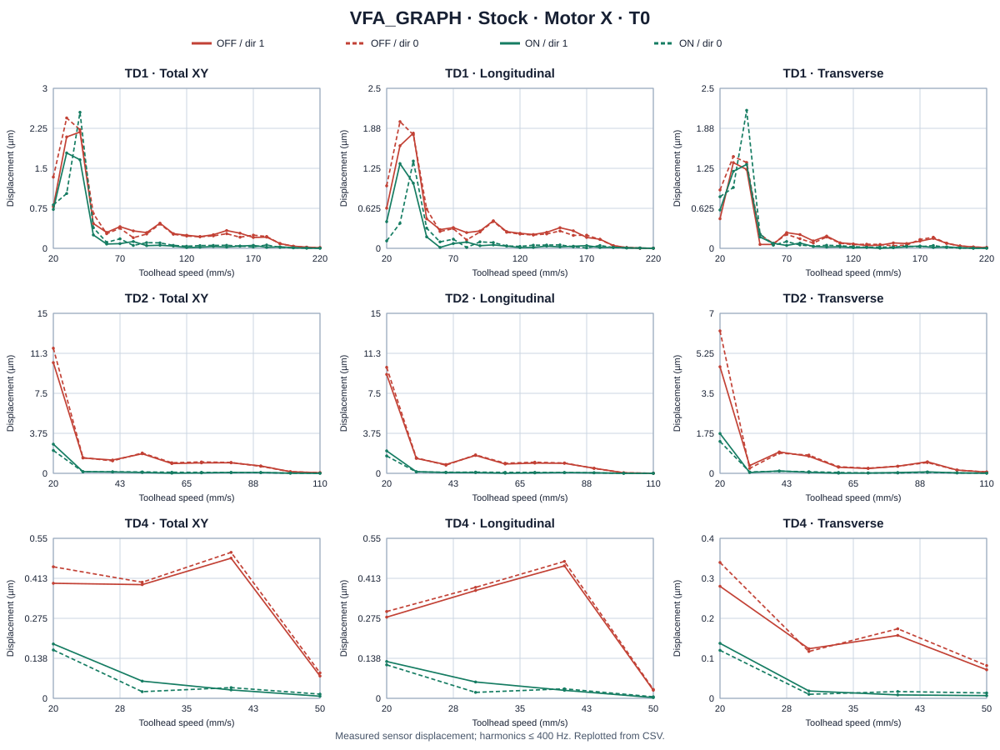

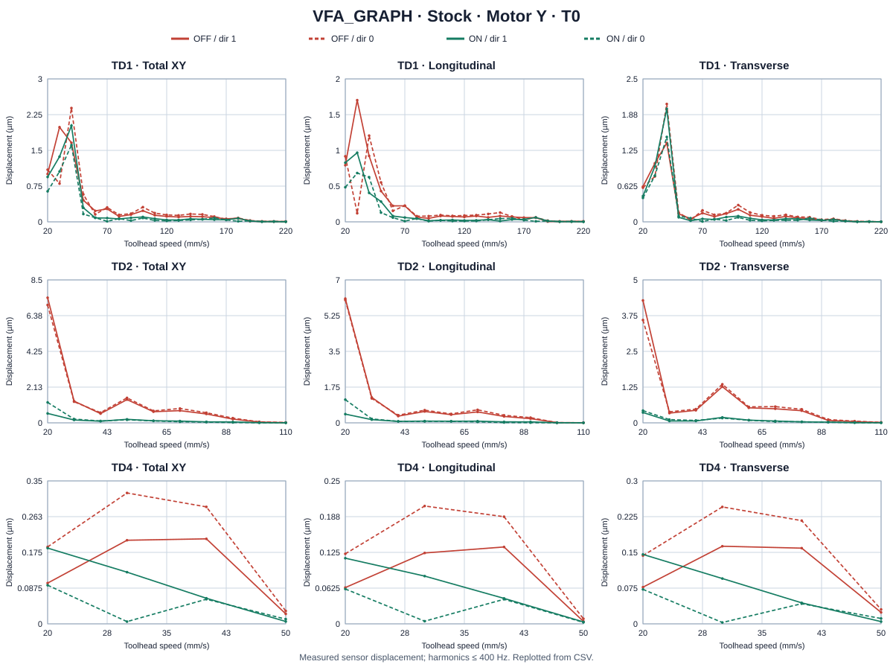

Časný test ve 04:16 obsahoval pouze X a jinou metodu/rozsah; byl vyloučen z přímého srovnání. Původní CSV standardního vyhledávání nebyly k dispozici; výsledky hledání byly rekonstruovány z konzole s její přesností zaokrouhlení. Pro nezávislé srovnání byly použity původní CSV VFA_GRAPH.

## 4. Co mění algoritmus z OpenCreator

Adaptovaný algoritmus využívá myšlenky [OpenCreator / Kalico](https://github.com/FlashForge-C5-Modding-Group/kalico/blob/7da732e09d4e213b7766482b6cfdf7e75ee9e191/klippy/extras/stepper_resonance_tester.py), ale zachovává měřicí část a omezení Z-Mod. Nejde o přenos celého firmwaru Kalico.

Místo kalibrace při pevných 200 Hz hledá rezonance v rozsahu 20–300 mm/s (v rámci rychlostního limitu), s geometrickým krokem do 8 % a zpřesněním až tří vrcholů TD2. Vyberou se až dvě výrazné dosažitelné frekvence; pokud žádná nevyhoví, použije se nastavená frekvence. Pro každého kandidáta se ladí TD1/TD2/TD4 v obou směrech.

Společná amplituda minimalizuje součet dvou parabol zbytkového zrychlení místo maxima individuálních amplitud. Vyžaduje se pokles společné RMS amplitudy alespoň o 5 %. Jsou-li dva kandidáti, každý se ověří při stejných rychlostech a harmonických. Vyhrává nižší součet čtverců zbytkových hodnot ve shodných platných bodech. Toto interní hodnocení není nezávislým hodnocením VFA_GRAPH: liší se metrika, dráhy i rozsah frekvencí.

### První experiment X

První experiment nalezl 270,1 a 82,8 Hz. Plně naladěné koeficienty X prvního kandidáta (270,1 Hz) jsme nezávisle ověřili pomocí VFA_GRAPH ve 14:20. Šlo o test jednoho kandidáta na jednom motoru, nikoli celého alternativního algoritmu.

| Rozsah frekvencí | Bodů | Algoritmus z OpenCreator lepší | Standard lepší | Medián poměru zbytků: algoritmus z OpenCreator / standard |
|---|---:|---:|---:|---:|
| Do 400 Hz | 70 | 34 | 36 | 1,012 |
| Nad 400 Hz | 64 | 46 | 18 | 0,792 |
| Všechny platné do 720 Hz | 134 | 80 | 54 | 0,820 |

Do 400 Hz klesl celkový medián zbytku z 0,027725 na 0,022088 µm (−20,3 %), ale medián párových poměrů byl blízko jedné. Většina výhody v počtu lepších bodů pocházela z oblasti snížené citlivosti snímače. V této fázi byly algoritmy považovány za srovnatelné.

## 5. Úplná alternativní kalibrace

`ZMOD_CALIBRATE_VFA T=0 ALTERNATIVE=1` probíhala pro oba motory od 20:53:51 do 22:14:05. Doba před vykreslením grafů činila 80 min 14 s, přibližně 3,8krát déle než standardní průběh (měřený do SAVE_CONFIG). Na jiných tiskárnách nebo při jednom kandidátovi se čas může lišit.

| Motor | Vyšší frekvence | Nižší frekvence | Skóre vyšší | Skóre nižší | Vybrána |
|---|---:|---:|---:|---:|---:|
| X | 269,812 Hz | 86,237 Hz | 3 315 023 | 5 921 932 | 269,812 Hz |
| Y | 243,352 Hz | 80,899 Hz | 2 301 420 | 10 878 684 | 243,352 Hz |

Skóre jsou součty čtverců zbytkových amplitud podle interního kritéria algoritmu, zaokrouhlené na celá čísla. Nejde o mikrometry ani procenta zlepšení kvality tisku.

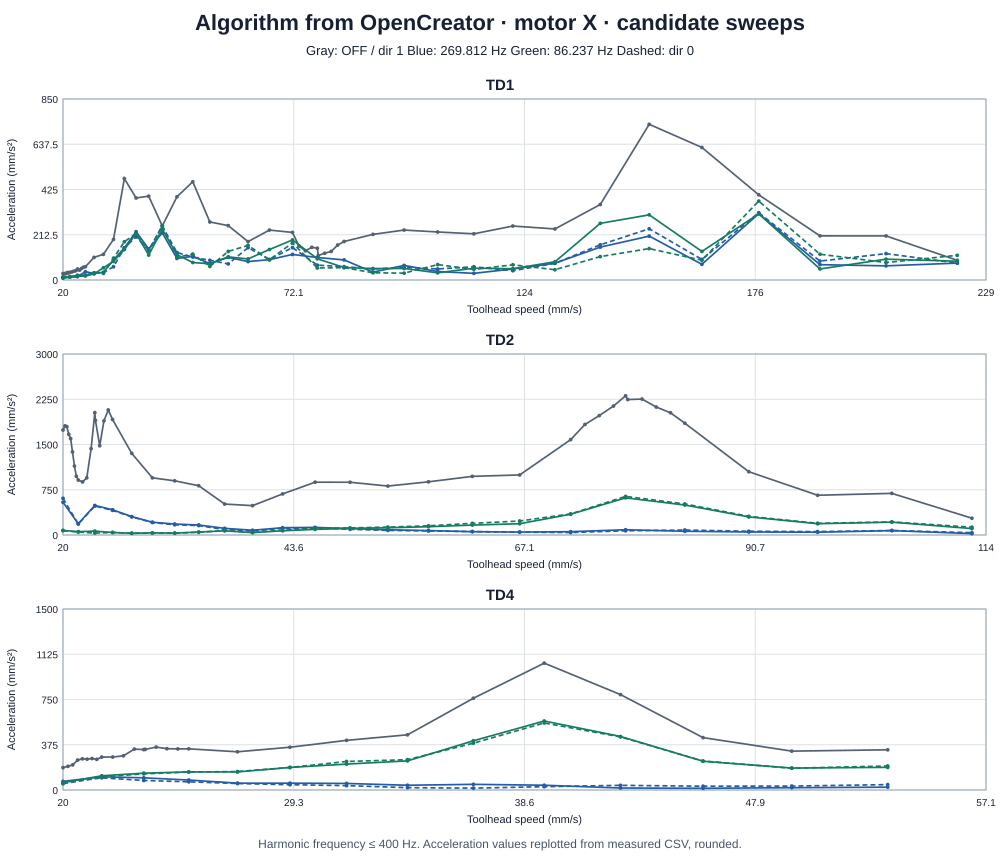

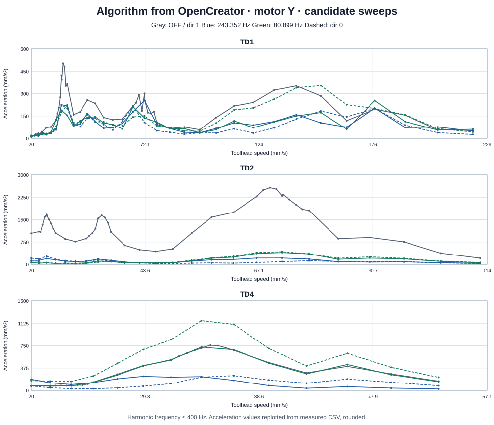

Výběr jsme také ověřili na shodných bodech kontrolních CSV do 400 Hz přepočtem rychlosti a harmonické na frekvenci. Ze 142 bodů vyhrála vyšší frekvence u X v 83 proti 59, u Y v 92 proti 50. Mediány poměrů zbytkových hodnot vyšší/nižší činily 0,915 (−8,5 %) a 0,764 (−23,6 %). To podporuje výběr vyšší frekvence, nikoli nadřazenost standardnímu algoritmu.

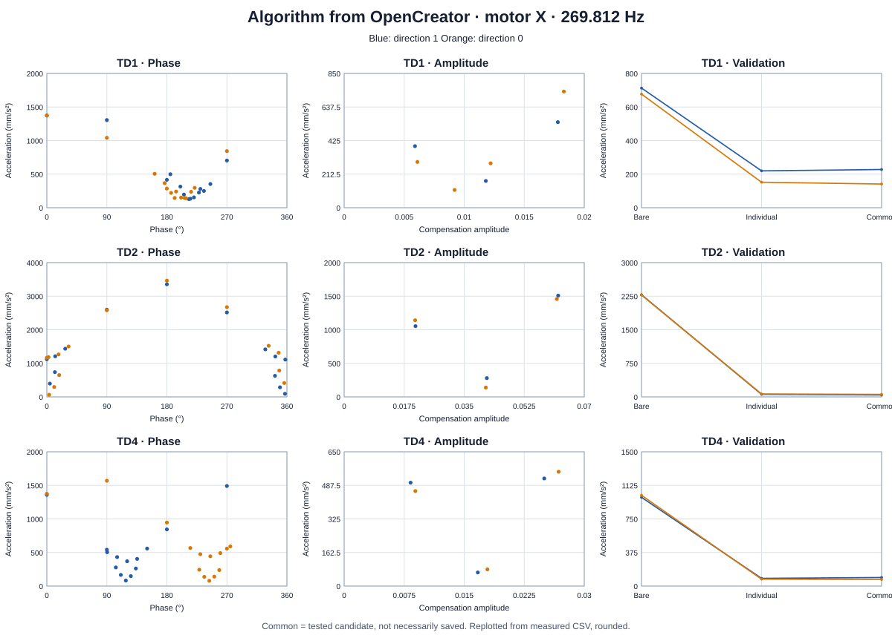

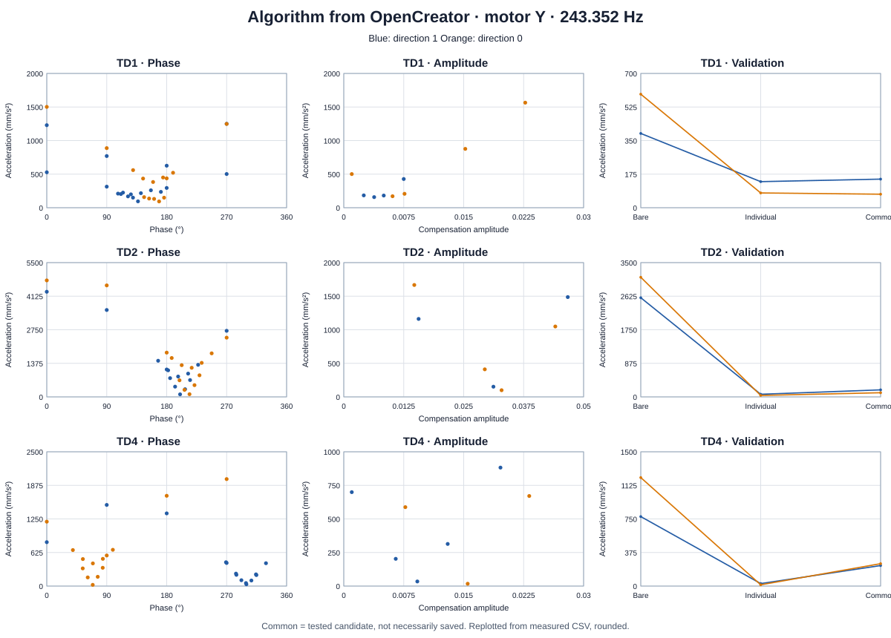

Common označuje změřeného kandidáta společné amplitudy, ne nutně uloženou hodnotu; skutečně použité hodnoty jsou v calibration.json. Do konfigurace se ukládá amplituda a dvě fáze, vybrané frekvence zůstávají diagnostické. Nastavená standardní frekvence zůstává 200 Hz.

### Výsledné koeficienty

| Motor / harmonická | Standard AMP | Standard PHASE1 / PHASE2, rad | AMP (algoritmus z OpenCreator) | PHASE1 / PHASE2 (algoritmus z OpenCreator), rad |
|---|---:|---:|---:|---:|
| X / TD1 | 0,010 | 3,730 / 3,517 | 0,010 | 3,762 / 3,539 |
| X / TD2 | 0,036 | 6,119 / 0,172 | 0,038 | 6,211 / 0,086 |
| X / TD4 | 0,016 | 2,102 / 4,219 | 0,017 | 2,077 / 4,254 |
| Y / TD1 | 0,005 | 2,721 / 2,191 | 0,005 | 2,854 / 2,389 |
| Y / TD2 | 0,032 | 3,662 / 3,579 | 0,032 | 3,705 / 3,508 |
| Y / TD4 | 0,013 | 1,112 / 5,372 | 0,012 | 1,199 / 5,233 |

Koeficienty jsou blízké, ale amplitudy a fáze nejsou totožné. Calibration.json je ukládá v celočíselných jednotkách MCU s měřítkem 1000. Nekopírujte tabulku do jiné tiskárny; vztahuje se pouze ke zkoušenému stroji a jeho mechanickému stavu.

## 6. Nezávislé srovnání standardního algoritmu a algoritmu z OpenCreator

Porovnáváme VFA_GRAPH v 13:10 (standard) a 22:21 (algoritmus z OpenCreator). Po uložení konfigurace obsahují metadata z 22:21 přesně koeficienty z calibration.json úspěšné alternativní kalibrace. Podmínky měření včetně drah se shodují. Srovnávají se pouze platné shodné body.

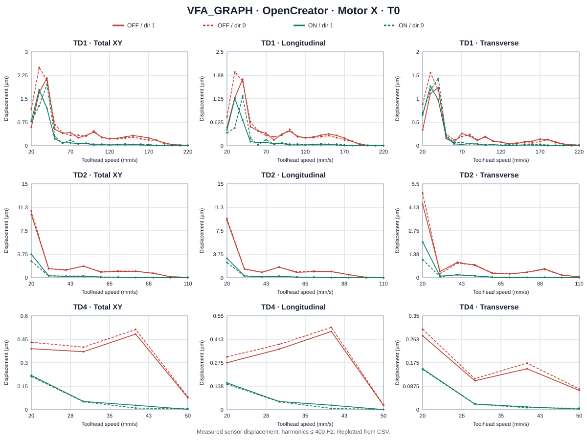

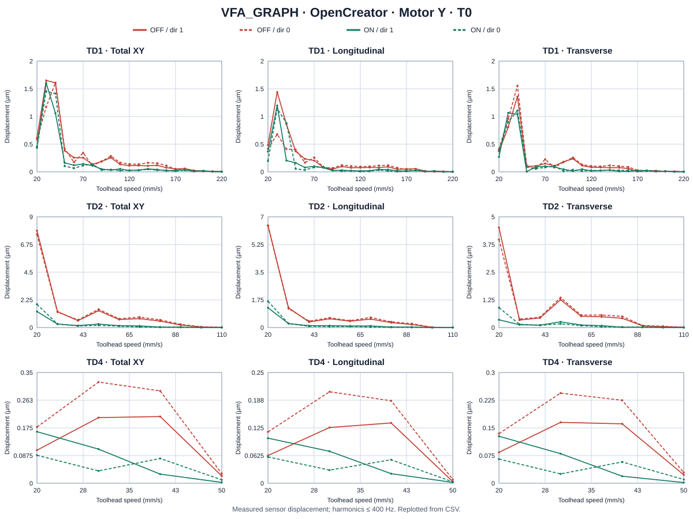

### Do 400 Hz

| Metrika | X standard | X, algoritmus z OpenCreator | Y standard | Y, algoritmus z OpenCreator |
|---|---:|---:|---:|---:|
| Medián OFF, µm | 0,146346 | 0,147090 | 0,123195 | 0,111504 |
| Medián ON, µm | 0,027725 | 0,021465 | 0,042425 | 0,027663 |
| Pokles v rámci průběhu | 81,1 % | 85,4 % | 65,6 % | 75,2 % |
| Lepší body proti OFF (ze 70) | 64 | 66 | 63 | 62 |

| Přímé srovnání zbytků | X | Y |
|---|---:|---:|
| Algoritmus z OpenCreator lepší | 41/70 | 46/70 |
| Standard lepší | 29/70 | 24/70 |
| Pokles celkového mediánu s algoritmem z OpenCreator | 22,6 % | 34,8 % |
| Medián poměru zbytků: algoritmus z OpenCreator / standard | 0,852 | 0,874 |
| Medián párového poklesu | **14,8 %** | **12,6 %** |

Algoritmus z OpenCreator vyhrává ve více bodech, ale párový efekt je menší než pozorovaný rozptyl opakovaných měření (asi 26 %). Liší se i výchozí měření OFF, zejména u Y. Samotný pokles celkového mediánu Y o 34,8 % proto neprokazuje takové zlepšení v každém bodě ani na hotovém výtisku.

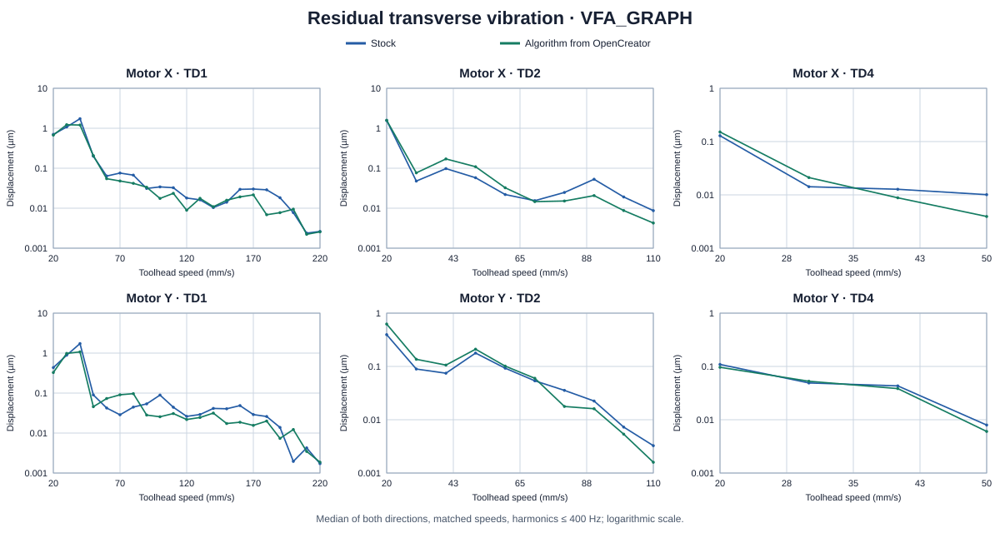

Graf zobrazuje medián obou směrů na každé rychlosti a harmonické. Logaritmická stupnice zpřístupňuje malé zbytkové hodnoty bez změny veličin. Jednotlivé směry lze zkontrolovat v tabulkách posunutí v oddílu 8.

### Při kterých rychlostech je který algoritmus lepší?

| Rychlost, mm/s | Bodů na motor | Změna mediánu X | Změna mediánu Y |
|---|---:|---:|---:|
| 20–50 | 24 | +41,6 % | +17,9 % |
| 60–110 | 24 | −30,8 % | −7,0 % |
| 120–220 | 22 | −28,9 % | −43,4 % |

Kladná hodnota znamená větší zbytek s algoritmem z OpenCreator, záporná menší. Všechny skupiny zahrnují jen frekvence do 400 Hz. S rostoucí rychlostí se počet harmonických zmenšuje: v poslední skupině zůstává pouze TD1. Jde o souhrnná srovnání, nikoli o výhru při každé rychlosti. Nad 220 mm/s v tomto rychlostním rastru nezůstávají platné body do 400 Hz.

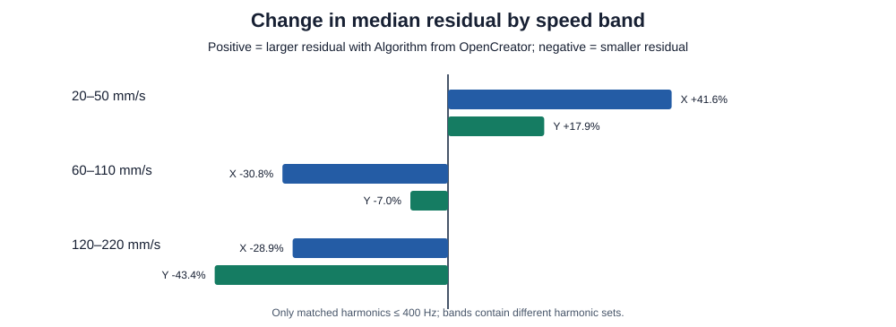

Pro úplnost: nad 400 Hz vyhrává algoritmus z OpenCreator u X v 52/64 bodech a u Y v 35/64. V celém dostupném rozsahu by to bylo 93/134 a 81/134, ale smíchala by se měření s rozdílnou citlivostí snímače. Proto tento rozsah nepoužíváme k výběru výchozího algoritmu.

## 7. Praktický závěr a použití Z-Mod

Oba algoritmy fungují. Opravený standardní algoritmus nabízí kratší kalibraci, dobré potlačení vibrací při nízkých rychlostech a podobné výsledné koeficienty. Algoritmus z OpenCreator přidává adaptivní hledání frekvence a určitou výhodu při středních a vyšších rychlostech. U tohoto stroje není výhoda dostatečně přesvědčivá pro změnu výchozího algoritmu.

**Většině uživatelů doporučujeme standardní kalibraci.** Uvolněte tiskovou podložku, zkontrolujte mechaniku a napnutí řemenů. Nekalibrujte během tisku ani při pozastavení. Použijte aktuální verzi Z-Mod s podporou VFA. Standardní kalibrace:

```gcode
CALIBRATE_VFA T=0 ALTERNATIVE=0
```

Experiment s alternativou:

```gcode
CALIBRATE_VFA T=0 ALTERNATIVE=1
```

Obě varianty makra `CALIBRATE_VFA` po úspěšné kalibraci a vytvoření grafů automaticky provedou `SAVE_CONFIG` a poté se Klipper restartuje. Ruční uložení není nutné. Bez parametru `ALTERNATIVE` se použije nastavení ze sekce `[stepper_resonance_tester]` (výchozí hodnota `alternative: False`). Parametrem `ALTERNATIVE=0` lze výslovně zvolit standardní algoritmus. Nízkoúrovňový příkaz `ZMOD_CALIBRATE_VFA` nadále neukládá konfiguraci automaticky.

Nezávislé ověření po uložení:

```gcode
VFA_GRAPH T=0 MAX_SPEED=400 SHAPER=0 REPEAT=3
```

Grafy a CSV jsou v `mod_data/vfa/`. Diagnostika používá adresář s přesností na minuty, kalibrace s přesností na sekundy a příponou `_setvfa`. Kalibrační CSV, calibration.json, grafy hledání a alternativní kontrolní průjezdy jsou odděleny od nezávislých grafů VFA_GRAPH. PNG se vytvářejí v chroot po vrácení nástroje, bez dalšího pohybu.

Další výzkum může opakovat nezávislá měření v náhodném pořadí s REPEAT=3, otestovat několik C5/C5 Pro a srovnat skutečné výtisky se stejným materiálem a nastavením. Nemá velký smysl optimalizovat koeficienty kvůli malým relativním změnám, které nepřevyšují opakovatelnost testu.

## 8. Data k ověření

Tabulky posunutí do 400 Hz pro každý směr a režim, včetně příčného, podélného a celkového posunutí:

- Standard v 13:10: [X CSV](../assets/vfa/stock-1310-x.csv), [Y CSV](../assets/vfa/stock-1310-y.csv).
- Algoritmus z OpenCreator v 22:21: [X CSV](../assets/vfa/alternative-2221-x.csv), [Y CSV](../assets/vfa/alternative-2221-y.csv).

Jde o odvozené tabulky posunutí v µm, zaokrouhlené při přípravě webových grafů, nikoli o původní CSV amplitud akcelerometru. Čísla v článku byla vypočtena z původních měření, poslední číslice se tedy mohou lišit. Grafy na webu byly ze zachovaných měření překresleny do SVG. Úplné časové řady akcelerometru nejsou k dispozici. Pro zopakování hlavního srovnání spojte řádky podle rychlosti, směru a harmonické a pro srovnání algoritmů použijte pouze `mode=after`.

### Změny Z-Mod a zdroje kódu

| PR | Změna |
|---|---|
| [#14](https://github.com/ghzserg/zmod_klipper_c5/pull/14) | Nezávislý VFA_GRAPH |
| [#16](https://github.com/ghzserg/zmod_klipper_c5/pull/16) | Řízení Input Shaperu při měření |
| [#17](https://github.com/ghzserg/zmod_klipper_c5/pull/17), [#18](https://github.com/ghzserg/zmod_klipper_c5/pull/18) | Oprava měření a ukládání standardní kalibrace |
| [#19](https://github.com/ghzserg/zmod_klipper_c5/pull/19) | Alternativní kalibrace |
| [#20](https://github.com/ghzserg/zmod_klipper_c5/pull/20) | Kalibrační grafy |
| [#22](https://github.com/ghzserg/zmod_klipper_c5/pull/22) | Standard opět jako výchozí algoritmus |
