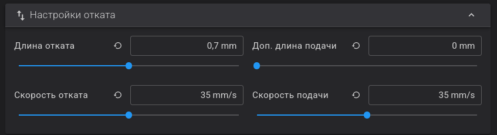

# FAQ
## Häufig gestellte Fragen

!!! note "Info"
    Der Mod ist installiert.

    Sie möchten sich mit nichts beschäftigen – drucken Sie einfach wie gewohnt.

    Es muss nichts konfiguriert oder geändert werden.

    Sie sind bereit, weiterzugehen? Lesen Sie die Dokumentation.
    
### Wie sich Z-Mod von KlipperMod und der nativen Firmware unterscheidet

   Der Unterschied zwischen KlipperMod und Z-Mod:

  - KlipperMod verwendet reinen Klipper mit einem Minimum an für FlashForge 5M (Pro) spezifischen Änderungen
  - Z-Mod verwendet den Standard-Klipper aus der nativen Firmware sowie Klipper 13.
  - KlipperMod verwendet KlipperScreen als Bildschirm für den Drucker.
  - Z-Mod verwendet den nativen Bildschirm oder GuppyScreen/HelixScreen anstelle von KlipperScreen.
  - KlipperMod verwendet Moonraker-Timelapse.
  - Z-Mod verwendet moonraker-telegram-bot auf einem EXTERNEN Host mit Timelapse-Unterstützung oder das [TimeLapse-Plugin](https://github.com/ghzserg/timelapse/).

Unterschiedliche Philosophie:

* KlipperMod ist im Wesentlichen eine alternative Firmware-Implementierung.
* Z-Mod ist ein minimaler Eingriff in die native Firmware. Alle Funktionen der nativen Firmware werden beibehalten.

Deshalb wird es in Z-Mod keine G17, G18, G19 geben – obwohl das einfach wäre. Es wird keine Updates des nativen Klippers geben, keine Umbenennung oder Änderung von Standardmakros, Einstellungen, Pin-Namen usw.

Z-Mod basiert NICHT auf KlipperMod und ist auch keine Weiterentwicklung davon. Z-Mod verwendet zwar einige Makros und Skripte von KlipperMod und nutzt auch dessen Entwicklungen, aber Sie sollten von Z-Mod kein KlipperMod-ähnliches Verhalten erwarten.

**Z-Mod ist binär inkompatibel mit KlipperMod.**

#### Was es in KlipperMod gibt, aber nicht in Z-Mod:

- [KlipperScreen](https://klipperscreen.readthedocs.io/en/latest/) - Bildschirm für den Drucker. In Z-Mod gibt es statt KlipperScreen den nativen Bildschirm oder GuppyScreen/HelixScreen
- [Moonraker-Timelapse](https://github.com/mainsail-crew/moonraker-timelapse) - Z-Mod verwendet Telegram-Bot oder [TimeLapse-Plugin](https://github.com/ghzserg/timelapse/).
- Netzwerkeinrichtung über iwd/wpa_supplicant (im Falle von GuppyScreen/HelixScreen) - in Z-Mod erfolgt die Netzwerkeinrichtung über den nativen Bildschirm; der Netzwerkstart ist auch im Modus ohne nativen Bildschirm möglich

#### Was es in Z-Mod gibt, aber nicht in KlipperMod:

- Unterstützung für [AD5X](/de/AD5X/)
- Unterstützung für [die folgenden Sprachen](/de/Global/#lang): Englisch, Deutsch, Französisch, Italienisch, Spanisch, Chinesisch, Japanisch, Koreanisch, Portugiesisch, Tschechisch, Türkisch, Russisch.
- Betrieb mit dem nativen Bildschirm
- [Druckwiederherstellung nach Stromausfall](/de/Zmod/#zrestore)
- [Shaper-Kalibrierung mit Diagrammen](/de/Calibrations/#zshaper) unter Berücksichtigung von [SCV](/de/Global/#fix_scv) ([square_corner_velocity](https://www.klipper3d.org/Config_Reference.html#printer)).
- [Prüfung und Wiederherstellung von Systemdateien, Rechten und symbolischen Links](/de/System/#check_system)
- Automatische Aktualisierung von `Fluidd`/`Mainsail`/`Moonraker` und Z-Mod über das Netzwerk
- [Entware](/de/FAQ/#z-mod-enthält-entware---wie-benutzt-man-es)
- Behebung des Fehlers [E0017](/de/Global/#fix_e0017)
- Zusätzlich unterstützt: **GuppyScreen/HelixScreen: PID-Kalibrierung, Shaper-Steuerung, Firmware-Retraktion, Düsenreinigung, Wägezellen-Reset, Schraubenjustierung, ColdPull, verbesserte Bettnivellierung**
- Korrigierte Steuerung der Treiberlüfter. Die Lüfter schalten sich automatisch ein, sobald die Motoren aktiv sind. Bei der Standard-Firmware nur während des Drucks.
- Adaptive Bettnivellierung [KAMP](/de/Calibrations/#kamp)
- PID-Kalibrierung von [Extruder](/de/Calibrations/#pid_tune_extruder) und [Bett](/de/Calibrations/#pid_tune_bed), auch über GuppyScreen/HelixScreen.
- Implementierung von [COLDPULL/coldpull](/de/Filament/#coldpull) (Düsenreinigung) ohne Kraftaufwand. Umsetzung [dieses Algorithmus](https://t.me/FF_5M_5M_Pro/2836/447172)

---

#### Was es in Z-Mod gibt, aber nicht in der nativen Firmware:

- Moonraker/Fluidd/Mainsail-Unterstützung
- Telegram-Bot-Unterstützung
- Unterstützung für Klipper 13
- Alle Funktionen, die im Vergleich zu KlipperMod aufgeführt sind.
- Die native Firmware sendet viele Daten an [chinesische Server](https://github.com/FlashForge/Orca-Flashforge/issues/26), dies kann durch die Verwendung von Z-Mod mit GuppyScreen/HelixScreen vermieden werden.

---

## Speichern von Einstellungen

Zugriff auf den Ordner **mod_data** über die Fluidd-Weboberfläche.
`Konfiguration` :arrow_right: `Konfigurationsdateien` :arrow_right: `mod_data`

- Eigene Klipper-Einstellungen gehören in `mod_data/user.cfg`; damit können `printer.base.cfg` und Z-Mod-Dateien überschrieben/ergänzt werden.
- Eigene Moonraker-Einstellungen müssen in die Datei `mod_data/user.moonraker.conf` eingetragen werden.
- Eigene Melodien werden in `mod_data/midi/` gespeichert.
- Globale Mod-Einstellungen werden mit dem Makro [SAVE_ZMOD_DATA](/de/Global/#save_zmod_data) gespeichert *nyuhler*
- Code, der beim Ausschalten des Druckers ausgeführt wird: `mod_data/power_off.sh`.
- Code, der beim Einschalten des Druckers ausgeführt wird: `mod_data/power_on.sh`.

**Die Dateien von Z-Mod und den Plugins dürfen nicht verändert werden**, da dies das Update-System beeinträchtigen würde.

Jede Funktion kann in `mod_data/user.cfg` oder `printer.cfg` überschrieben werden.

---

## Bekannte Besonderheiten:

- Bei Aktionen wie `M109` (Extruderheizung), `M190` (Bettheizung), PID-Kalibrierung oder jeglicher Pause im G-Code friert der Standardbildschirm ein.
- Beim Neustart von Klipper (nach dem Speichern von Bettnetz, PID, Shapern usw.) friert der Standardbildschirm ein; verwenden Sie [NEW_SAVE_CONFIG](/de/Main/#new_save_config) für den Neustart.
- Nach dem Abbrechen eines Drucks müssen Sie auf dem nativen Bildschirm „OK“ drücken (verwenden Sie [CLOSE_DIALOGS](/de/Main/#close_dialogs) oder [FAST_CLOSE_DIALOGS](/de/Main/#fast_close_dialogs)).
- Der Standardbildschirm lädt beim Starten eines Druckvorgangs immer das Profil `DEFAULT_MESH` und löscht das `DEFAULT` Profil nach dem Druckvorgang.

---

## Merkmale der Version ohne nativen Bildschirm

- Entfernen Sie den gesamten Start-G-Code und verwenden Sie die Makros [START_PRINT](/de/Main/#start_print) und [END_PRINT](/de/Main/#end_print).
- Die Standardkamera ist deaktiviert; starten Sie die alternative Kamera mit [CAMERA_ON](/de/Zmod/#camera_on).
- Gegebenenfalls ist es notwendig, den Parameter `Z_OFFSET` manuell in das Makro [START_PRINT](/de/Main/#start_print) zu schreiben oder den globalen Parameter [LOAD_ZOFFSET](/de/Global/#load_zoffset) zu verwenden, der den Z-Offset aus den globalen Parametern lädt, die zuvor über SET_GCODE_OFFSET gespeichert wurden. *crot*.
- Wenn Sie den Z-Offset vom nativen Bildschirm in den Modus ohne nativen Bildschirm übertragen wollen, rufen Sie das Makro ```LOAD_ZOFFSET_NATIVE``` auf. Es liest den Z-Offset vom nativen Bildschirm und wendet ihn auf den Modus ohne nativen Bildschirm an. _Für Creator 5 / Creator 5 Pro nicht erforderlich._
- Das Bettnetz wird beim Start automatisch geladen.
- Das FlashForge-Protokoll wird nicht unterstützt (es wird vom nativen Bildschirm verarbeitet). Verwenden Sie „Octo/Klipper“.

    - **Host Type**: `Octo/Klipper`
    - **Printer Agent**: `Moonraker`

    Für Creator 5 / Creator 5 Pro / AD5X:

    - **Hostname**: `IP_printer`

    

    Für FF5M / FF5M Pro:

    - **Hostname**: `IP_printer:7125`
    - **Device UI**: `IP_printer` oder `IP_printer:80`

    


---

### Was ist der Unterschied zwischen der Arbeit mit und ohne nativen Bildschirm

Der Drucker kann in zwei Modi betrieben werden:

- Mit nativem Bildschirm – fast die gesamte Logik wird vom nativen Bildschirm gesteuert, und vieles lässt sich nicht ändern.
- Ohne nativen Bildschirm – alle Funktionen werden von Z-Mod gesteuert.
Das bedeutet nicht, dass Sie den Bildschirm hardwaremäßig deaktivieren oder ihn durch einen anderen ersetzen müssen.
Im Modus ohne nativen Bildschirm können Sie den alternativen Software-Bildschirm GuppyScreen/HelixScreen verwenden oder den Bildschirm ganz ausschalten, dann bleibt er dunkel.

!!! warning "Warnung"
    Deaktivieren Sie den Bildschirm nur, wenn Sie Bettnivellierung, Z-Offset und die Makros START_PRINT/END_PRINT vollständig verstehen.
    
AD5M/AD5M Pro haben 128 Megabyte Arbeitsspeicher, von denen die Hälfte vom System belegt wird und 13 Megabyte (20 in älteren Versionen der nativen Firmware) von der nativen Bildschirmsteuerung belegt werden.

Wenn Sie den nativen Bildschirm deaktivieren ([DISPLAY_OFF](/de/System/#display_off)), sparen Sie diesen Speicher.

**Das Deaktivieren des Bildschirms spart RAM, ändert aber die Druckverwaltung (Start/Pause/Fortsetzen/Abbrechen/Wiederherstellung nach Stromausfall, Dateiübertragung). Passen Sie den Start-/End-G-Code entsprechend an.** *elk*

!!! info
    Deshalb ist es notwendig, den Start- und End-G-Code zu ändern. *war*.

Ohne Bildschirm wird der Z-Offset des Bildschirms nicht angewendet und muss als Parameter an [START_PRINT](/de/Main/#start_print) oder über globale Parameter übergeben werden. [Mehr lesen](/de/FAQ/#so-funktioniert-der-z-offset)

Lesen Sie [Merkmale der Version ohne nativen Bildschirm](#merkmale-der-version-ohne-nativen-bildschirm).

---

### Was ist ein MAKRO? Wie man es ausführt, herunterlädt und benutzt.

Ein Makro ist ein kleines Programm in der Klipper/G-Code-Sprache.

Es kann aufgerufen werden:

- aus einer G-Code-Datei
- über die Fluidd/Mainsail-Konsole
*Igel*

[Makro-Liste](/de/Macros/)

---

### Ich verwende die Bildschirmversion. Ich sende eine Datei zum Drucken, aber auf dem Bildschirm wird eine Temperatur von 0 °C angezeigt und der Druckvorgang startet nicht.

Fügen Sie diese beiden Zeilen ganz am Anfang des Startcodes in den Druckereinstellungen unter „Maschinen-G-Code“ ein:
```
M190 S[bed_temperature_initial_layer_single]
M104 S[nozzle_temperature_initial_layer] T{single_extruder_multi_material ? 0 : initial_extruder} T{single_extruder_multi_material ? 0 : initial_extruder}
```

Ohne diese Zeilen weiß der Druckerbildschirm nicht, auf welche Temperatur die Düse und das Bett erwärmt werden sollen.
*hippopotamus*

---

#### Nach der Installation von Z-Mod ist mein Bildschirm tot und reagiert nicht mehr auf Berührungen.

- Installieren Sie das letzte Update der nativen [Firmware und Z-Mod](/de/Recommendations/#installieren-sie-die-neueste-native-firmware-und-das-z-mod-update)
- Lesen Sie die [bekannten Besonderheiten](#bekannte-besonderheiten)
- Möglicherweise haben Sie den Bildschirm ausgeschaltet. Schalten Sie ihn mit dem Makro [DISPLAY_ON](/de/System/#display_on) ein.

---

#### Muss ich etwas am Startcode ändern?

Wenn Sie mit dem nativen Bildschirm arbeiten, brauchen Sie nichts zu ändern.

Wenn Sie ohne nativen Bildschirm bzw. mit GuppyScreen/HelixScreen arbeiten (empfohlen auch bei Arbeit mit dem nativen Bildschirm), ersetzen Sie den gesamten Startcode:
```
START_PRINT EXTRUDER_TEMP=[nozzle_temperature_initial_layer] BED_TEMP=[bed_temperature_initial_layer_single]
{single_extruder_multi_material ? "; T0" : "T" + initial_extruder}
M190 S[bed_temperature_initial_layer_single]
M104 S[nozzle_temperature_initial_layer] T{single_extruder_multi_material ? 0 : initial_extruder} T{single_extruder_multi_material ? 0 : initial_extruder}
SET_PRINT_STATS_INFO TOTAL_LAYER=[total_layer_count]
```

```START_PRINT EXTRUDER_TEMP= BED_TEMP=``` sollte in eine Zeile geschrieben werden.

Und den Endcode durch:
```
END_PRINT
```

Für eine korrekte Schichtzählung in Fluidd fügen Sie im „G-Code vor dem Schichtwechsel“ Folgendes hinzu:
```
SET_PRINT_STATS_INFO CURRENT_LAYER={layer_num + 1}
```

Um die automatische Nivellierung für jeden Druck zu aktivieren, geben Sie dies einmalig in der Fluidd/Mainsail-Konsole ein:
```
SAVE_ZMOD_DATA CLOSE_DIALOGS=2 PRINT_LEVELING=1 USE_KAMP=1
```
Gehen Sie im Bildschirmmenü des Druckers zu `Einstellungen` :arrow_right:`WLAN-Symbol` :arrow_right:`Netzwerkmodus`  und aktivieren Sie `Nur lokale Netzwerke`.

Lesen Sie die Dokumentation von [START_PRINT](/de/Main/#start_print) und [SAVE_ZMOD_DATA](/de/Global/#save_zmod_data), damit Sie die erweiterten und nützlichen Funktionen von Z-Mod nutzen können.

Wenn Sie die Firmware-Retraktion verwenden wollen, lesen Sie [Was ist Firmware-Retraktion](/de/FAQ/#was-ist-ein-firmware-rückzug) und fügen Sie Folgendes hinzu unter `Filamentprofil` :arrow_right:`Erweitert` :arrow_right:`Filamentstart-G-Code`:
```
SET_RETRACTION RETRACT_LENGTH=[filament_retraction_length]
```

*Waschbär*

---

### So funktioniert der Z-Offset

Lesen Sie den Artikel „[Wie Z-Offset auf unserem Drucker funktioniert](/de/SetupCalibrations/#wie-funktioniert-z-offset-auf-ihrem-drucker)“.

Bei Verwendung des nativen Bildschirms beeinflusst der Mod den Z-Offset nicht; es wird der auf dem Bildschirm gespeicherte Z-Offset verwendet.

Der Z-Offset mit nativem Bildschirm und im Modus ohne nativen Bildschirm ist unterschiedlich: Jeder lebt sein eigenes Leben und wird separat eingestellt.

Verwenden Sie ```LOAD_ZOFFSET_NATIVE```, um den Z-Offset vom nativen Bildschirm in den Modus ohne nativen Bildschirm zu kopieren. _Für Creator 5 / Creator 5 Pro nicht erforderlich._

Z-Offset-Anpassungen über Fluidd/Mainsail/GuppyScreen/HelixScreen sind **nur bis zum Neustart** wirksam. Ändern Sie ihn nicht, ohne zu verstehen, wohin sich die Düse bewegt.

Jeder Aufruf von `SET_GCODE_OFFSET` (wird automatisch aufgerufen, wenn man den Z-Offset in Fluidd/Mainsail/GuppyScreen/HelixScreen ändert) speichert den aktuellen Z-Offset in den globalen Parametern des Mods. 
Dieser gespeicherte Wert wird aber nur verwendet, wenn der globale Parameter [LOAD_ZOFFSET](/de/Global/#load_zoffset) gesetzt ist (standardmäßig deaktiviert; aktivieren mit `SAVE_ZMOD_DATA LOAD_ZOFFSET=1`), der native Bildschirm nicht verwendet wird und das Makro [START_PRINT](/de/Main/#start_print) verwendet wird.

Sie können auch die Parameter [START_PRINT](/de/Main/#start_print) verwenden, um den Z-Offset zu setzen:

- Z_OFFSET - Z-Offset setzen (0.0)

---

### Welche Optionen stehen für die Bettnivellierung zur Verfügung?

Um die automatische Nivellierung für jeden Druck zu aktivieren, geben Sie dies einmalig in der Fluidd/Mainsail-Konsole ein:
```
SAVE_ZMOD_DATA CLOSE_DIALOGS=2 PRINT_LEVELING=1 USE_KAMP=1
```

Der native Bildschirm verwendet immer:

- `MESH_DATA` - Voreinstellung
- `DEFAULT` - wenn `Leveling` (Messen des Bettnetzes vor dem Druck) angekreuzt ist; nach dem Druck wird das Netz `DEFAULT` immer gelöscht.

Ohne nativen Bildschirm wird beim Start automatisch geladen:

- `auto` - wird beim Einschalten des Druckers automatisch geladen.

Wenn Sie beim Drucken ein anderes Bettnetz verwenden wollen (z. B. `PETG_75`), dann:

- Schalten Sie die automatische Kalibrierung in den globalen Parametern aus.

  ```SAVE_ZMOD_DATA PRINT_LEVELING=0```

- Geben Sie das Netz über den Parameter `MESH` in [START_PRINT](/de/Main/#start_print) an. Beispiel: `START_PRINT MESH=PETG_75`.

- Oder laden Sie es im Filamentprofil über `BED_MESH_PROFILE LOAD=PETG_75`. Stellen Sie sicher, dass Profil und `START_PRINT` übereinstimmen, oder deaktivieren Sie die Düsenreinigung in `START_PRINT`.

- Messen Sie das Bettnetz vorab mit [AUTO_FULL_BED_LEVEL](/de/Calibrations/#auto_full_bed_level). Beispiel: `AUTO_FULL_BED_LEVEL EXTRUDER_TEMP=230 BED_TEMP=75 PROFILE=PETG_75`.

---

#### Über globale Parameter

Ich empfehle die Verwendung globaler Parameter, die einmal konfiguriert und bei jedem Druckvorgang verwendet werden. In diesem Fall ist es nicht notwendig, den Start- und End-G-Code zu ändern.

Parameter `PRINT_LEVELING`:

- Misst das Bettnetz bei jedem Druck
- Beim Arbeiten mit dem Bildschirm misst der native Bildschirm das Bettnetz, als hätten Sie die Datei auf dem Bildschirm ausgewählt und das Kontrollkästchen `Leveling` aktiviert. Mit `SAVE_ZMOD_DATA PRINT_LEVELING=1` geht der Drucker beim Senden von Dateien über Orca/Fluidd/Mainsail davon aus, dass Sie die Datei am nativen Bildschirm ausgewählt und `Leveling` aktiviert haben. In diesem Fall wird das Bettnetz bei jedem Druck gemessen.
- Im Modus ohne nativen Bildschirm mit dem Makro [START_PRINT](/de/Main/#start_print) im Start-G-Code wird das Bettnetz ebenfalls bei jedem Druck gemessen

  Um diese Funktion zu aktivieren, konfigurieren Sie einmalig im Makro [SAVE_ZMOD_DATA](/de/Global/#save_zmod_data) den Parameter [PRINT_LEVELING](/de/Global/#print_leveling)

  ```SAVE_ZMOD_DATA PRINT_LEVELING=1``` *(**muss in der Fluidd/Mainsail Konsole eingegeben werden**)*. In diesem Fall wird das Bettnetz bei jedem Druck gemessen.

- Damit der native Bildschirm das Bettnetz messen kann, gehen Sie im Menü des Druckerbildschirms zu ```Einstellungen``` :arrow_right:```WLAN-Symbol``` :arrow_right:```Netzwerkmodus``` und aktivieren Sie den Schieberegler ```Nur lokale Netzwerke```.

- Wenn diese Option aktiviert ist, werden alle START_PRINT-Parameter, die sich auf die Erstellung/Verwendung eines Bettnetzes beziehen, ignoriert (FORCE_LEVELING, FORCE_KAMP, SKIP_LEVELING, MESH).

Parameter `USE_KAMP`:

- Klipper Adaptive Meshing and Purging (KAMP) kann aktiviert werden; dann wird nicht das ganze Bett gemessen, sondern nur der Bereich mit den zu druckenden Modellen.
  **Die automatische Messung des Bettnetzes wird dadurch nicht ausgelöst!** Dieser Parameter legt nur fest, dass bei jedem Aufruf der Bettnetz-Messung stattdessen KAMP ausgeführt wird.

  Um diese Funktion zu aktivieren, konfigurieren Sie einmalig im Makro [SAVE_ZMOD_DATA](/de/Global/#save_zmod_data) den Parameter [USE_KAMP](/de/Global/#use_kamp)

  ```SAVE_ZMOD_DATA USE_KAMP=1``` *(**muss in der Fluidd/Mainsail Konsole eingegeben werden**)*. In diesem Fall wird wo immer möglich das adaptive Bettnetz verwendet, auch wenn das Bettnetz über das Netzwerk vom nativen Bildschirm gemessen wird.

---

#### Durch Änderung des Startcodes und des Makros START_PRINT

Wenn Sie die globalen Parameter *(SAVE_ZMOD_DATA PRINT_LEVELING=0)* nicht verwenden wollen, stehen Ihnen die folgenden Parameter des Makros [START_PRINT](/de/Main/#start_print), das im Start-G-Code geschrieben wird, zur Verfügung.

- FORCE_LEVELING - erzwingt den Aufbau eines Bettnetzes, True - aufbauen, False - nicht aufbauen (False)
- FORCE_KAMP - Aufbau eines adaptiven Bettnetzes, True - ja, False - nein (False).
- SKIP_LEVELING - unter keiner Bedingung ein Bettnetz aufbauen. Stärker als FORCE_KAMP und FORCE_LEVELING (False)
- MESH - Name des zu ladenden Bettnetzes; wenn nicht angegeben, wird nichts geladen; existiert es nicht, wird es erstellt ("").

!!! warning "Warnung"
    Der Parameter FORCE_LEVELING oder FORCE_KAMP ist kein separates Makro, sondern ein Parameter des Makros START_PRINT.

Beispiele:

Messen des vollständigen Bettnetzes:
```
START_PRINT EXTRUDER_TEMP=[nozzle_temperature_initial_layer] BED_TEMP=[bed_temperature_initial_layer_single] FORCE_LEVELING=True
{single_extruder_multi_material ? "; T0" : "T" + initial_extruder}
M190 S[bed_temperature_initial_layer_single]
M104 S[nozzle_temperature_initial_layer] T{single_extruder_multi_material ? 0 : initial_extruder} T{single_extruder_multi_material ? 0 : initial_extruder}
```

Messen des adaptiven Bettnetzes:
```
START_PRINT EXTRUDER_TEMP=[nozzle_temperature_initial_layer] BED_TEMP=[bed_temperature_initial_layer_single] FORCE_KAMP=True
{single_extruder_multi_material ? "; T0" : "T" + initial_extruder}
M190 S[bed_temperature_initial_layer_single]
M104 S[nozzle_temperature_initial_layer] T{single_extruder_multi_material ? 0 : initial_extruder} T{single_extruder_multi_material ? 0 : initial_extruder}
```

Algorithmus der Bettnetz-Messung im Makro [START_PRINT](/de/Main/#start_print):

1. Wenn MESH nicht leer ist, wird das Netz mit dem im Parameter MESH angegebenen Namen geladen
2. Wenn `SKIP_LEVELING=True`, wird das Bettnetz unter keinen Umständen gemessen
3. Andernfalls, wenn `FORCE_KAMP=True` gesetzt ist, wird KAMP erstellt.
4. Andernfalls, wenn kein Bettnetz geladen ist (der native Bildschirm lädt immer das Netz `MESH_DATA`) oder wenn `FORCE_LEVELING=True`, wird ein Bettnetz erstellt, aber nicht gespeichert.

---

#### Über Makros und Schaltflächen in Fluidd

Wenn Sie das Makro `START_PRINT` und die globalen Parameter nicht verwenden wollen, stehen Ihnen die folgenden Makros zur Verfügung:

- [AUTO_FULL_BED_LEVEL](/de/Calibrations/#auto_full_bed_level) (Fluidd-Schaltfläche `BED LEVELING`) - Misst das Bettnetz und reinigt die Düse bei der angegebenen Bett- und Extrudertemperatur. *Die Heizung wird nach der Messung abgeschaltet.*

  Dasselbe Makro kann über die Fluidd/Mainsail-Schaltfläche `BED CALIBRATION` aufgerufen werden. Nachdem Sie das Bettnetz bei einer bestimmten Temperatur gemessen haben, können Sie die Schaltfläche `Save Parameters` drücken, und das Bettnetz wird in der Datei `printer.cfg` gespeichert.

   Es kann auch in den Start-G-Code geschrieben werden:
   ```
   AUTO_FULL_BED_LEVEL EXTRUDER_TEMP=[nozzle_temperature_initial_layer] BED_TEMP=[bed_temperature_initial_layer_single]
   M190 S[bed_temperature_initial_layer_single]
   M104 S[nozzle_temperature_initial_layer] T{single_extruder_multi_material ? 0 : initial_extruder} T{single_extruder_multi_material ? 0 : initial_extruder}
   ```

- [KAMP](/de/Calibrations/#kamp) - Adaptive Bettnetzkalibrierung mit Düsenreinigung
  ```
  EXTRUDER_TEMP=[nozzle_temperature_initial_layer]
  BED_TEMP=[bed_temperature_initial_layer_single]
  ```

- [BED_MESH_CALIBRATE](https://www.klipper3d.org/G-Codes.html#bed_mesh_calibrate) - Messen des Bettnetzes mit dem Standard-Klipper-Makro.

  **Es wird nicht empfohlen, es zu verwenden**, da keine Düsenreinigung durchgeführt wird, so dass die Ergebnisse falsch sein werden. **Das adaptive Bettnetz von Orca wird überhaupt nicht empfohlen**, da die Messpunkte nicht zufällig gewählt werden: Beim Drucken identischer Modelle misst die Düse jedes Mal an denselben Punkten, was zu Mikrodellen und infolgedessen zu einem falschen Bettnetz führt.

- Standard-Klipper-Makros (**nicht empfohlen**)

---

#### Verwendung von Standard-Klipper-Befehlen

Für die Arbeit mit MESH gibt es Standard-Klipper-Makros:

- [BED_MESH_CALIBRATE](https://www.klipper3d.org/G-Codes.html#bed_mesh_calibrate) - Bettnetz messen
- [BED_MESH_OUTPUT](https://www.klipper3d.org/G-Codes.html#bed_mesh_output) - Bettnetz ausgeben
- [BED_MESH_PROFILE](https://www.klipper3d.org/G-Codes.html#bed_mesh_profile) - Bettnetz laden, löschen, speichern

Wenn Sie ein Bettnetz mit Klipper-Befehlen im Filamentprofil laden, stellen Sie sicher, dass Sie in `START_PRINT` und im Filamentprofil dasselbe Bettnetz verwenden. Alternativ können Sie die Düsenreinigung in START_PRINT deaktivieren und separat im Filamentprofil ausführen.

Es wird dringend empfohlen, die Optionen für die Düsenreinigung zu lesen:

- [CLEAR_NOZZLE](/de/Main/#clear_nozzle) - Düsenreinigung wie in der nativen Firmware
- [PRECLEAR](/de/Global/#preclear) - Zusätzliche Düsenreinigung beim Messen des Bettnetzes.
- [CLEAR](/de/Global/#clear) - vier Algorithmen (Sie können eigene hinzufügen) für das Vorextrudieren einer Linie vor dem Druck.

---

#### Warum tauchen in der Dokumentation immer wieder Tiernamen auf?

Niemand mag die Dokumentation lesen, obwohl 90 % der Fragen darin beantwortet werden.

Diejenigen, die sie nicht lesen, behaupten auch gern, alles gelesen zu haben.

Deshalb habe ich Tiernamen *opossum* im Text verteilt und frage danach, wenn jemand eine Frage stellt, die in der Dokumentation beantwortet ist. Wenn Sie das Tier, das für Ihre Frage im Text versteckt war, nicht nennen konnten, dann haben Sie die Dokumentation nicht gelesen.

Wenn Sie hierher verwiesen wurden, lesen Sie die Dokumentation und nennen Sie das Tier, das bei Ihrer Frage steht – dann bekommen Sie auf jeden Fall Hilfe:

- [Häufig gestellte Fragen](/de/FAQ/)
- [Tipps zur Verbesserung der Druckerstabilität](/de/Recommendations/)
- [Mod installieren/aktualisieren/deinstallieren](/de/Setup/)
- [Makro-Liste](/de/Macros/)
- [Speichern von Einstellungen](/de/FAQ/#speichern-von-einstellungen)
- [Bekannte Besonderheiten](/de/FAQ/#bekannte-besonderheiten)

---

### Ich möchte Z-Mod entfernen - muss ich alles neu kalibrieren?

Nein, alle Einstellungen bleiben erhalten.

----

### Was ist eine alternative Kamera?
 
Die native Kamera, die über den Bildschirm eingeschaltet wird, hat eine Reihe von Nachteilen:

- Hoher RAM-Verbrauch
- Schlechte Bildqualität
- Nur eine Verbindung zur Kamera. Sobald Sie sie in Orca Slicer öffnen, wird sie im Browser nicht mehr angezeigt
- Regelmäßige Bildaussetzer

Die alternative Kamera erlaubt es, Auflösung und FPS zu ändern, unterstützt mehrere Verbindungen, komprimiert das Bild nicht und lässt sich einfach über das [Makro](/de/Zmod/#camera_on) neu starten und anpassen. *zayats*.

- Deaktivieren Sie die native Kamera auf dem Druckerbildschirm.
- Rufen Sie das Makro [CAMERA_ON](/de/Zmod/#camera_on) auf.

Lesen: [Ich habe einen Drucker installiert und Z-Mod hat meine Kamera versteckt!](#ich-habe-einen-drucker-installiert-und-z-mod-hat-meine-kamera-versteckt-ich-konnte-sie-in-orca-ff-sehen-aber-jetzt-ist-sie-weg).

#### Kamera-Einrichtung

**Haupteinstellungen**

| Parameter | Bedeutung | Standardwert |
|----------|------------|------------------|
| `WIDTH` | Bildbreite | 640 |
| `HEIGHT` | Bildhöhe | 480 |
| `FPS` | Bilder pro Sekunde | 20 |
| `VIDEO` | Kameragerät | video0 |
| `FS` | Korrektur für problematische Kameras (1 – ja, 0 – nein) | 0 |
| `STREAMER` | Programm zur Verarbeitung des Kamerastreams | auto |
| `FORMAT` | Bildformat (nur ustreamer) | MJPEG |

**Was ist ein Streamer?**

Ein Streamer ist ein Programm, das das Bild der Kamera aufnimmt und im Browser bereitstellt.

**Es sind zwei Optionen verfügbar:**

- **mjpg_streamer** - einfaches Programm, funktioniert nur mit MJPG-Kameras.
- **ustreamer** - leistungsfähiger, benötigt aber mehr Speicher, unterstützt verschiedene Kameras.

Der Parameter `STREAMER=auto` wählt den geeigneten Streamer automatisch aus.

**Bildformate (nur für ustreamer)**

Folgende Formate stehen zur Auswahl: YUYV, YVYU, UYVY, RGB565, RGB24, BGR24, MJPEG, JPEG.

Standardmäßig wird **MJPEG** verwendet.

**Befehlsbeispiele**

Einfaches Starten der Kamera video0 über mjpg_streamer:
```
CAMERA_ON VIDEO=video0
```

Starten der Kamera video0 über ustreamer mit eigenen Einstellungen:
```
CAMERA_ON VIDEO=video0 STREAMER=ustreamer FORMAT=YUYV WIDTH=640 HEIGHT=480
```

**Wo kann man das Bild sehen?**

Im Browser öffnen: `http://IP_des_Druckers:8080`

Dort können Sie Helligkeit, Kontrast und andere Einstellungen ändern.

**Probleme?**

Die Kamera wird nicht erkannt?
Führen Sie aus:
```
CAMERA_ON VIDEO=video99
```
Das Programm zeigt eine Liste der verfügbaren Kameras an.

**Logs (Fehlerprotokolle)** befinden sich im Ordner: `log/cam/`.

---

### Ich habe einen Drucker installiert und Z-Mod hat meine Kamera versteckt! Ich konnte sie in Orca-FF sehen, aber jetzt ist sie weg!
 
In der Weboberfläche (Fluidd) gehen Sie zu `Einstellungen` :arrow_right: `Videokameras`.

Dort gibt es bereits eine Kamera `Sample_Settings_Camera`. Öffnen Sie sie und sehen Sie sich die Einstellungen an.

**Erstellen Sie eine neue Kamera** mit ähnlichen Einstellungen wie die Kamera `Sample_Settings_Camera`:

- Streamtyp: `MJPEG-Stream`
- Stream-URL: `http://printer_ip_address:8080/?action=stream`
- Schnappschuss-URL: `http://printer_ip_address:8080/?action=snapshot`
- printer_ip_address - ersetzen Sie durch die IP-Adresse Ihres Druckers.

In Versionen neuer als `1.4.3` können Sie auch angeben:

- Streamtyp: `MJPEG-Stream`
- Stream-URL: `/webcam/?action=stream`
- Schnappschuss-URL: `/webcam/?action=snapshot`

Wenn Sie die Auflösung und die Bildrate anpassen, die Kamera des Telegram-Bots verwenden, den RAM-Verbrauch reduzieren oder parallele Verbindungen erlauben wollen, verwenden Sie die [alternative Kamera](/de/FAQ/#was-ist-eine-alternative-kamera). *Kroot*

!!! info "Statische IP"
    Legen Sie auf dem Router eine *statische IP-Adresse für den Drucker* fest, sonst ändert sie sich und die Kamera fällt aus.

---

### Ich habe 2 Kameras / wie kann ich die Kamera deaktivieren/umkehren

Wenn Sie keine Kamera haben oder Ihnen die automatischen Kameraeinstellungen nicht zusagen, öffnen Sie die Datei `mod_data/user.moonraker.conf` über Fluidd/Mainsail

und fügen Sie Folgendes hinzu:

Um die Kamera zu deaktivieren:
```
[webcam video]
aktiviert: false
```

Um die Kamera zu drehen:
```
[webcam video]
Drehen: 90
```

---

### Ich habe die neueste Version installiert, und der Entwickler sagt, ich soll aktualisieren

- Vergewissern Sie sich, dass Sie die neueste Version vom USB-Stick installiert haben
  
- **Öffnen Sie die Weboberfläche.**
```
  Maschine :arrow_right: Update-Manger :arrow_right: Klicken Sie auf Nach Update suchen.
```

- Aktualisieren Sie alle Komponenten *treeflyer*

- Starten Sie den Drucker neu


---

### Kann MCU nicht aktualisieren

Nach einem Neustart erscheint der Fehler:
```
!! Cannot update MCU 'eboard' config as it is shutdown
```

Ein Neustart des Druckers ist ein abnormaler Betriebsmodus.

_Wenn Sie glauben, dass dieser Fehler während des Drucks aufgetreten ist, hat Ihre Heizung (nach langem Gebrauch) einen Kurzschluss, und der Drucker startet unbemerkt neu._

Deshalb werden Sie bei der Installation der nativen Firmware aufgefordert, den Drucker aus- und wieder einzuschalten.

Beim Neustart wird die MCU nicht von der Stromversorgung getrennt, was bedeutet, dass das in die MCU geschriebene Programm weiterläuft. Dieses Programm versucht, mit Klipper zu kommunizieren, der während des Neustarts nicht verfügbar ist. Dadurch friert die MCU ein oder die Verbindung bricht ab.

In diesem Fall müssen Sie sich für eine Option entscheiden:

- Rufen Sie `FIRMWARE_RESTART` auf – dabei bleibt der native Bildschirm hängen.
- Schalten Sie den Drucker aus und wieder ein.

Der Unterschied zwischen `REBOOT` und `FIRMWARE_RESTART` ist, dass `REBOOT` Linux und damit auch Klipper auf der Hauptplatine neu startet, während `FIRMWARE_RESTART` Klipper und die MCU vollständig neu startet.

---

### Ich gehe über Orca/Browser zum Drucker und sehe Welcome to Moonraker

Welche Ports verwendet Z-Mod?

- `7125` - dort befindet sich Moonraker.
- `8080` - dort befindet sich die Kamera.
- `80` - dort arbeitet Fluidd/Mainsail.

Um auf den Drucker zuzugreifen, geben Sie einfach die IP-Adresse des Druckers ein, **ohne Portnummer**. *Hase*

[So richten Sie Orca ein](/de/Recommendations/#senden-sie-dateien-zum-drucken-über-octoklipper)

#### Ich habe die Weboberfläche umgestellt, und jetzt funktioniert nichts mehr

Wenn Sie die Weboberfläche mit dem Makro [WEB](/de/System/#web) umschalten *whoosh*

1. Drücken Sie als Erstes `Strg + F5`, `Strg + Umschalt + R` oder `Option + Befehl + E`.

2. Wenn das Problem in Orca besteht, drücken Sie dort ebenfalls `Strg + F5`, `Strg + Umschalt + R` oder `Option + Befehl + E` *fox*

3. In einem anderen Browser löschen Sie Cache und Cookies und rufen die IP-Adresse des Druckers ohne zusätzliche Zeichen in der Adressleiste auf.
    `http://PRINTER_IP/`

Wenn dies nicht hilft, verwenden Sie einen anderen Browser: Firefox, Chrome, Yandex, Opera usw.

---

### Z-Mod enthält Entware - wie benutzt man es?

!!! warning "Warnung"
    **Es gibt keine Entware** im [AD5X](/de/AD5X/)

Verbinden Sie sich per SSH mit dem Drucker (`root`:`root`, Port `22`).

Führen Sie den Befehl aus:
```bash
export PATH="$PATH:/opt/bin/:/opt/sbin/"
```

Sie können dann `mc` oder `opkg` ausführen

- Aktualisieren der Paketdatenbank: `opkg update`
- Installieren eines Pakets: `opkg install mc`

Verzeichnisse, die von Entware erstellt und verwendet werden:

- /opt/bin
- /opt/etc
- /opt/home
- /opt/lib
- /opt/libexec
- /opt/root
- /opt/sbin
- /opt/share
- /opt/tmp
- /opt/usr
- /opt/var

---

### Was ist ein Firmware-Rückzug?

- In Z-Mod verfügt Fluidd/Mainsail über Schieberegler zur Anpassung von Rückzugsgeschwindigkeit und -distanz per Firmware. 



- Diese Einstellungen wirken sich nur dann auf den Druck aus, wenn die G-Code-Datei mit aktiviertem Firmware-Rückzug gesliced wurde.

- Der Firmware-Rückzug ermöglicht die Anpassung des Rückzugs während des Druckvorgangs, ohne dass ein erneutes Slicen erforderlich ist.

Statt umfangreicher Befehle wie `G1 E-.5 F2100` wird zum Zurückziehen der kurze Befehl `G10` verwendet, und statt `G1 E.5 F2100` zum Wiedereinfahren `G11`.

**Um dies in Orca zu aktivieren:**
`Druckereinstellungen` :arrow_right:`Allgemeine Informationen` :arrow_right: `Erweitert` :arrow_right: Häkchen bei `Firmware-Rückzug verwenden` setzen.

**So ändern Sie die Standardeinstellungen für den Rückzug:**
Über Fluidd/Mainsail (`Konfiguration` :arrow_right: `mod_data` :arrow_right: `user.cfg`):
```
[firmware_retraction].
retract_length: 0.9
retract_speed: 35
unretract_extra_length: 0
untract_speed: 35
```

**`SET_RETRACTION` wird normalerweise als Teil der Slicer-Konfiguration für jedes Filament gesetzt, da verschiedene Filamente unterschiedliche Parametereinstellungen erfordern:**
!!! info
    SET_RETRACTION [RETRACT_LENGTH=<mm>] [RETRACT_SPEED=<mm/s>] [UNRETRACT_EXTRA_LENGTH=<mm>] [UNRETRACT_SPEED=<mm/s>]: Setzt die Parameter für den Rückzug.

- `RETRACT_LENGTH` – Länge des Filaments für Rückzug und Wiedereinfahren.
- `RETRACT_SPEED` - Geschwindigkeit für den Rückzug.
- `UNRETRACT_SPEED` - Geschwindigkeit des Wiedereinfahrens; nicht besonders kritisch, oft aber niedriger als `RETRACT_SPEED`.
- `UNRETRACT_EXTRA_LENGTH` - in manchen Fällen ist es nützlich, beim Wiedereinfahren eine kleine zusätzliche Länge hinzuzufügen.

**Beispiel in Orca:**
`Filamentprofil` :arrow_right: `Parameter überschreiben` :arrow_right: `Rückzug` :arrow_right: `Länge`
`Filamentprofil` :arrow_right: `Erweitert` :arrow_right: `Start G-Code`:
```
SET_RETRACTION RETRACT_LENGTH=[filament_retraction_length]
```

Verwenden Sie `GET_RETRACTION`, um die aktuellen Einstellungen im Terminal anzuzeigen.

Variante für das Setzen der Retraktion von [@minicx](https://github.com/loss-and-quick/)
```
SET_RETRACTION RETRACT_LENGTH={if not is_nil(filament_retraction_length[current_extruder])}[filament_retraction_length[current_extruder]]{else}[retraction_length]{endif} RETRACT_SPEED={if not is_nil(filament_retraction_speed[current_extruder])}[filament_retraction_speed[current_extruder]]{else}[retraction_speed]{endif}
```

---

### Besonderheiten des AD5X

[AD5X](/de/AD5X/)

---

### Hilfe

### Wie kontaktiere ich den Entwickler-Support?

[Die Anleitung wurde verschoben](/de/Help/)

---

### Wie ändere ich das Boot-Logo?

Das Logo befindet sich im Ordner ```mod_data/logo```.

Anforderungen an das Logo:

- Größe 800x480, Farbtiefe 24 Bit
- AD5M: BMP-Format. Dateiname: ```bootlogo.bmp```
- AD5X: JPG-Format. Dateiname: ```logo.jpeg```

Laden Sie Ihr Logo in den Ordner ```mod_data/logo``` hoch.

Starten Sie den Drucker zweimal neu.

Wenn Sie den Mod entfernen, wird das ursprüngliche Logo wiederhergestellt. Ist das beim AD5M nicht geschehen:

- Installieren Sie den Mod
- Laden Sie die Datei [boot.bmp](https://github.com/ghzserg/FF/releases/download/R/boot.bmp) in den Ordner `mod_data/logo` hoch.
- Starten Sie den Drucker neu

Logo von Alberto Maciel:

- [AD5M/AD5M Pro](https://github.com/ghzserg/zmod/tree/main/Native_firmware/logo/ad5m)
- [AD5X](https://github.com/ghzserg/zmod/tree/main/Native_firmware/logo/ad5x)

---

### No trigger on probe after full movement

Dieser Fehler tritt üblicherweise auf, wenn die Z-Achse beim Messen nicht weit genug angehoben wird.

Softwareseitig lässt sich das so beheben:

Tragen Sie in `mod_data/user.cfg` ein:
```
[bed_mesh]
horizontal_move_z: 5
```

Hardwareseitig: Alle Schrauben müssen eingestellt sein, und das Bett darf nicht verzogen sein.

---

### WeightValue

**WeightValue** ist der Wert der Wägezellen in Gramm. Da er über die Schnittstelle eines Temperatursensors umgesetzt ist, zeigen Fluidd und Mainsail ihn in Grad an.

Wozu dient dieser Sensor?

- Er kann verwendet werden, um den Z-Offset über das [g28_tenz](https://github.com/ghzserg/g28_tenz) Plugin zu messen.
- Damit kann der Druck gestoppt werden, wenn die Düse auf ein Teil trifft oder sich ein Teil löst. [NOZZLE_CONTROL](/de/Global/#nozzle_control)
- Ohne Reset der Wägezellen wird das Bettnetz falsch gemessen.

---

### MCU Protocol error

Hier sind einige Fehler, die von der MCU abhängen:

- MCU Protocol error
- Unknown temperature sensor flashforge_loadcell
- Requested MCU command
- flashforge_loadcell: Requested MCU command `flashforge_loadcell_h1` is not available

Allen diesen Fehlern ist gemeinsam, dass die Klipper-Version nicht zur MCU-Version passt.

Sie können die MCU-Version auf der Registerkarte `System` einsehen.


Sie verwenden z. B. Klipper 13, aber die MCU-Firmware stammt von Klipper 11 oder 12.

Oder umgekehrt: Sie verwenden den nativen Klipper, haben aber die MCU-Firmware für Klipper 13 geladen.

Wenn Ihre MCU-Version mit ```?-20230317_182329-ubuntu20-virtual-machine``` beginnt, bedeutet dies, dass Sie die MCU für Klipper 12 (AD5X) oder Klipper 11 (AD5M/AD5M Pro) geladen haben.

[Zum nativen Klipper wechseln](/de/Native_FW/#fix_klipper)

Dementsprechend muss Z-Mod den nativen Klipper laden.

- Gehen Sie zu ```mod_data/variables.cfg``` und löschen Sie die Zeile ```klipper13 = 1```.
- Speichern Sie die Datei
- Schalten Sie den Drucker aus und schalten Sie ihn wieder ein (**nicht neu starten!**).


Wenn das nicht der Fall ist und Klipper läuft, führen Sie ```UPDATE_MCU FORCE=13``` aus – dieser Befehl installiert die aktuelle MCU-Version.

Wenn nichts hilft und **Klipper nicht funktioniert**:

- [Zum nativen Klipper wechseln](/de/Native_FW/#fix_klipper)
- [Installieren Sie die native Factory-Firmware](/de/Native_FW/#so-installieren-sie-die-native-firmware) – dabei wird auch die native MCU-Firmware installiert.

---

#### Das Filament ist ausgegangen oder wurde gestoppt

Beim AD5M müssen Sie die Sensorschritte durch Ausprobieren kalibrieren. Tragen Sie in `mod_data/user.cfg` ein:

Erhöhen Sie diese Zahl. Bei manchen funktioniert der Standardwert `8`, manche Sensoren arbeiten erst bei `17` korrekt.
```
[filament_motion_sensor e0_sensor].
Erkennung_Länge: 8
```

Filamentstau erkannt (IFS).

Beim AD5X müssen Sie die Schritte des IFS-Sensors durch Ausprobieren kalibrieren. Tragen Sie in `mod_data/user.cfg` ein:

Erhöhen Sie diese Zahl. Bei manchen funktioniert der Standardwert `10`, manche IFS arbeiten erst bei `17` korrekt.
```
[zmod_ifs_motion_sensor ifs_motion_sensor].
detektion_länge: 8
```

Darüber hinaus kann ein Filamentstopp im IFS folgende Ursachen haben:

- Im Extruder befindet sich Filament von Spule 1, entladen wird aber Spule 2. Verwenden Sie [`SET_EXTRUDER_SLOT`](/de/AD5X/#5-wie-man-dem-drucker-ad5x-manuell-mitteilt-welche-spule-eingelegt-ist), um den aktuellen Extruder-Slot zu synchronisieren.
- Neues Filament wird eingeführt, während sich altes Filament noch im Extruder befindet.
- Die 4-in-1-Module und ihre Schläuche haben unterschiedliche Längen. Passen Sie daher den Wert für `filament_unload_into_tube` in `mod_data/filament.json` an. Setzen Sie ihn auf **70 oder höher**. [Mehr lesen](/de/AD5X/#grundlegende-parameter-am-häufigsten-angepasst)

Das Problem kann auch daran liegen, dass **das Filament im IFS-Kanal nicht freigegeben werden kann**.

Mechanische Ursachen sind beispielsweise:

- Kunststoffspäne, die an der Andruckrollenwelle kleben.
- Eine Feder, die sich vom IFS-Kanalhebel gelöst hat.

!!! info "Lösung"
    Entfernen Sie die Verunreinigungen, zerlegen Sie den Mechanismus und setzen Sie die Komponenten korrekt wieder zusammen.

Testen Sie nach der Reparatur den Druckvorgang und das Verhalten der Filamentverriegelung/-entriegelung mithilfe der [IFS-Befehle](/de/AD5X/#10-ifs-befehle).

---

### Vor jedem Druckvorgang misst der Drucker die Mitte des Druckbetts

Vor dem Drucken:

- heizt er Bett und Düse auf
- reinigt die Düse
- kühlt die Düse ab
- **misst die Mitte des Bettes** (Start des manuellen Z-Tasters; mit TESTZ wird die Position eingestellt)
- heizt die Düse auf
- startet den Druck

Dies ist ein Verhalten der **nativen Firmware** ab folgenden Versionen:

- 1.1.8 AD5X
- 3.2.4 AD5M/AD5M Pro

Lösung:

- [Native Firmware zurücksetzen](/de/Native_FW/) auf Version **1.1.7** für AD5X, **3.2.3** für FF5M/FF5MPro
- [Nativen Bildschirm deaktivieren](/de/System/#display_off)

---

### E0120

Dies ist ein Klipper-Fehler.

Er lässt sich meist durch folgende einfache Maßnahmen beheben:

- Schalten Sie den Drucker aus
- 10 Sekunden warten
- Schalten Sie den Drucker wieder ein

Um zu sehen, was genau der Fehler ist:

- Öffnen Sie Fluidd/Mainsail
- Öffnen Sie die Konsole und lesen Sie den Fehlertext
- Öffnen Sie den Telegram-Bot [@zmod_help_bot](http://t.me/zmod_help_bot) und geben Sie den Fehlertext ein oder suchen Sie selbst in der Dokumentation nach der Beschreibung.

Wenn Sie den Fehler nicht beheben können, [erstellen Sie ein Ticket](#wie-kontaktiere-ich-den-entwickler-support).

[Native Konfigurationen](https://github.com/ghzserg/zmod/tree/main/Native_firmware/config/)

