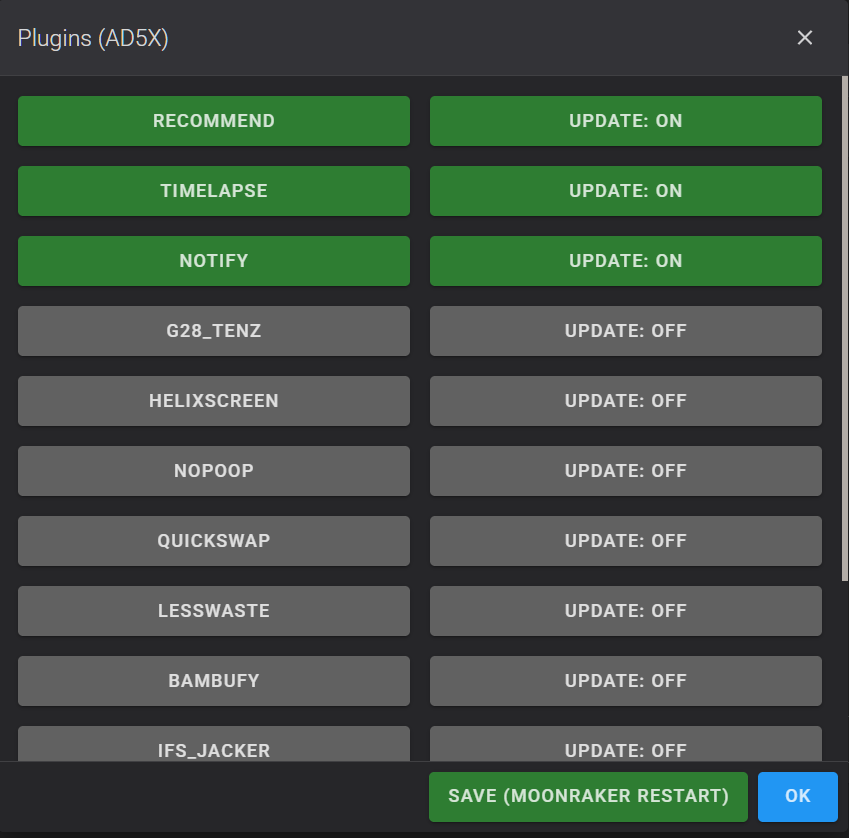

<h1 align="center">Globaler Parameter</h1>

Ein Makro ist ein kleines Programm in der Sprache Klipper/Gcode.

Es kann aufgerufen werden:

- aus der G-Code-Datei
- über die Fluidd/Mainsail-Konsole (drücken Sie in Fluidd die lateinische Taste „C“)

!!! info "Hinweis"
    *Der Wert in Klammern ist der Standardwert.

---

### LANG

Legt Sie die Sprache fest, die Z-Mod verwenden soll.

- LANG - Sprache: `en - Englisch`, `ru - Russisch`, `de - Deutsch`, `fr - Französisch`, `it - Italienisch`, `es - Spanisch`, `zh - Chinesisch`, `ja - Japanisch`, `ko - Koreanisch`, `pt - Portugiesisch`, `cs - Tschechisch`, `tr - Türkisch`

Beispiel:
```
LANG LANG=de
```

---

### SET_TIMEZONE

Zeitzone ändern:

Die Zeitzonen finden Sie im Ordner `/usr/data/.mod/.zmod/usr/share/zoneinfo`

```
SET_TIMEZONE ZONE=Asia/Yekaterinburg
```

- ZONE - Zeitzone (Standard: `Asia/Yekaterinburg`)

Mehr dazu: [SET_TIMEZONE](/de/System/#set_timezone).

---

### NOZZLE_CONTROL

Schutz bei einem Aufprall der Düse auf das Druckbett oder beim Ablösen des Teils.

Notabschaltung des Druckers, wenn eine Gewichtsüberschreitung erkannt wird (AD5M und AD5X).

- WEIGHT - Gewicht in Gramm (1500)

Einstellungen bleiben nach einem Neustart erhalten.

Setzen Sie `NOZZLE_CONTROL WEIGHT=0`, um diese Funktion zu deaktivieren.

!!! info "INFO"
    *Die Kontrolle ist deaktiviert, bis das Makro zum ersten Mal aufgerufen wird.*

Nach dem ersten Aufruf wird die Kontrolle beim Drucken automatisch aktiviert.

Bei Verwendung des nativen Bildschirms startet der Drucker nach der Makroausführung neu.

Ohne den nativen Bildschirm wird Klipper neu gestartet (Konfigurationsdateien werden angepasst).

Funktioniert automatisch; für den G-Code stehen zusätzliche Makros zur Verfügung:

- `ZCONTROL_ON` - Kontrolle aktivieren
- `ZCONTROL_OFF` - Kontrolle deaktivieren
- `ZCONTROL_STATUS` - Status der Funktion anzeigen
- `ZCONTROL_PAUSE` - beim Auslösen pausieren (die Pause wird erst ausgeführt, wenn die Befehlswarteschlange abgearbeitet ist; nicht in den ersten Schichten)
- `ZCONTROL_ABORT` - beim Auslösen Klipper stoppen
- `ZCONTROL_AUTO` - Klipper stoppen (wenn Höhe z < `ZCONTROL_Z`) oder PAUSE aufrufen (wenn z >= `ZCONTROL_Z`)
- `ZCONTROL_Z Z=10` - Höhe Z setzen
- `SAVE_ZMOD_DATA ZCONTROL_Z=10` - Höhe Z speichern. Wenn Sie nicht auf Pause schalten wollen, setzen Sie ```SAVE_ZMOD_DATA ZCONTROL_Z=230```.

Um für die ersten Schichten statt des Abbruchs eine Pause zu verwenden, fügen Sie `ZCONTROL_PAUSE` im Slicer bei der gewünschten Schicht hinzu.

_Die Meldung „Die Kontrolle ist nicht aktiv“ bedeutet, dass die Kontrolle gerade nicht verwendet wird; beim Drucken wird sie automatisch aktiviert._

---

### GET_ZMOD_DATA

Zeigt die Werte der globalen Z-Mod-Parameter/Flags an.
Nach der Ausführung des Makros zeigt die Konsole die gespeicherten und aktuell angewendeten Werte.

??? note "FLUIDD"

    `Fluidd` -> `Makros` -> `Haupt` -> `Z-Mod-PARAMETER`.

??? note "MAINSAIL"

    `Mainsail` -> `Dashboard` -> `System` -> `GET ZMOD DATA`

---

### PLUGINS

Zeigt das Menü zur Plugin-Verwaltung an.



In diesem Menü können Sie zusätzliche Plugins aktivieren, deaktivieren und vollständig entfernen.

- Linke Spalte (Aktivierung): Klicken Sie, um das Plugin zu aktivieren oder zu deaktivieren.
    - Grüne Schaltfläche — das Plugin ist aktiv.
    - Graue Schaltfläche — das Plugin ist deaktiviert.
- Rechte Spalte (Updates): aktiviert oder deaktiviert automatische Updates über Moonraker.
    - UPDATE: ON — Updates sind aktiviert.
    - UPDATE: OFF — Updates sind deaktiviert.

**So entfernen Sie ein Plugin vollständig:**

Wenn Sie ein Plugin nicht mehr benötigen, schalten Sie beide Schaltflächen auf Grau (deaktivieren Sie das Plugin selbst und seine Updates), drücken Sie SAVE (MOONRAKER RESTART) und starten Sie den Drucker anschließend neu. Das System löscht seinen Ordner automatisch aus `mod_data/plugins/`.

---

### GLOBAL

Vereinfachte Verwaltung der globalen Parameter. Verfügbar sind nur Parameter, die per Schaltfläche umgeschaltet werden können. Parameter, die eine Zahl, einen Dateinamen usw. erfordern, werden mit diesem Makro nicht verwaltet.

**Es wird empfohlen, den Drucker nach dem Ändern von Parametern neu zu starten.**

---

### SAVE_ZMOD_DATA

Speichert globale Z-Mod-Parameter/Flags, die bei jedem Druck angewendet werden.

Dieses Makro muss nicht in den Start- oder End-G-Code oder in die G-Code-Datei eingefügt werden. Es wird über die Fluidd/Mainsail-Konsole aufgerufen.

Die Parameter werden im Druckerspeicher in der Datei `mod_data/variables.cfg` gespeichert und bleiben nach dem Ausschalten erhalten, sodass Sie sie nicht jedes Mal neu eingeben müssen.

!!! info "INFO"
    **Bearbeiten Sie die Datei nicht von Hand – sonst bringen Sie Klipper oder den Mod durcheinander.**

**Um den gewünschten Parameter zu bearbeiten:**

??? note "FLUIDD"

    `Fluidd` -> `Makros` -> `System` -> `SAVE Z-Mod PARAMETERS`

??? note "MAINSAIL"

    `Mainsail` -> `Dashboard` -> `System` -> `SAVE ZMOD DATA`
    
Wählen Sie den Parameter aus, den Sie ändern wollen, tragen Sie den Wert ein und drücken Sie `SENDEN`. Prüfen Sie die Ausgabe in der Konsole.

Zweite Möglichkeit: Geben Sie den gewünschten Befehl in die Konsole ein, zum Beispiel: `SAVE_ZMOD_DATA CLOSE_DIALOGS=2`.

[Gespeicherte Parameter anzeigen](/de/Global/#get_zmod_data)

---

### Parameter des Farbauswahlmenüs

**Die Parameter des Farbauswahlmenüs gelten ausschließlich für den AD5X.**

##### ALLOWED_TOOL_COUNT

Die Anzahl der Werkzeuge, die im Farbauswahlmenü angezeigt werden. Gemeint sind die Befehle T0, T1 usw. in der G-Code-Datei, nicht auf die physischen Spulen in Ihrem IFS.

Wenn Z-Mod die verwendeten Werkzeuge erfolgreich aus der Datei ermittelt, wird dieser Wert überschrieben, und es werden nur die in der Datei verwendeten Werkzeuge angezeigt.

Diese Einstellung kann nicht verwendet werden, wenn der native Bildschirm aktiviert ist.

[Siehe Einrichtung der Vorverarbeitung](/de/Recommendations/#aktivieren-sie-die-md5-kontrolle)

Beispiel: `SAVE_ZMOD_DATA ALLOWED_TOOL_COUNT=4`.

##### SCAN_FILE_COLORS

!!! note "3MF"
    Bei 3MF-Dateien erfolgen Scannen und Farbzuordnung sofort; der [Präprozessor](/de/Global/#force_md5) wird nicht benötigt.

Ermöglicht das Scannen von G-Code-Dateien, um die verwendeten Werkzeugwechselbefehle (T0, T1 usw.) und die ihnen im Slicer zugewiesenen Farben und Materialien zu ermitteln: 0 (aus), 1 (an), 2 (kein vollständiges Scannen, nur die vom Slicer-Skript vorbereiteten Daten werden gelesen).

[Siehe Einrichtung der Vorverarbeitung](/de/Recommendations/#aktivieren-sie-die-md5-kontrolle)

Beispiel: `SAVE_ZMOD_DATA SCAN_FILE_COLORS=0`.

##### COLOR_MENU_1_BASED

Legt fest, welche Bezeichnungen im Farbauswahlmenü angezeigt werden sollen: beginnend mit 0 (T0, T1 usw.) oder beginnend mit 1 (Farbe 1, Farbe 2 usw.). Dies ändert nur die Namen der Schaltflächen und dient nur der Bequemlichkeit: 0 (von Null), 1 (von Eins).

Beispiel: `SAVE_ZMOD_DATA COLOR_MENU_1_BASED=1`.

##### AUTO_ASSIGN_COLORS

Legt fest, ob beim Druckstart die automatische Zuordnung von Werkzeugwechselbefehlen (T0, T1 usw.) zum im IFS geladenen Filament versucht werden soll. Sofern der leise Modus nicht aktiviert ist, wird das Farbauswahlmenü weiterhin angezeigt. Diese Einstellung betrifft nur die Standardauswahl: 

- 0 (deaktivieren), 
- 1 (aktivieren).

Diese Einstellung gilt auch für Drucke, die im leisen Modus gestartet werden. Sie können die automatische Materialzuordnung so konfigurieren, dass der Druckvorgang bei bestimmten Fehlern abgebrochen wird: 

- 2 (Abbruch, wenn Materialien nicht zugeordnet werden können; Farbabweichungen sind zulässig), 
- 30 (Abbruch bei allen Problemen).

Für eigene Abbruchbedingungen im leisen Modus addieren Sie die folgenden Werte, um die richtige Einstellung zu ermitteln:

- 2 (Mindestens ein Material kann nicht zugeordnet werden; z. B. ist in der G-Code-Datei ABS angegeben, aber nur PLA geladen; oder die Materialdaten konnten nicht geladen werden).
- 4 (Mindestens eine Farbe kann nicht zugeordnet werden, üblicherweise aufgrund eines deaktivierten oder fehlgeschlagenen Dateiscans).
- 8 (Mindestens eine Farbe stimmt schlecht überein).
- 16 (Mindestens eine physische Spule wurde in der Datei mehreren Werkzeugindizes zugeordnet).

[Siehe Einrichtung der Vorverarbeitung](/de/Recommendations/#aktivieren-sie-die-md5-kontrolle)

Beispiel: `SAVE_ZMOD_DATA AUTO_ASSIGN_COLORS=0`.

---

##### PURGE_ALL_EXTRUDERS

Nur Creator 5 / Creator 5 Pro

Spülen der Extruder beim Druckstart:

- 0 - nur den ersten (Start-)Extruder spülen (Standard)
- 1 - alle verwendeten Extruder spülen

Gespült werden die Extruder, die an der Zuordnung der Farben aus der Datei zu den physischen Spulen beteiligt sind. Sind mehrere Farben derselben Spule zugeordnet, wird dieser Extruder nur einmal gespült.

Ist Auto PA aktiviert ([PRINT_AUTOPA](/de/Global/#print_autopa) oder die Schaltfläche `Auto PA` im Druckmenü), werden alle verwendeten Extruder ohnehin während der PA-Kalibrierung gespült, daher hat dieser Parameter keine Wirkung.

Beispiel: `SAVE_ZMOD_DATA PURGE_ALL_EXTRUDERS=1`

---

##### UNUSED_EXTRUDERS_OFF_TIME

Nur Creator 5 / Creator 5 Pro

Heizung ungenutzter Extruder beim Mehrfarbdruck nach einer festgelegten Zeit (in Minuten) abschalten:

- 0 - nicht abschalten
- 5, 10, 20, 40, 60 - nach wie vielen Minuten Leerlauf die Extruderheizung abgeschaltet wird

Im Menü wird der Parameter als „Ungenutzte Extruder nach N Min. ausschalten“ angezeigt.

Damit die Funktion korrekt arbeitet, muss im Slicer **Ooze prevention** aktiviert sein (`Druckeinstellungen` > `Multimaterial` > `Ooze prevention`).

Beispiel: `SAVE_ZMOD_DATA UNUSED_EXTRUDERS_OFF_TIME=5`

### Parameter für den Start des Druckvorgangs und die Erstellung einer Bettkarte [START_PRINT]:

##### MIDI_START

MIDI-Datei zu Druckbeginn abspielen (""), 0 zum Ausschalten

Beispiel: `SAVE_ZMOD_DATA MIDI_START=Pain-Shut-your-mouth.mid`.

---

##### PRECLEAR

Düsenvorreinigung in CLEAR_NOZZLE verwenden: 0 (nein), 1 (ja)

Beispiel: `SAVE_ZMOD_DATA PRECLEAR=0`.

---

##### PRINT_LEVELING

Bei jedem Druck ein Bettnetz messen (über den nativen Bildschirm, wenn dieser aktiviert ist):

- 0 (nein)
- 1 (ja)

*Damit das Bettnetz über den nativen Bildschirm gemessen werden kann, gehen Sie zu `Einstellungen` :arrow_right: `WLAN-Symbol` :arrow_right: `Netzwerkmodus` und **aktivieren Sie den Schieberegler** `Nur lokale Netzwerke`.*

Beispiel: `SAVE_ZMOD_DATA PRINT_LEVELING=0`.

---

##### PRINT_AUTOPA

Nur für Creator 5 / Creator 5 Pro

PA (Pressure Advance) bei jedem Druck ermitteln: 0 (nein), 1 (ja) (0).

*Damit Auto PA über den nativen Bildschirm funktioniert, gehen Sie zu `Einstellungen` :arrow_right: `WLAN-Symbol` :arrow_right: `Netzwerkmodus` und **aktivieren Sie den Schieberegler** `Nur lokale Netzwerke`.*

Beispiel: `SAVE_ZMOD_DATA PRINT_AUTOPA=1`

---

##### USE_KAMP

!!! note "Schnelles KAMP"
    KAMP wird automatisch aktiviert und funktioniert ohne den langsamen Objektausschluss. Bei 3MF stehen die KAMP-Daten sofort zur Verfügung, bei G-Code nach dem Scannen der Datei.

Wo möglich, ein adaptives Bettnetz (KAMP) anstelle des vollständigen Bettnetzes verwenden:

- 0 (nein)
- 1 (ja)

Es wird empfohlen, `SAVE_ZMOD_DATA CLEAR=LINE_PURGE` zu setzen, damit die Reinigung im KAMP-Bereich erfolgt.

*Ermöglicht KAMP auch dann, wenn das Bettnetz über das Netzwerk vom nativen Bildschirm gemessen wird.*

Beispiel: `SAVE_ZMOD_DATA USE_KAMP=1`.

---

##### MESH_TEST

Bettnetz vor dem Druck prüfen:

- 0 - nicht prüfen
- 1 - Prüfung OHNE automatischen Z-Offset (Standard)
- 2 - Prüfung OHNE automatischen Z-Offset, bei Nichtübereinstimmung KAMP starten
- 3 - Prüfung MIT automatischem Z-Offset und Düsenreinigung
- 4 - Prüfung MIT automatischem Z-Offset und Düsenreinigung, bei Nichtübereinstimmung KAMP starten

**Automatischer Z-Offset**

Algorithmus zur automatischen Z-Offset-Kalibrierung:

1. **Quelldaten:** Der Druckerspeicher speichert ein Bettnetz (AD5M/AD5X: 25 Punkte, C5Pro: 100 Punkte), das beim letzten Nivellierungsvorgang erstellt wurde.

2. **Vorbereitung:**

	* Bei AD5M/AD5X wird die Düse auf Betriebstemperatur erhitzt, am Druckbett abgestreift und auf die Prüftemperatur abgekühlt: [TEMP_TEST_MAX](/de/Global/#temp_test_max) (standardmäßig 151), wenn die Zieltemperatur der Düse über 230 °C liegt, sonst [TEMP_TEST_MIN](/de/Global/#temp_test_min) (standardmäßig 121).
	* Bei Creator 5 / Creator 5 Pro wird der aktive Extruder abgelegt.

3. **Messpunktauswahl:**

	* Der **Mittelpunkt** des Netzes wird verwendet.

4. **Messung und Vergleich:**

	* Am ausgewählten Punkt wird eine neue Messung (PROBE) durchgeführt.

	* Der ermittelte Wert wird mit dem im Bettnetz gespeicherten Wert verglichen.

5. **Offset-Korrektur:**

	* Beträgt die Abweichung **weniger als 0,3 mm**, wird die Differenz zum aktuellen Z-Offset-Wert addiert.

	* Beträgt die Abweichung **größer oder gleich 0,3 mm**, betrachtet das System das gespeicherte Netz als veraltet und startet, sofern die Einstellungen dies zulassen, automatisch die Bettnetz-Messung (KAMP).

**Kein automatischer Z-Offset**

Algorithmus zur Validierung des Druckbettnetzes:

1. **Messung:** An der aktuellen Position wird eine Standard-Sondenmessung (PROBE) durchgeführt.

2. **Validierung:** Der ermittelte Z-Wert wird auf Übereinstimmung mit dem geladenen Netz geprüft.

3. **Kriterium:** Der Wert muss im Bereich von (Netzminimum - 0,21 mm) bis (Netzmaximum + 0,21 mm) liegen.

4. **Ergebnis:**
	* **Erfolg:** Das Netz wird als korrekt betrachtet, der Druckvorgang wird fortgesetzt.

	* **Fehler:** Es wird eine Warnung ausgegeben und der Druckvorgang wird gestoppt oder, falls die Einstellungen dies zulassen, automatisch die Bettnetz-Messung (KAMP) gestartet.

**Hinweise zur Prüfung ohne automatischen Z-Offset:**

* Diese Prüfung ist eine grobe Schätzung. Sie dient dazu, kritische Fehler zu erkennen, z. B. wenn ein für eine PEI-Platte erstelltes Netz bei dickem Glas geladen ist und umgekehrt.

* **Diese Prüfung bietet keinen absoluten Schutz.**
* Bei Verwendung der intelligenten Reinigung (KAMP) erfolgt die Heizwartezeit in der Nähe des Reinigungsbereichs, nicht in einer Ecke des Bettes.
* Die Prüfung erfolgt mit heißer Düse.

Beispiel: `SAVE_ZMOD_DATA MESH_TEST=0`

---

##### TEMP_TEST_MIN

Untere Düsentemperatur für den Bettkontakttest in [MESH_TEST](/de/Global/#mesh_test) Modi 3/4 (mit Düsenreinigung). Liegt die Zieltemperatur der Düse bei 230 °C oder darunter, kühlt die Düse vor dem Prüfen auf diese Temperatur ab. Standard: `121`.

Verringern Sie den Wert, wenn Ihre Druckplatte die Standardtemperatur nicht verträgt: Auf PC-Platten (Glasübergangspunkt ~145-150 °C) und einigen G10-Platten hinterlässt die heiße Düse tiefe Abdrücke.

Dieser Parameter wird nicht über `SAVE_ZMOD_DATA` gesetzt — geben Sie den Befehl in der Fluidd/Mainsail-Konsole ein (der Wert wird in `mod_data/variables.cfg` gespeichert):

Beispiel: `SAVE_VARIABLE VARIABLE=temp_test_min VALUE=110`

*   Empfohlener Bereich: 100-150. Der neue Wert gilt ab dem nächsten Druck, ein Neustart ist nicht erforderlich.
*   Wird nur verwendet, wenn eine Düsenreinigung durchgeführt wird ([MESH_TEST](/de/Global/#mesh_test) 3/4). In den Modi 1/2 (Standard) wird das Netz bei voller Drucktemperatur ohne Abkühlung geprüft.

---

##### TEMP_TEST_MAX

Obere Düsentemperatur für den Bettkontakttest in [MESH_TEST](/de/Global/#mesh_test) Modi 3/4 (mit Düsenreinigung). Liegt die Zieltemperatur der Düse über 230 °C, kühlt die Düse vor dem Prüfen auf diese Temperatur ab. Standard: `151`.

Die Verwendung entspricht [TEMP_TEST_MIN](/de/Global/#temp_test_min) — verringern Sie den Wert für temperaturempfindliche Druckplatten (PC, einige G10).

Beispiel: `SAVE_VARIABLE VARIABLE=temp_test_max VALUE=140`

---

##### FORCE_MD5

Igor Polunovskiy

Überprüft die MD5-Summe der Datei und löscht die Datei bei einem Fehler.

> Hinweis: Nur beim Senden von G-Code. Für 3MF nicht erforderlich.

- 0 - nicht prüfen
- 1 - prüfen

??? info "Download: Wählen Sie die passende Datei für Ihr System"

    1. Sie müssen eine Datei für Ihre Architektur und Ihr Betriebssystem auswählen und auf Ihren Computer herunterladen:
        * [zmod_preprocess-windows-amd64.exe](https://github.com/ghzserg/zmod_preprocess/releases/latest/download/zmod_preprocess-windows-amd64.exe) - **Windows**
        * [zmod_preprocess-linux-amd64](https://github.com/ghzserg/zmod_preprocess/releases/latest/download/zmod_preprocess-linux-amd64) - **Linux** Vergessen Sie nicht, `chmod +x zmod_preprocess-linux-amd64` auszuführen.
        * [zmod_preprocess-darwin-arm64](https://github.com/ghzserg/zmod_preprocess/releases/latest/download/zmod_preprocess-darwin-arm64) - **macOS Apple Silicon** Vergessen Sie nicht, `chmod +x zmod_preprocess-darwin-arm64` auszuführen.
        * [zmod_preprocess-darwin-amd64](https://github.com/ghzserg/zmod_preprocess/releases/latest/download/zmod_preprocess-darwin-amd64) - **macOS Intel** Vergessen Sie nicht, `chmod +x zmod_preprocess-darwin-amd64` auszuführen.
        * [zmod-preprocess.py](https://github.com/ghzserg/zmod_preprocess/releases/latest/download/zmod-preprocess.py) - **Universal Python** Vergessen Sie nicht, `chmod +x zmod-preprocess.py` auszuführen.
        * [zmod-preprocess.sh](https://github.com/ghzserg/zmod_preprocess/releases/latest/download/zmod-preprocess.sh) - **Linux/macOS Bash** Vergessen Sie nicht, `chmod +x zmod-preprocess.sh` auszuführen.
     
??? tip "2. Konfiguration in Orca"
    In Orca müssen Sie den Pfad zum Skript an folgender Stelle angeben:
    `Prozessprofil` :arrow_right: `Sonstiges` :arrow_right: `Nachbearbeitungsskripte`.

    **Hier sind die Optionen, die Sie hinzufügen müssen (je nach System):**

    * **Windows (Executable):**
        ```text
        "C:\path_to_file\zmod_preprocess-windows-amd64.exe";
        ```

    * **Windows (Python Skript):**
        ```text
        "C:\python_ordner\python.exe" "C:\Scripts\zmod-preprocess.py";
        ```

    * **Linux/macOS (Python):**
        ```text
        "/usr/bin/python3" "/home/user/zmod-preprocess.py";
        ```

    * **Linux/macOS (Direkter Pfad):**
        ```text
        "/home/benutzer/zmod-preprocess.py";
        ```

    * **Binärdateien (Linux/macOS):**
        * `/home/benutzer/zmod_preprocess-darwin-amd64`;
        * `/home/benutzer/zmod_preprocess-darwin-arm64`;
        * `/home/benutzer/zmod_preprocess-linux-amd64`;

Beispiel: `SAVE_ZMOD_DATA FORCE_MD5=1`.

---

##### DISABLE_SKEW

- 1 - SKEW-Korrektur deaktivieren
- 0 - Profil `skew_profile` laden (das Makro `SKEW_PROFILE LOAD=skew_profile` wird aufgerufen)

[Mehr lesen](https://www.klipper3d.org/Skew_Correction.html)

Beispiel: `SAVE_ZMOD_DATA DISABLE_SKEW=1`.

---

##### LOAD_ZOFFSET

!!! note "Creator 5 / Creator 5 Pro"
    Beim Creator 5 / Creator 5 Pro ist der Z-Offset mit nativem Bildschirm und im Modus ohne nativen Bildschirm identisch – beide sind vollständig synchronisiert. Ist der native Bildschirm deaktiviert, können Sie den Z-Offset während des Drucks über GuppyScreen, HelixScreen, Fluidd oder Mainsail ändern – er wird gespeichert.

Z-Offset aus den globalen Parametern laden, die zuvor über SET_GCODE_OFFSET gespeichert wurden:

- 1 - ja
- 0 - nein

[So funktioniert der Z-Offset](/de/FAQ/#so-funktioniert-der-z-offset)

Beispiel: `SAVE_ZMOD_DATA LOAD_ZOFFSET=0`.

---

##### DISABLE_PRIMING

Vorextrudieren (Priming) der Düse deaktivieren:

- 0 - nein
- 1 - ja

[Details](/de/Global/#clear)

Beispiel: `SAVE_ZMOD_DATA DISABLE_PRIMING=0`.

---

##### CLEAR

Algorithmus für das Vorextrudieren der Düse auswählen (LINE_PURGE)

- _CLEAR1 – Orca-Stil
- _CLEAR2 – FF-Gruppenstil
- _CLEAR3 – Alternative zur FF-Gruppe
- _CLEAR4 – Shreider-Code (von oben rechts nach unten rechts)
- _CLEAR_TRAP – für Bürsten (von oben rechts nach unten rechts)
- LINE_PURGE – KAMP-Reinigung

Wenn Sie `KAMP` verwenden, wird die Reinigung zwangsweise auf `LINE_PURGE` gesetzt (anstelle von _CLEAR1, _CLEAR2, _CLEAR3, _CLEAR4).

Wenn Sie `LINE_PURGE` verwenden, aber die Objektbeschriftung in Orca nicht aktiviert haben, wird `_CLEAR2` verwendet.

Sie können Ihr eigenes Reinigungsmakro in `mod_data/user.cfg` hinzufügen und seinen Namen in diesem Parameter angeben.

*behemoth*

Beispiel: `SAVE_ZMOD_DATA CLEAR=LINE_PURGE`.

*5M/5MPro: Dies ist kein Ersatz für die native Reinigung (CLEAR_NOZZLE), bei der die Düse in der Mitte oben auf das Bett stößt und dann den Kunststoff am Bett abstreift. Dies ist ein Vorextrudieren der Düse unmittelbar vor dem Druck.*

_Um das Vorextrudieren mit einer Linie zu deaktivieren, verwenden Sie [DISABLE_PRIMING](/de/Global/#disable_priming)_

---

### Parameter für Druckende und Abbruch [END_PRINT]:

##### MIDI_END

MIDI-Datei am Ende des Drucks abspielen (""), 0 zum Deaktivieren

Beispiel: `SAVE_ZMOD_DATA MIDI_END=Pain-Shut-your-mouth.mid`.

---

##### CLOSE_DIALOGS

Dialoge am Ende und beim Abbruch des Drucks automatisch schließen:

- 0 - nein
- 1 - ja, langsam
- 2 - ja, schnell

*Um Dialoge schnell zu schließen, gehen Sie im Menü des Druckerbildschirms zu `Einstellungen` :arrow_right: `WLAN-Symbol` :arrow_right: `Netzwerkmodus` und **aktivieren Sie den Schieberegler** `Nur lokale Netzwerke`.*

Beispiel: `SAVE_ZMOD_DATA CLOSE_DIALOGS=2`.

---

##### STOP_MOTOR

Motoren 25 Sekunden nach Druckende/-abbruch automatisch abschalten:

- 0 - nein
- 1 - ja 

Beispiel: `SAVE_ZMOD_DATA STOP_MOTOR=1`.

---

##### AUTO_REBOOT

Automatischer Neustart des Druckers nach Beendigung des Druckvorgangs (0):

- 0 - kein Neustart
- 1 - Neustart des Druckers über den Befehl `REBOOT`
- 2 - im Modus ohne nativen Bildschirm Neustart der Firmware über `FIRMWARE_RESTART`, mit nativem Bildschirm Neustart des Druckers über `REBOOT`

Beispiel: `SAVE_ZMOD_DATA AUTO_REBOOT=0`.

---

### Systemparameter:

##### MOTION_SENSOR

Einen [Filamentbewegungssensor](https://de.aliexpress.com/item/1005006119360974.html) anstelle des Filamentpräsenzsensors verwenden.

- 0 - nein (der Filamentpräsenzsensor wird verwendet)
- 1 - ja (der Filamentbewegungssensor wird verwendet)

**Wenn Sie den Filamentbewegungssensor verwenden, deaktivieren Sie ihn auf dem nativen Bildschirm, da sonst der Druckvorgang abgebrochen wird.**

Wenn der Filamentsensor im Modus ohne nativen Bildschirm verwendet wird, wird beim Auslösen folgende Meldung angezeigt: „Filament ist ausgegangen. Pause in 30 Sekunden“.

Beispiel: `SAVE_ZMOD_DATA MOTION_SENSOR=1`.

---

##### SILENT

Nur AD5X.

Legt fest, ob das Farbauswahlfenster beim Druckstart angezeigt wird:

- 0 - Fenster anzeigen (Standard)
- 1 - Fenster nicht anzeigen, vorher eingestellte Farben verwenden
- 2 - Fenster nicht anzeigen, IFS nicht verwenden

Beispiel: `SAVE_ZMOD_DATA SILENT=0`

---

##### AUTOINSERT

Nur AD5X.

Filament automatisch laden:

- 0 - Filament nicht automatisch laden
- 1 - Filament automatisch laden (Standard)

Beispiel: `SAVE_ZMOD_DATA AUTOINSERT=0`

---

##### ALWAYS_FULL_COLOR_CHANGE

Nur AD5X

Legt fest, ob der Farbwechselvorgang übersprungen werden soll, wenn die vorherige und die nachfolgende Farbe derselben physischen Spule zugeordnet sind:

- 0 - Vorgang überspringen
- 1 - Vorgang nicht überspringen

Beispiel: `SAVE_ZMOD_DATA ALWAYS_FULL_COLOR_CHANGE=0`

---

##### USE_TRASH_ON_PRINT

Nur AD5X

Nur bei Betrieb im Modus ohne nativen Bildschirm

Beim Farbwechsel während des Drucks den Abfallbehälter verwenden:

- 0 - nicht in den Abfallbehälter spülen
- 1 - in den Abfallbehälter spülen (Standard)
- 2 - nach dem Farbwechsel zum Abfallbehälter fahren, aber nicht spülen

Beispiel: `SAVE_ZMOD_DATA USE_TRASH_ON_PRINT=0`

---

##### REMOVE_FILAMENT

Nur AD5X.

Nur bei Betrieb im Modus ohne nativen Bildschirm

Filament nach Druckende entladen:

- 0 - nicht entladen (Standard)
- 1 - entladen

Beispiel: `SAVE_ZMOD_DATA REMOVE_FILAMENT=1`

---

##### FIX_SCV

Korrigiert den fehlerhaften SCV-Wert ([square_corner_velocity](https://www.klipper3d.org/Config_Reference.html#printer)) beim Zeichnen der Beschleunigungsgrafiken und beim Berechnen der Input Shaper.

- 0 - belässt den Parameter wie im Stock (5)
- 1 - verwendet `square_corner_velocity` aus `mod_data/user.cfg` oder `printer.base.cfg`

Beispiel: `SAVE_ZMOD_DATA FIX_SCV=1`.

In unserem Drucker ist `square_corner_velocity: 25`, die Shaper- und Beschleunigungsgrafiken werden jedoch für `SCV = 5` berechnet.

Im Großen und Ganzen wirkt sich dies nur auf die ausgegebenen Beschleunigungen und die berechnete Glättung aus.
Die Werte `shaper_type_x`, `shaper_freq_x`, `shaper_type_y`, `shaper_freq_y` werden nicht verändert.

Bei korrekter Berechnung sinken die berechneten Beschleunigungen dagegen etwa um den Faktor 2.

Daher die Empfehlung, in `mod_data/user.cfg` einzutragen:
```
[printer]
square_corner_velocity: 9
```

Dies reduziert die Geschwindigkeit in den Ecken und verbessert generell die Druckqualität, auf Kosten einer geringfügig niedrigeren Geschwindigkeit.

!!! tip "Empfohlenes Plugin aktivieren"
	
	Oder das Plugin [Recommend](/de/Plugin/#plugins-in-z-mod) aktivieren.

---

##### WIFI

Bei einigen Firmware-Versionen kann es gelegentlich vorkommen, dass WLAN nicht startet.

Um dies zu beheben, verbinden Sie sich zunächst über den nativen Bildschirm mit einem WLAN-Netzwerk und dann:

1. `SAVE_ZMOD_DATA WIFI=1` aufrufen
2. Den Drucker ausschalten
3. Den Drucker einschalten

- 0 – WLAN über den nativen Bildschirm verwenden
- 1 – WLAN über Z-Mod verwenden

---

##### FIX_E0011

Häufige Ursachen für den Fehler E0011 (Timer zu kurz):

- Der Host hat nicht innerhalb der vorgegebenen Zeit (0,025 s) reagiert.

- Die MCU hat nicht innerhalb der vorgegebenen Zeit (0,025 s) reagiert.

Spezifische Ursachen:

- Eingefrorene MCU der Hauptplatine oder der Extruderplatine. `Lost communication with MCU 'mcu'`. Lösung: Neustart; Austausch der Hauptplatine (`mcu`) oder der Extruderplatine (`eboard`).

- Überlastung der Host-CPU (Shaper-Berechnungen/Grafikdarstellung).

- Überlastung des EMMC (Git-Operationen, Backups, Uploads großer Dateien während des Druckvorgangs usw.).

- Unzureichender Arbeitsspeicher. Lösung: CPU nachlöten und auf 256 MB Arbeitsspeicher aufrüsten.

- Beschädigtes Extruderkabel. Lösung: Kabel austauschen/reparieren.

- Wackelkontakt am Stecker des Extruderkabels. Lösung: Extruderplatine austauschen.

- Laden von SWAP-Daten (SWAP befindet sich auf dem EMMC-Speicher, der mit 10 MB/s arbeitet; die SWAP-Daten können während der Shaper-Berechnungen bis zu 25 MB groß sein). Lösung: Deaktivieren Sie SWAP mit `SAVE_ZMOD_DATA USE_SWAP=0`, wenn Sie 256 MB RAM haben.

- Absturz der MCU-Firmware. Lösung: Flashen Sie die MCU neu, indem Sie sie auf Werkseinstellungen zurücksetzen (z. B. über [Werkseinstellungen](/de/Setup/#drucker-auf-werkseinstellungen-zurücksetzen-erforderlich-für-die-installation-des-mods)) oder mit dem Makro [UPDATE_MCU](/de/System/#update_mcu).

Fehler E0011 und `Communication timeout during homing` beheben. Durch Ändern dieses Parameters wird der Drucker neu gestartet. 0 – Nein, 1 – Ja (0):

- 0 – Standardparameter (0.025) beibehalten
- 1 – Parameter auf 0.1 setzen

Beispiel: `SAVE_ZMOD_DATA FIX_E0011=1`

Dieser Fehler kann auch auftreten:

- Bei sehr vielen ausschließbaren Objekten. Lösung: `Prozessprofil` :arrow_right: `Sonstiges` :arrow_right: `G-Code-Ausgabe` :arrow_right: Häkchen bei `Objekte ausschließen` entfernen.

- Wenn Sie den Swap-Speicher auf FF5M/FF5MPro deaktiviert haben.

Führen Sie das Makro `MEM` aus und prüfen Sie, ob Swap-Speicher vorhanden ist und wie groß dieser ist.

Aktivieren Sie den Swap-Speicher, falls er deaktiviert ist: ```SAVE_ZMOD_DATA USE_SWAP=1```

- Wenn Sie Klipper 13 auf dem AD5X verwenden. In diesem Fall können Sie mit `UPDATE_MCU FORCE=12` zum nativen Klipper zurückkehren.

- Wenn Fuzzy Skin verwendet wird und die CPU mit der Berechnung der Bahn nicht nachkommt. Deaktivieren Sie Fuzzy Skin oder passen Sie seine Parameter an.

- Wenn Sie auf FF5M/FF5MPro einen vollständigen Test durchführen, also PID-Kalibrierung, Messen des Bettnetzes und Shaper-Kalibrierung gleichzeitig.

Es empfiehlt sich, alle Kalibrierungen [gemäß dieser Anleitung](/de/SetupCalibrations/#drucker-kalibrierung-für-einsteiger) durchzuführen.

Der Fehler `Communication timeout during homing` kann aufgrund einer hohen Kommunikationslatenz zwischen Host und MCU auftreten. Die Round-Trip-Zeit sollte konstant unter 10 ms liegen. Kurzzeitige Latenzspitzen können zu Homing-Fehlern führen.

`TRSYNC_TIMEOUT` ist ein Klipper-Parameter (Standardwert: 0,025 s), der Systemverzögerungen kompensiert.

Die Standarddatei `/opt/klipper/klippy/mcu.py` setzt `TRSYNC_TIMEOUT = 0.025`. Der Patch ändert diesen Wert auf `TRSYNC_TIMEOUT = 0.1`.

**So beheben Sie das Problem mit der Standard-Firmware:**

- Formatieren Sie einen USB-Stick auf FAT32 (MBR).

- Speichern Sie die Datei `flashforge_init.sh` auf dem USB-Stick:

- [Parameter Adventurer5M korrigieren](https://github.com/ghzserg/FF/releases/download/R/Adventurer5M-e0011-on.tgz)

- [Standardparameter Adventurer5M wiederherstellen](https://github.com/ghzserg/FF/releases/download/R/Adventurer5M-e0011-off.tgz)

- [Parameter Adventurer5MPro korrigieren](https://github.com/ghzserg/FF/releases/download/R/Adventurer5MPro-e0011-on.tgz)

- [Standardparameter Adventurer5MPro wiederherstellen](https://github.com/ghzserg/FF/releases/download/R/Adventurer5MPro-e0011-off.tgz)

- Schalten Sie den Drucker aus.
- Stecken Sie den USB-Stick in den Drucker.

- Schalten Sie den Drucker ein (er piept laut).

- Warten Sie, bis er neu gestartet ist.

- Entfernen Sie den USB-Stick.

- Drucken Sie die problematische Datei erneut; der Fehler E0011 sollte nun nicht mehr auftreten.

**Manuelle Behebung mit der Standard-Firmware:**

- Installieren Sie [root](https://github.com/ghzserg/zmod/tree/main/Native_firmware/root).

- Stellen Sie mit [WinSCP](https://winscp.net/eng/download.php) eine SSH-Verbindung zum Drucker her.

- Bearbeiten Sie die Datei `/opt/klipper/klippy/mcu.py`.

- Suchen Sie nach `TRSYNC_TIMEOUT = 0.025` und ändern Sie den Wert in `TRSYNC_TIMEOUT = 0.1`.

- Speichern Sie die Datei und starten Sie den Drucker neu.

!!! tip "Empfohlenes Plugin aktivieren"
	
	Oder das Plugin [Recommend](/de/Plugin/#plugins-in-z-mod) aktivieren.

---

##### FIX_E0017

Fehler E0017 beheben. Durch Ändern dieses Parameters wird der Drucker neu gestartet. 0 - Nein, 1 - Ja (1):

In der Originaldatei `/opt/klipper/klippy/toolhead.py` ist `LOOKAHEAD_FLUSH_TIME = 0.5` gesetzt. Der Original-Klipper verwendet `LOOKAHEAD_FLUSH_TIME = 0.250`. Unsere Modifikation funktioniert am besten mit `LOOKAHEAD_FLUSH_TIME = 0.150`.

- 0 - Originalwert
- 1 - 0.150

Beispiel: `SAVE_ZMOD_DATA FIX_E0017=1`

**So beheben Sie den Fehler mit der Original-Firmware:**

- Formatieren Sie einen USB-Stick auf FAT32 (MBR).

- Speichern Sie die entsprechende Datei auf dem USB-Stick:

- [Adventurer5M-e0017-4.tgz](https://github.com/ghzserg/FF/releases/download/R/Adventurer5M-e0017-4.tgz) für FlashForge 5M

- [Adventurer5MPro-e0017-4.tgz](https://github.com/ghzserg/FF/releases/download/R/Adventurer5MPro-e0017-4.tgz) für FlashForge 5M Pro

- Schalten Sie den Drucker aus.

- Stecken Sie den USB-Stick in den Drucker.

- Schalten Sie den Drucker ein (er piept laut).

- Warten Sie, bis er neu gestartet ist.

- Entfernen Sie den USB-Stick.

- Drucken Sie die problematische Datei erneut; der Fehler E0017 sollte nun nicht mehr auftreten.

**Manuelle Reparatur der Standard-Firmware:**

- Installieren Sie [root](https://github.com/ghzserg/zmod/tree/main/Native_firmware/root).

- Stellen Sie mit [WinSCP](https://winscp.net/eng/download.php) eine SSH-Verbindung zum Drucker her.

- Bearbeiten Sie die Datei `/opt/klipper/klippy/toolhead.py`.

- Suchen Sie nach `LOOKAHEAD_FLUSH_TIME = 0.5` und ändern Sie den Wert in `LOOKAHEAD_FLUSH_TIME = 0.150`.

- Speichern Sie die Datei und starten Sie den Drucker neu.

!!! tip "Empfohlenes Plugin aktivieren"
	
	Oder das Plugin [Recommend](/de/Plugin/#plugins-in-z-mod) aktivieren.

---

##### LED

LED-Helligkeit nach dem Einschalten (50)

Beispiel: `SAVE_ZMOD_DATA LED=50`

---
##### WEB_SCREEN

Nur Creator 5 / Creator 5 Pro

Den Druckerbildschirm als virtuelle Kamera `screen` in Fluidd/Mainsail und [zmod.link](https://zmod.link) weiterleiten:

- 0 - Nicht umleiten
- 1 - Umleiten (Standard)

Beispiel: `SAVE_ZMOD_DATA WEB_SCREEN=1`

---
##### MIDI_ON

MIDI-Datei beim Einschalten des Druckers abspielen (""), 0 zum Ausschalten

Beispiel: `SAVE_ZMOD_DATA MIDI_ON=Pain-Shut-your-mouth.mid`.

---

##### NEW_SAVE_CONFIG

Beim PID-Kalibrieren das alternative [NEW_SAVE_CONFIG](/de/Main/#new_save_config) verwenden (führt `SAVE_CONFIG` aus, ohne dass der native Bildschirm hängt): 0 (nein), 1 (ja) (0)

Beispiel: `SAVE_ZMOD_DATA NEW_SAVE_CONFIG=0`.

---

##### USE_SWAP

SWAP aktivieren (1):

- 0 – Nein (*nur bei auf 256 MB RAM aufgerüstetem Prozessor*)
- 1 – Ja, auf EMMC
- 2 – Ja, bevorzugt auf USB-Stick (_für Mutige; tatsächlich etwa 90 % langsamer als EMMC_)

Beispiel: `SAVE_ZMOD_DATA USE_SWAP=1`.

---

##### CHINA_CLOUD

Chinesische Cloud-Dienste einschalten: 0 (nein), 1 (ja) (1)

Beispiel: `SAVE_ZMOD_DATA CHINA_CLOUD=0`.

[Chinesische Cloud-Dienste deaktivieren](/de/Recommendations/#chinesische-cloud-dienste-deaktivieren)

Selbst wenn alle Cloud-Optionen über den Bildschirm deaktiviert sind, versucht der Drucker weiterhin, Fotos, Videos und Telemetriedaten an chinesische Server zu senden.

Durch Setzen dieses Parameters auf 0 werden diese Funktionen teilweise deaktiviert.

**Wenn chinesische Cloud-Dienste deaktiviert sind, sucht der Drucker nicht nach Firmware-Updates.**

Um die Firmware zu aktualisieren, aktivieren Sie die chinesischen Cloud-Dienste über `SAVE_ZMOD_DATA CHINA_CLOUD=1`, starten Sie den Drucker neu und führen Sie das Update durch.

Stattdessen können Sie verwenden:

- [zmod.link](/de/Zmod/#zlink) - Cloud für die Verwaltung von Druckern über Fluidd/Mainsail.
- [Telegram-Bot](/de/Telegram/#telegram-bot).

So **deaktivieren** Sie chinesische Cloud-Dienste auf der Standard-Firmware:

- Formatieren Sie den USB-Stick auf FAT32 (MBR)
- Legen Sie die Datei [flashforge_init.sh](https://github.com/ghzserg/zmod/blob/main/Native_firmware/cloud/rem/flashforge_init.sh) auf dem USB-Stick ab.
- Schalten Sie den Drucker aus
- Stecken Sie den USB-Stick in den Drucker
- Schalten Sie den Drucker ein
- Der Drucker wird 1 Mal neu gestartet
- Entfernen Sie den USB-Stick und verwenden Sie die Standard-Firmware

So **aktivieren** Sie chinesische Cloud-Dienste auf der Standard-Firmware:

- Formatieren Sie den USB-Stick auf FAT32 (MBR)
- Legen Sie die Datei [flashforge_init.sh](https://github.com/ghzserg/zmod/blob/main/Native_firmware/cloud/orig/flashforge_init.sh) auf dem USB-Stick ab.
- Schalten Sie den Drucker aus
- Stecken Sie den USB-Stick in den Drucker
- Schalten Sie den Drucker ein
- Der Drucker wird 1 Mal neu gestartet
- Entfernen Sie den USB-Stick und verwenden Sie die Standard-Firmware

---

##### NICE

Legt die Priorität des Klipper-Prozesses fest:

- 1 – niedrigste Priorität
- 40 – höchste Priorität (20)

Beispiel: `SAVE_ZMOD_DATA NICE=20`.

Je höher die Priorität von Klipper, desto mehr Ressourcen erhält er, aber desto häufiger stürzen Moonraker und die Kamera ab.

Für diejenigen, die Linux kennen:
```bash
NICE=20
grep -q "^nice = " /opt/config/mod_data/variables.cfg && NICE=$(grep "^nice = " /opt/config/mod_data/variables.cfg | cut -d "=" -f2| awk '{print $1}')
NICE=$((20-$NICE))
[ $NICE -ge 20 ] && NICE=19
[ $NICE -lt -20 ] && NICE=-20.
renice $NICE $(ps |grep klippy.py| grep -v grep| awk '{print $1}')
```

---

##### DISPLAY_OFF_TIMEOUT

Zeit (in Sekunden), nach der der native Bildschirm im Modus ohne nativen Bildschirm ausgeschaltet wird. Standardwert: 180.

Hinweis: Der Bildschirm benötigt mindestens 5 Sekunden, um WLAN zu konfigurieren.

Beispiel: `SAVE_ZMOD_DATA DISPLAY_OFF_TIMEOUT=120`

---

##### PRO_POWEROFF_TIMEOUT

Zeit (in Minuten), nach der sich der FF5M Pro automatisch ausschaltet. Standardwert: 0 (deaktiviert).

Beispiel: `SAVE_ZMOD_DATA PRO_POWEROFF_TIMEOUT=10`

---

##### SAVE_MOONRAKER

- 0 - Lädt die Positionen der Makrotasten aus Z-Mod (Standard)
- 1 - Änderungen an den Makrotasten werden lokal in Fluidd/Moonraker gespeichert.

Wenn Makros lokal gespeichert werden, werden neue Makros in einem separaten Abschnitt abgelegt.

Beispiel: `SAVE_ZMOD_DATA SAVE_MOONRAKER=1`.

---

##### SAVE_FILAMENT_SENSORS

- 0 - Den Zustand der Filamentsensoren nach einem Neustart nicht speichern; sie sind dann immer aktiviert (Standard)
- 1 - Den Zustand der Sensoren über einen Neustart hinweg speichern. Ein deaktivierter Sensor bleibt auch nach dem Neustart deaktiviert.

Beispiel: `SAVE_ZMOD_DATA SAVE_FILAMENT_SENSORS=1`.
