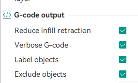

# Empfehlungen
## Empfehlungen zur Verbesserung der Druckerstabilität

Die Empfehlungen gelten sowohl für die native Firmware als auch für Z-Mod.

---

### Aktivieren Sie den Modellausschluss

Aktivieren Sie den Modellausschluss in Orca:

- `Prozessprofil` -> `Sonstiges` -> `G-Code-Ausgabe` -> Häkchen bei `Objekte ausschließen` setzen
- `Prozessprofil` -> `Sonstiges` -> `G-Code-Ausgabe` -> Häkchen bei `Objekte beschriften` setzen



---

### Installieren Sie die neueste native Firmware und das Z-Mod-Update

Nur die neueste Version des Mods wird unterstützt.

Der Autor hat nicht die Ressourcen, um alle Versionen zu unterstützen, also [installieren Sie die neueste native Firmware und das Z-Mod-Update](/de/Setup/).

### Ersetzen Sie Spiral/Automatisch beim Z-Hop

Der Drucker unterstützt dies nicht.

In Orca: `Druckerprofil` -> `Extruder 1` -> `Z-Achsen-Hubtyp`. Stellen Sie `Normal` oder `Schräg` ein.

---

### Deaktivieren Sie Bögen (arc_move)

Der Drucker unterstützt sie, aber sie verschlechtern die Druckqualität und verursachen gelegentlich Druckfehler.

In Orca: `Prozessprofil` -> `Qualität` -> `Präzision` -> Häkchen bei `Bogenanpassung (Arc fitting)` entfernen.

---

### Deaktivieren Sie die eingebaute Kamera auf dem Druckerbildschirm

Sie verbraucht mehr Speicher und die Bildqualität ist schlecht.

Verwenden Sie eine andere Kamera.

Auf dem Bildschirm des Druckers: „Einstellungen“ -> Registerkarte „Kamera“ -> „Kamera“ und „Video“ deaktivieren.

Führen Sie dann das Makro [CAMERA_ON](/de/Zmod/#camera_on) aus.

- [Was ist eine alternative Kamera?](/de/FAQ/#was-ist-eine-alternative-kamera)
- [Ich habe einen Drucker installiert und Z-Mod hat meine Kamera versteckt! Ich habe sie in Orca-FF gesehen, und jetzt ist sie weg!](/de/FAQ/#ich-habe-einen-drucker-installiert-und-z-mod-hat-meine-kamera-versteckt-ich-konnte-sie-in-orca-ff-sehen-aber-jetzt-ist-sie-weg)

---

### Chinesische Cloud-Dienste deaktivieren

### LAN-Modus-Fehler

Diese Dienste arbeiten instabil und verlieren zeitweise die Verbindung. Beim erneuten Verbinden überlasten die aufgestauten Anfragen den Drucker und verursachen Fehler.

Durch die Deaktivierung dieser Dienste werden außerdem Dialoge nach dem Druck schneller geschlossen, und das Messen des Bettnetzes über den nativen Bildschirm wird möglich.

**Auf dem Druckerbildschirm:**

1. `Einstellungen` :arrow_right: `WLAN` :arrow_right: `Netzwerkmodus` :arrow_right: `Nur lokales Netzwerk` aktivieren.

2. `Einstellungen` :arrow_right: `Cloud` :arrow_right: `FlashCloud` und `Polar3D` deaktivieren.

Alternativ können Sie Folgendes verwenden:

- [zmod.link](/de/Zmod/#zlink) – Cloud zur Druckerverwaltung über Fluidd/Mainsail.

- [Telegram-Bot](/de/Telegram/#telegram-bot).

[Mehr über chinesische Cloud-Dienste](/de/Global/#china_cloud).

---

### Aktivieren Sie die [MD5]-Kontrolle

Igor Polunovskiy

> Hinweis: Nur beim Senden von G-Code. Für 3MF nicht erforderlich.

[CHECK_MD5](/de/System/#check_md5)

Es wird empfohlen, den [globalen Parameter FORCE_MD5](/de/Global/#force_md5) `SAVE_ZMOD_DATA FORCE_MD5=1` zu verwenden.

??? info "Download: Wählen Sie die passende Datei für Ihr System"

    1. Sie müssen eine Datei für Ihre Architektur und Ihr Betriebssystem auswählen und auf Ihren Computer herunterladen:
        * [zmod_preprocess-windows-amd64.exe](https://github.com/ghzserg/zmod_preprocess/releases/latest/download/zmod_preprocess-windows-amd64.exe) - **Windows**
        * [zmod_preprocess-linux-amd64](https://github.com/ghzserg/zmod_preprocess/releases/latest/download/zmod_preprocess-linux-amd64) - **Linux** Vergessen Sie nicht, `chmod +x zmod_preprocess-linux-amd64` auszuführen.
        * [zmod_preprocess-darwin-arm64](https://github.com/ghzserg/zmod_preprocess/releases/latest/download/zmod_preprocess-darwin-arm64) - **macOS Apple Silicon** Vergessen Sie nicht, `chmod +x zmod_preprocess-darwin-arm64` auszuführen.
        * [zmod_preprocess-darwin-amd64](https://github.com/ghzserg/zmod_preprocess/releases/latest/download/zmod_preprocess-darwin-amd64) - **macOS Intel** Vergessen Sie nicht, `chmod +x zmod_preprocess-darwin-amd64` auszuführen.
        * [zmod-preprocess.py](https://github.com/ghzserg/zmod_preprocess/releases/latest/download/zmod-preprocess.py) - **Universal Python** Vergessen Sie nicht, `chmod +x zmod-preprocess.py` auszuführen.
        * [zmod-preprocess.sh](https://github.com/ghzserg/zmod_preprocess/releases/latest/download/zmod-preprocess.sh) - **Linux/macOS Bash** Vergessen Sie nicht, `chmod +x zmod-preprocess.sh` auszuführen.
     
??? tip "2. Konfiguration in Orca"
    In Orca müssen Sie den Pfad zum Skript an folgender Stelle angeben:
    `Prozessprofil` :arrow_right: `Sonstiges` :arrow_right: `Nachbearbeitungsskripte`.

    **Hier sind die Optionen, die Sie hinzufügen müssen (je nach System):**

    * **Windows (Executable):**
        ```text
        "C:\path_to_file\zmod_preprocess-windows-amd64.exe";
        ```

    * **Windows (Python Skript):**
        ```text
        "C:\python_ordner\python.exe" "C:\Scripts\zmod-preprocess.py";
        ```

    * **Linux/macOS (Python):**
        ```text
        "/usr/bin/python3" "/home/user/zmod-preprocess.py";
        ```

    * **Linux/macOS (Direkter Pfad):**
        ```text
        "/home/benutzer/zmod-preprocess.py";
        ```

    * **Binärdateien (Linux/macOS):**
        * `/home/benutzer/zmod_preprocess-darwin-amd64`;
        * `/home/benutzer/zmod_preprocess-darwin-arm64`;
        * `/home/benutzer/zmod_preprocess-linux-amd64`;


[Mehr lesen](/de/System/#check_md5)

*hamster*

---

### Senden Sie Dateien zum Drucken über "Octo/Klipper"

Das native FF-Protokoll überträgt gelegentlich beschädigte Dateien und erzeugt keine Vorschaubilder und Metadaten für den Telegram-Bot.

In Orca: Klicken Sie auf das WLAN-Symbol neben dem Drucker:

- **Host Type**: `Octo/Klipper`
- **Printer Agent**: `Moonraker`

Für Creator 5 / Creator 5 Pro / AD5X:

- **Hostname**: `IP_printer`


Für FF5M / FF5M Pro:

- **Hostname**: `IP_printer:7125`
- **Device UI**: `IP_printer` oder `IP_printer:80`


Wenn Mainsail verwendet wird, geben Sie nur diese Miniaturgrößen an: ```140x110/PNG, 64x64/PNG```.

In Orca: ```Druckerprofil```:arrow_right:```Allgemeine Informationen```:arrow_right:```Erweitert```:arrow_right:```G-Code Thumbnails```.

Beachten Sie, dass der native Bildschirm dann keine Miniaturbilder mehr anzeigt.


---

### Fehlerbehebung E0017 einschalten

[E0017](/de/Global/#fix_e0017)

Sie ist bereits standardmäßig aktiviert.

---

### Fehlerbehebung E0011 einschalten

Soll `E0011` und `Communication timeout during homing` beheben.

[E0011](/de/Global/#fix_e0011)

---

### Prüfen Sie die Integrität der Systemdateien

Da die Firmware den Drucker nicht korrekt herunterfährt, kann das Dateisystem beschädigt werden.

Das führt zu kleineren und größeren Fehlern.

Das Makro [CHECK_SYSTEM](/de/System/#check_system) prüft die MD5-Summe der Dateien und zeigt an, welche Dateien beschädigt wurden.

Es prüft auch, ob die symbolischen Links korrekt sind und korrigiert sie automatisch, falls nötig.

---

### Aktivieren Sie die Düsenaufprallkontrolle

Die Kontrolle ist standardmäßig deaktiviert.

Aktivierung mit dem Makro [NOZZLE_CONTROL](/de/Global/#nozzle_control)

`NOZZLE_CONTROL WEIGHT=1500`

Die Kontrolle schaltet Klipper ab, wenn die Düse beginnt, die Platte zu zerkratzen oder sich das Teil vom Bett löst.

Nach dem Einschalten wird sie beim Drucken automatisch aktiviert.

Es ist besonders empfehlenswert, die Kontrolle für diejenigen einzuschalten, die die Düsenvorreinigung verwenden.
