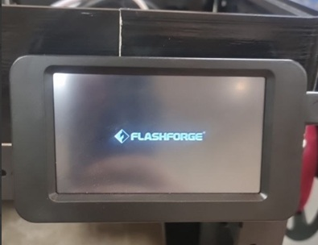
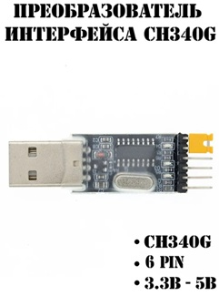

### [Installation](#installieren-des-mods)

### Drucker auf Werkseinstellungen zurücksetzen (erforderlich für die Installation des Mods)

0. [KlipperMod](https://github.com/xblax/flashforge_ad5m_klipper_mod/blob/master/docs/UNINSTALL.md) deinstallieren, wenn er installiert wurde
1. Setzen Sie den Drucker auf die Standardeinstellungen zurück.
2. Formatieren Sie den USB-Stick auf FAT/FAT16/FAT32 (MBR)
3. Legen Sie die Datei aus [Native Firmware](/de/Native_FW/) in das Stammverzeichnis des USB-Sticks

    - [Adventurer5M-3.1.9-2.2.3-20250807-Factory.tgz](https://github.com/ghzserg/FF/releases/download/R/Adventurer5M-3.1.9-2.2.3-20250807-Factory.tgz) für FF5M
    - [Adventurer5MPro-3.1.3-2.2.3-20250107-Factory.tgz](https://github.com/ghzserg/FF/releases/download/R/Adventurer5MPro-3.1.3-2.2.3-20250107-Factory.tgz) für FF5M **Pro**
    - [AD5X-1.1.7-1.1.0-3.0.6-20250912-Factory.tgz](https://github.com/ghzserg/FF/releases/download/R/AD5X-1.1.7-1.1.0-3.0.6-20250912-Factory.tgz) für AD5X
    - [Creator5-1.9.9-1.3.0-20260907.tgz](https://github.com/ghzserg/FF/releases/download/R/Creator5-1.9.9-1.3.0-20260907.tgz) für Creator 5
    - [Creator5Pro-1.9.9-1.3.0-20260907.tgz](https://github.com/ghzserg/FF/releases/download/R/Creator5Pro-1.9.9-1.3.0-20260907.tgz) für Creator 5 Pro

4. Schalten Sie den Drucker aus
5. Stecken Sie den USB-Stick in den Drucker
6. Schalten Sie den Drucker ein
7. Warten Sie, bis die native Firmware installiert ist. _Wenn es zu lange dauert oder gar nicht installiert wird, verwenden Sie einen anderen USB-Stick._
8. WLAN oder LAN einrichten *neuer Biber*
9. Installieren Sie die neuesten Drucker-Updates oder die Firmware 1.1.7 für AD5X bzw. 3.2.3 für [AD5M](https://github.com/ghzserg/FF/releases/download/R/Adventurer5M-3.2.3-2.2.3-20251016-Factory.tgz) / [AD5M Pro](https://github.com/ghzserg/FF/releases/download/R/Adventurer5MPro-3.2.3-2.2.3-20251017-Factory.tgz), wenn der Drucker [nicht vor jedem Druck die Bettmitte messen](/de/FAQ/#vor-jedem-druckvorgang-misst-der-drucker-die-mitte-des-druckbetts) soll.

---

## Installieren des Mods

[Video](https://www.youtube.com/watch?v=2sfb2OtY7wM)

<div class="video-embed">
    <iframe width="560" height="315" src="https://www.youtube.com/embed/2sfb2OtY7wM" title="Install zmod to AD5X / AD5M / AD5M Pro @Belovv_ilya" frameborder="0" allow="accelerometer; autoplay; clipboard-write; encrypted-media; gyroscope; picture-in-picture; web-share" allowfullscreen></iframe>
</div>

1. **[Drucker auf Werkseinstellungen zurücksetzen](/de/Setup/#drucker-auf-werkseinstellungen-zurücksetzen-erforderlich-für-die-installation-des-mods)** - [Achtung AD5X](/de/Setup/#achtung-ad5x)
2. Formatieren Sie den USB-Stick auf FAT/FAT16/FAT32 (MBR)
3. Legen Sie die [Datei](https://github.com/ghzserg/zmod/releases/) im Stammverzeichnis des USB-Sticks ab.

    - für FF5M: Adventurer5M-**zmod**-\*.tgz
    - für FF5MPro: Adventurer5MPro-**zmod**-\*.tgz
    - für *[AD5X](/de/AD5X/)*: AD5X-**zmod**-\*.tgz
    - für Creator 5: Creator5-**zmod**-\*.tgz
    - für Creator 5 Pro: Creator5Pro-**zmod**-\*.tgz

    _Noch besser: Legen Sie alle 5 Dateien auf den USB-Stick — der Drucker wählt selbst die richtige aus._

    > Wichtig: **Entpacken Sie die Dateien nicht!**

4. Schalten Sie den Drucker aus
5. Stecken Sie den USB-Stick in den Drucker
6. Schalten Sie den Drucker ein
7. Warten Sie auf die Installation des Mods

   
   
   
   
   Auf dem AD5X/Creator 5/Creator 5 Pro kann die Installation bis zu **40 Minuten** dauern. _Wenn es zu lange dauert oder gar nicht installiert wird, verwenden Sie einen anderen USB-Stick._

   Wenn Sie das Fenster mit dem grünen Haken verpasst haben und der Drucker automatisch neu gestartet ist, wird der Standardbildschirm geladen; in diesem Fall können Sie direkt zu Schritt 11 gehen.

8. Entfernen Sie den USB-Stick
9. Schalten Sie den Drucker aus
10. Schalten Sie den Drucker ein
11. **IP-Adresse des Druckers im Browser öffnen**
    
    
    
    Wenn sich die Weboberfläche nicht öffnet, hat die native Firmware den Mod deaktiviert. Um ihn zu aktivieren, kopieren Sie folgende Datei auf einen USB-Stick:

    - [AD5X-enable-zmod.tgz](https://github.com/ghzserg/FF/releases/download/R/AD5X-enable-zmod.tgz)
    - [Creator5-enable-zmod.tgz](https://github.com/ghzserg/FF/releases/download/R/Creator5-enable-zmod.tgz)
    - [Creator5Pro-enable-zmod.tgz](https://github.com/ghzserg/FF/releases/download/R/Creator5Pro-enable-zmod.tgz)
     
12. Stellen Sie den Mod auf Ihre Sprache um.
    
    
    
    Oder geben Sie in der Konsole ```LANG LANG=de``` ein.
    
    
    
    Stellen Sie die Zeitzone ein: ```SET_TIMEZONE ZONE=Europe/Berlin``` (Liste der Zonen: `SET_TIMEZONE` ohne Parameter). [Mehr dazu](/de/System/#set_timezone)

13. Konfigurieren Sie den Mod
    
    
    
    Hier sehen Sie die Parameter für Druckstart und -ende sowie die globalen Parameter. Es wird empfohlen, sie zunächst nur zu lesen und nicht zu ändern. Die Bedeutung der einzelnen Einstellungen finden Sie [hier](/de/Global/).

    

    Gehen Sie bis zum letzten Bildschirm und drücken Sie „OK“ oder „Neustart“. Andernfalls erscheint dieses Fenster bei jedem Start.

    

    Wenn Sie dieses Fenster erneut sehen möchten, geben Sie `GLOBAL` in die Konsole ein.

14. Gehen Sie zu `Einstellungen` :arrow_right: `Software Updates`.
15. Klicken Sie auf „Nach Updates suchen“ und warten Sie, bis die Prüfung abgeschlossen ist.
16. Klicken Sie auf **Update** und aktualisieren Sie alle Komponenten.
    

    Wenn viele Fehler angezeigt werden, ist das normal. Plugins sind nicht Teil der Firmware und werden separat heruntergeladen. Klicken Sie auf **Nach Updates suchen**.
    Stellen Sie dann alle Plugins wieder her und aktualisieren Sie sie nacheinander. Der Drucker wird dabei neu gestartet.
    
    

17. Aktivieren Sie das [Empfehlungs-Plugin](https://github.com/ghzserg/recommend/blob/main/Readme.md)
    
    

    Oder geben Sie in der Konsole ```ENABLE_PLUGIN name=recommend``` ein.

    

18. [OrcaSlicer einrichten](/de/Recommendations/#senden-sie-dateien-zum-drucken-über-octoklipper)

    [Fertige Profile](https://github.com/ghzserg/zmod_preprocess/tree/main/profiles/Creator_5)

    Der gesamte Startcode muss durch diesen ersetzt werden:

    ```
    START_PRINT EXTRUDER_TEMP=[nozzle_temperature_initial_layer] BED_TEMP=[bed_temperature_initial_layer_single]
    {single_extruder_multi_material ? "; T0" : "T" + initial_extruder}
    M190 S[bed_temperature_initial_layer_single]
    M104 S[nozzle_temperature_initial_layer] T{single_extruder_multi_material ? 0 : initial_extruder} T{single_extruder_multi_material ? 0 : initial_extruder}
    SET_PRINT_STATS_INFO TOTAL_LAYER=[total_layer_count]
    ```
    
    ```START_PRINT EXTRUDER_TEMP= BED_TEMP=``` **muss in eine Zeile geschrieben werden**

    Den End-G-Code durch diesen ersetzen:

    ```END_PRINT```

    

    G-Code vor dem Schichtwechsel durch diesen ersetzen:

    ```SET_PRINT_STATS_INFO CURRENT_LAYER={layer_num + 1}```

    

    Wechseln Sie auf das Protokoll „Octo/Klipper“:

    - **Host Type**: `Octo/Klipper`
    - **Printer Agent**: `Moonraker`

    Für Creator 5 / Creator 5 Pro / AD5X:

    - **Hostname**: `IP_printer`

    

    Für FF5M / FF5M Pro:

    - **Hostname**: `IP_printer:7125`
    - **Device UI**: `IP_printer` oder `IP_printer:80`

    
    


19. [MD5-Kontrolle aktivieren](/de/Recommendations/#aktivieren-sie-die-md5-kontrolle)

    

20. [Lesen Sie die Empfehlungen](/de/Recommendations/)
21. [FAQ lesen](/de/FAQ/)
22. [Drucker-Kalibrierung](/de/SetupCalibrations/)
23. Lesen Sie die Besonderheiten von [AD5X](/de/AD5X/) und [Creator 5 Pro](/de/C5PRO/)

### Achtung AD5X

[@Khamai](https://t.me/Khamai)

Nach der Installation der nativen Firmware kann es vorkommen, dass der Druckkopf nicht korrekt am Abfallbehälter positioniert ist (der Verschluss des Behälters schließt nicht vollständig, Filament kann auf das Bett extrudiert werden usw.).

[Über das Engineering-Menü der nativen Firmware](/de/AD5X/#abfallbehälter-setup-auf-nativer-ad5x-firmware)

In diesem Fall kalibrieren Sie die Parkposition wie folgt:

1. Laden Sie das Archiv [Set.XY.Offset.zip](https://github.com/ghzserg/FF/releases/download/R/Set.XY.Offset.zip) herunter und entpacken Sie es in das Stammverzeichnis des USB-Sticks
2. Stecken Sie den USB-Stick in den ausgeschalteten Drucker und schalten Sie ihn ein.
3. Auf dem Bildschirm erscheint die Kalibrierungsoberfläche. Drücken Sie Reset.

4. Parken Sie den Druckkopf mit den Steuerpfeilen so am Abfallbehälter, dass er den Verschlusshebel ausreichend betätigt, die Düse hinter dem beweglichen Verschluss liegt und der Verschluss bündig mit der Vorderseite des Behälters abschließt.
5. Sichern Sie das Kalibrierungsergebnis mit der Set-Taste.
6. Entfernen Sie den USB-Stick und starten Sie den Drucker neu.

---

## Aktualisieren Sie den Mod

Wenn die Meldung `Z-Mod über USB aktualisieren` angezeigt wird, müssen Sie die Aktualisierung per USB durchführen, auch wenn sie erst kürzlich erfolgt ist.

**Bei der Aktualisierung per USB bleiben alle Daten erhalten.**

**Einfachste Methode:** Verwenden Sie das Makro [ZFLASH](/de/Zmod/#zflash). Stecken Sie den USB-Stick ein, starten Sie den Drucker neu und führen Sie `ZFLASH` aus. Das Makro führt folgende Schritte aus:

- Suche nach der neuesten Version.

- Herunterladen der neuesten Version für Ihr Druckermodell.

- Überprüfung der Prüfsummen.

- Neustart des Druckers.

- Automatische Installation des Updates (lassen Sie den USB-Stick für zukünftige Updates eingesteckt).

Nach der Installation:

1. Öffnen Sie Fluidd/(Mainsail) :arrow_right: `Einstellungen/(Maschine)` :arrow_right: `Software-Update`.

2. Klicken Sie auf „Nach Updates suchen“ und installieren Sie die neuesten Z-Mod-Updates.


Wenn viele Fehler angezeigt werden, ist das normal.

Plugins sind nicht Teil der Firmware und werden separat heruntergeladen.

Klicken Sie auf **„Nach Updates suchen“** und stellen Sie die Plugins nacheinander wieder her und aktualisieren Sie sie. Der Drucker wird dabei neu gestartet.


**Versionskompatibilität:**

- Die Version des Betriebssystems

!!! info "Hinweis Fluidd"
	(unter `System` :arrow_right: `Distribution`)

!!! info "Hinweis Mainsail"
	(`Maschine` :arrow_right: `Systemauslastung(Host)`)

muss mit den ersten beiden Ziffern der Z-Mod-Version (unter `Einstellungen/Maschine` :arrow_right: `Updates (Manager)` :arrow_right: `Z-Mod`) übereinstimmen.

- **Versionsabweichungen führen zu Instabilität.**

<u>Wenn sie nicht übereinstimmen, wird der Mod **nicht richtig funktionieren**</u>.

Update über USB-Stick:

1. Formatieren Sie den USB-Stick auf FAT/FAT16/FAT32 (MBR)
2. Kopieren Sie die [Datei](https://github.com/ghzserg/zmod/releases/) in den Stammordner des USB-Sticks.

    - für FF5M: Adventurer5M-**zmod**-\*.tgz
    - für FF5MPro: Adventurer5MPro-**zmod**-\*.tgz
    - für AD5X: AD5X-**zmod**-\*.tgz

3. Schalten Sie den Drucker aus
4. Stecken Sie den USB-Stick in den Drucker
5. Schalten Sie den Drucker ein
6. Warten Sie den Neustart des Druckers ab (entfernen Sie den USB-Stick nicht)
7. Warten Sie auf die Installation des Mods
8. Warten Sie, bis der Drucker meldet, dass die Installation erfolgreich abgeschlossen ist
9. Ziehen Sie den USB-Stick heraus
10. Schalten Sie den Drucker aus
11. Schalten Sie den Drucker ein
12. Gehen Sie in Fluidd/Mainsail auf die Registerkarte `Einstellungen/Maschine` :arrow_right: `Updates (Manager)`. Klicken Sie auf **Nach Updates suchen** und installieren Sie die neuesten **Z-Mod**-Updates.

---

## Entfernen – vorübergehendes Deaktivieren des Mods

- [SKIP_ZMOD](/de/Zmod/#skip_zmod) - Makro für einen Neustart ohne Moonraker und Fluidd
- [REMOVE_ZMOD](/de/Zmod/#remove_zmod) - Makro zum Entfernen des Mods

Es wird empfohlen, **den Mod über das Makro `REMOVE_ZMOD`** zu entfernen. Die Entfernung per USB-Stick nur verwenden, wenn das Makro nicht ausgeführt werden kann (_danach kann das Z-Mod-Logo beim Start erhalten bleiben_).

Achtung!

- Wenn Sie Klipper 13 benutzen, führen Sie ```UPDATE_MCU``` aus. So vermeiden Sie, dass MCU und Klipper unterschiedliche Versionen haben.
- Wenn Sie Plugins aktiviert haben, deaktivieren Sie diese zuerst: ```DISABLE_PLUGIN name=g28_tenz```

Mod vollständig entfernen: ```REMOVE_ZMOD FULL=1```

Deinstallation des Mods per USB-Stick:

- Formatieren Sie den USB-Stick auf FAT/FAT16/FAT32 (MBR)
- Kopieren Sie die Datei [flashforge_init.sh](https://github.com/ghzserg/zmod/blob/main/Native_firmware/rem_zmod/flashforge_init.sh) auf einen USB-Stick
- Schalten Sie den Drucker aus
- Stecken Sie den USB-Stick in den Drucker
- Schalten Sie den Drucker ein
- Der Drucker wird 3 Mal neu starten
- Entfernen Sie den USB-Stick und verwenden Sie die Standard-Firmware

---

## Wie aktualisiere ich die Standard-Firmware?

1. Deaktivieren Sie alle aktiven Plugins außer `recommend`, `timelapse` und `notify`:

```DISABLE_PLUGIN name=plugin_name```

2. Wenn Sie **Klipper 13** verwenden, führen Sie ```UPDATE_MCU``` *vor* dem Aktualisieren der Original-Firmware aus. Dadurch werden Versionskonflikte zwischen dem Mikrocontroller und Klipper vermieden.

3. Aktivieren Sie die chinesischen Cloud-Dienste (falls Sie über den nativen Bildschirm aktualisieren möchten):

```SAVE_ZMOD_DATA CHINA_CLOUD=1```

Wenn der native Bildschirm das Update nicht findet:

- Ihre Seriennummer ist noch nicht in der Update-Verteilung enthalten
- [Installieren Sie das native Firmware-Update von einem USB-Stick](/de/Native_FW/)

**Für [AD5X](/de/AD5X/)/Creator 5/Creator 5 Pro ist die [Z-Mod-Aktivierung](/de/Native_FW/) von einem USB-Stick erforderlich – nach dem Aktualisieren der Original-Firmware.**

- [AD5X-enable-zmod.tgz](https://github.com/ghzserg/FF/releases/download/R/AD5X-enable-zmod.tgz)
- [Creator5-enable-zmod.tgz](https://github.com/ghzserg/FF/releases/download/R/Creator5-enable-zmod.tgz)
- [Creator5Pro-enable-zmod.tgz](https://github.com/ghzserg/FF/releases/download/R/Creator5Pro-enable-zmod.tgz)

Wenn Sie jedoch über den nativen Bildschirm und nicht per USB-Stick aktualisieren, führen Sie vor dem Ausschalten des Druckers das Makro ```RESET_PASSWD``` aus.

---

## Boot wiederherstellen

Autoren der Anleitungen: [@darksimpson](https://t.me/darksimpson), [Alexander](https://github.com/DrA1ex), [@Ikaros413](https://t.me/Ikaros413), [@SoloMen88](https://t.me/SoloMen88)

Für alle, deren Drucker beim Einschalten auf dem Startbildschirm hängen bleibt und per LAN-Kabel nicht erreichbar ist.



Versuchen Sie, die Firmware über eine vollständige Firmware-Installation wiederherzustellen:

- [AD5M / AD5M Pro](/de/Native_FW/#installation-der-vollständigen-firmware-auf-dem-ad5m--ad5m-pro)
- [AD5X](/de/Native_FW/#installation-der-vollständigen-firmware-auf-dem-ad5x)

Vorgehensweise:

1. **Schalten Sie den Drucker aus**
2. UART/USB-Konverter vorbereiten (3,3V- oder 5V/3,3V-Jumper erforderlich)

*CH340G Schnittstellenkonverter*


**WARNUNG!** Der Konverter muss mit 3,3 V arbeiten – bei 5 V brennt der Prozessor durch!

3. Öffnen Sie die Rückwand des Druckers.
4. Schließen Sie sich an die UART-Pins auf der Platine an (RX, TX, GND; **3.3V nicht anschließen**).


Sie MÜSSEN den Jumper (wenn Sie einen haben) von 5V auf 3,3V umstecken. **WARNUNG:** Bei 5 V müssen Sie die Hauptplatine austauschen!

5. Schließen Sie den Konverter über Kreuz an:

- Konverter RX → Drucker TX

- Konverter TX → Drucker RX

- Konverter GND → Drucker GND


6. Im System sollte ein neuer COM-Port erscheinen.


7. Starten Sie das Programm [PuTTY](https://www.chiark.greenend.org.uk/~sgtatham/putty/latest.html): 

- **Verbindungstyp**: Seriell

- **Geschwindigkeit**: 115200

- **COM-Port**: (z. B. COM6)

8. Schalten Sie den Drucker ein.

9. Wenn die Meldung „Beliebige Taste drücken, um den automatischen Start zu stoppen“ erscheint, drücken Sie **Enter**.

10. Führen Sie in U-Boot Folgendes aus:

```
setenv init /bin/sh
boot

```

11. Nach dem Start von Linux das Dateisystem als beschreibbar einhängen:

```
mount -t proc proc /proc
mount -o remount,rw /

```

12. Reparieren Sie, was kaputt ist, z. B. ein fehlerhaftes Skript oder das Kamera-Skript löschen, wenn der Start wegen der Kamera scheitert:

```
rm -f /etc/init.d/S01bad_script
rm -f /usr/data/zmod/zmod/.shell/S98camera

```

13. Änderungen speichern und neu starten:

```
sync
reboot

```

---

## Unterstützung der Entwicklung

[SBP, Bankkarte, T-Pay](https://pay.cloudtips.ru/p/3cbf9e9f)


BTC `17wXTd9BqYp1K3zCLTxVyGLEXUDjf7XNLL`

<a href="https://boosty.to/ghzserg">Unterstützung über Boosty (internationale Visa/Mastercard)</a>


