# VFA beim Creator 5 Pro: Standardalgorithmus im Vergleich zum Algorithmus aus OpenCreator

*Untersuchung von Z-Mod, 26. November 2026.*

## Was bedeutet das für den Druckalltag?

**Eine VFA-Kalibrierung ist sinnvoll; den alternativen Algorithmus aus OpenCreator benötigen die meisten Anwender nicht.** VFA-Kompensation hilft, feine vertikale Streifen auf gedruckten Wänden zu reduzieren, die durch Motor- und mechanische Schwingungen entstehen. Auf glatten Oberflächen fallen sie besonders auf.

- Bei regelmäßigen feinen Streifen die Standardkalibrierung mit `CALIBRATE_VFA T=0 ALTERNATIVE=0` ausführen. Auf unserem C5 Pro dauerte sie etwa 21 Minuten. Sie muss nicht vor jedem Druck wiederholt werden: Die gespeicherte Kompensation wird automatisch angewendet. Nach Änderungen an der Riemenspannung oder Mechanik sowie bei erneut auftretenden Streifen erneut kalibrieren.
- In OrcaSlicer können die gewohnten Geschwindigkeiten und Beschleunigungen beibehalten werden. VFA erhöht die zulässigen Geschwindigkeiten nicht, verändert das Slicerprofil nicht und ersetzt Input Shaper nicht. Bleiben Streifen bei einer bestimmten Geschwindigkeit sichtbar, die Geschwindigkeit der Außenwand verändern und identische Testteile vergleichen. Die tatsächliche Geschwindigkeit in der OrcaSlicer-Vorschau prüfen; sie kann vom eingestellten Wert abweichen.
- Den Algorithmus aus OpenCreator ausprobieren, wenn das Standardergebnis nicht zufriedenstellt und ein Vergleich möglich ist. Auf unserem Drucker war der Algorithmus aus OpenCreator im Mittel bei 60–220 mm/s besser, der Standardalgorithmus bei 20–50 mm/s. Angesichts der Streuung der Messungen ist der Unterschied nicht überzeugend genug; zudem dauerte die alternative Kalibrierung etwa 80 Minuten.

**Fazit:** Ohne konkreten Grund für Experimente beim Standardalgorithmus bleiben. Mit der Standardkompensation sank der Gesamtmedian der Schwingungsamplitude bei Motor X um etwa 81 % und bei Y um 66 %. Das sind Beschleunigungssensormessungen, kein Versprechen, dass die Streifen auf einem Druckteil im gleichen Verhältnis abnehmen.

## Ergebnis der Untersuchung

Auf einem Flashforge Creator 5 Pro wurden die korrigierte Standardkalibrierung von Flashforge und der angepasste Algorithmus aus OpenCreator getestet. Beide reduzierten Schwingungen deutlich. Der Algorithmus aus OpenCreator lieferte bei mittleren und hohen Geschwindigkeiten etwas bessere Ergebnisse, jedoch keinen überzeugenden Vorteil über die beobachtete Streuung wiederholter Messungen hinaus. Bei niedrigen Geschwindigkeiten war der Median der Restbewegung mit der Standardkompensation kleiner.

Die Standardkalibrierung dauerte etwa 21 Minuten, die alternative etwa 80 Minuten. **Z-Mod behält deshalb den Standardalgorithmus als Voreinstellung bei.** Der Algorithmus aus OpenCreator steht optional zur Verfügung.

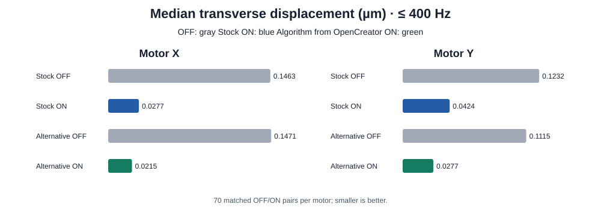

Die Untersuchung betrifft einen Drucker, nicht die gesamte Creator-5-Serie. Gemessen wird die Bewegung des Beschleunigungssensors, nicht die Oberflächenrauheit eines Druckteils.

## 1. Was ist VFA und was misst Z-Mod?

VFA (Vertical Fine Artifacts) sind feine, sich wiederholende vertikale Streifen auf gedruckten Wänden. Zu ihren Ursachen gehören periodische Störungen durch Motoren, Riemen und Druckermechanik. Beim Creator 5 erfolgt die Motorkompensation über `mclib`: Für jede der Harmonischen TD1, TD2 und TD4 wird eine Amplitude und je eine Phase pro Drehrichtung eingestellt. Das ist eine separate Einstellung, unabhängig von Input Shaper.

Der Testdrucker verwendet CoreXY, `rotation_distance=40.4` mm und eine Bewegung entlang einer 45°-Diagonalen. Ein Motor dreht sich, während der andere im Idealfall stillsteht. Die Frequenzumrechnung in Klipper lautet:

`f(TD) = 50 × sqrt(2) × v × TD / 40.4 ≈ 1.750264 × v × TD`,

wobei v die Geschwindigkeit des Druckkopfs in mm/s und f die Frequenz der Harmonischen in Hz ist. Der Faktor hängt von Kinematik und Motorparametern ab und ist nicht universell.

Die Standardfrequenz von 200 Hz entspricht beispielsweise drei unterschiedlichen Geschwindigkeiten:

| Harmonische | Druckkopfgeschwindigkeit, mm/s |
|---|---:|
| TD1 | 114,27 |
| TD2 | 57,13 |
| TD4 | 28,57 |

**Frequenz in Hz und Geschwindigkeit in mm/s sind unterschiedliche Größen.** Der LIS2DW hat eine nominale Abtastrate von 1600 Hz. Sein Filter kann die gemessenen Amplituden bei höheren Frequenzen dämpfen. Daher ist die Hauptauswertung auf 400 Hz begrenzt. Der unabhängige Test behält gültige CSV-Daten bis 720 Hz bei (höchstens 45 % der tatsächlichen Abtastrate), die Diagramme enden bei 400 Hz. Das ist eine konservative Vergleichsgrenze und bedeutet nicht, dass der Sensor bei 401 Hz nichts mehr misst.

Auf diesem Drucker entsprechen 400 Hz etwa 228,5 mm/s für TD1, 114,3 für TD2 und 57,1 für TD4. `MAX_SPEED=400` bedeutet also nicht, dass alle drei Harmonischen bei 400 mm/s zuverlässig gemessen werden.

Die Beschleunigung wird in eine geschätzte Auslenkung des Sensors umgerechnet. Für die Frequenz f und die Beschleunigungsamplitude A gilt:

`d [µm] = 1000 × A [mm/s²] / (2πf)²`.

Damit lassen sich Restschwingungen als Auslenkung vergleichen, statt Beschleunigungen unterschiedlicher Frequenzen zu vermischen. Hauptmessgröße ist die Komponente quer zur Druckkopfbewegung; zusätzlich werden Längskomponente und gesamte XY-Auslenkung dargestellt.

## 2. Unabhängiger Test VFA_GRAPH

Vor dem Vergleich der Kalibrierungsalgorithmen wurde ein separates Messwerkzeug implementiert. Die Kalibrierung sucht Koeffizienten auf den werkseitigen Bewegungsbahnen; `VFA_GRAPH` bewertet die resultierende Kompensation unabhängig in der Mitte des Arbeitsbereichs.

```gcode
VFA_GRAPH T=0 MAX_SPEED=400 SHAPER=0
```

Für die Untersuchung wurden T0, beide Motoren und Richtungen, 20–400 mm/s in Schritten von 10 mm/s, 5000 mm/s² Beschleunigung, adaptive Messstreckenlänge und eine Wiederholung pro Kombination verwendet. Input Shaper war deaktiviert. Die Metadaten der Tests um 13:10 und 22:21 stimmen bis auf die Kompensationskoeffizienten überein. Zwischen den Durchläufen kommt die Bewegung vollständig zum Stillstand; die Reihenfolge OFF/ON wechselt, um Reihenfolgeeffekte zu verringern.

Die adaptive Länge zielt auf 0,6 Sekunden nutzbare Messung und mindestens 20 TD1-Perioden, soweit die Strecke dies erlaubt. Nur die Bewegung bei konstanter Geschwindigkeit wird ausgewertet. Eine gemeinsame Sinusanpassung bei bekannten Frequenzen trennt die Harmonischen vom konstanten Anteil und linearen Trend. Unvollständige, beschädigte oder zu kurze Messungen werden verworfen. Beschleunigungsgrenzen und Shaper-Zustand werden anschließend wiederhergestellt. Der Test führt kein SAVE_CONFIG aus.

Verglichen werden `before` (Kompensation aus) und `after` (gespeicherte Koeffizienten). Jeder Punkt ist durch Geschwindigkeit, Richtung, Harmonische, Frequenz und Wiederholung bestimmt. Bei einer Wiederholung ergeben sich bis 400 Hz pro Motor 70 gültige Paare: TD1 — 42, TD2 — 20, TD4 — 8. Höhere Frequenzen bleiben zur Information erhalten, fließen aber nicht in die Hauptschlussfolgerung ein.

Zwei unterschiedliche Kennzahlen werden verwendet:

- **Abnahme des Gesamtmedians:** `1 − median(after)/median(before)` innerhalb eines Durchlaufs. Für den Algorithmenvergleich werden stattdessen die beiden Mediane der Restwerte verwendet.
- **Median der paarweisen Verhältnisse:** `median(after_alternative / after_stock)` für übereinstimmende Messpunkte. Ein Verhältnis unter eins bedeutet eine Verbesserung. Das ist die wichtigste Kennzahl zwischen den Algorithmen, ergänzt durch die Zahl besserer Messpunkte und die Wiederholbarkeit.

Ein niedrigerer Gesamtmedian bedeutet nicht dieselbe Verbesserung an jedem Messpunkt. Unterschiedliche Amplitudenverteilungen können einen niedrigeren Median ergeben, obwohl beide Algorithmen ähnlich viele Punkte gewinnen.

Für einen robusteren Vergleich kann `REPEAT=3` verwendet werden; die Diagramme zeigen Mediane gültiger Paare. Die Untersuchung selbst verwendete `REPEAT=1` pro Durchlauf; die Wiederholbarkeit wurde separat untersucht.

## 3. Korrektur der Standardkalibrierung und Wiederholbarkeit

Vor Änderungen am Suchalgorithmus wurde der Messteil der Flashforge-Kalibrierung korrigiert: Verwendung des gesamten Abschnitts mit konstanter Geschwindigkeit statt eines kurzen Fensters, Prüfung der Messdauer und Datenintegrität, Maschinenkoordinaten, Wiederherstellung der Grenzwerte und Shaper sowie Auswertung beider Richtungen. Die werkseitige Amplituden- und Phasensuche blieb erhalten.

Die Suche arbeitet mit einer konfigurierten Frequenz (gewöhnlich 200 Hz): zunächst unkompensierte Amplitude, Phasenprüfung an vier Punkten, Phasenverfeinerung, Amplitudensuche und abschließende Validierung. Die gemeinsame Amplitude ist das Maximum der beiden individuellen Amplituden und wird bei Bedarf zusätzlich geprüft. Das Ergebnis wird verworfen, wenn eine Richtung gegenüber OFF um mehr als 20 % schlechter wird oder keine der beiden Richtungen eine Verbesserung zeigt.

Unabhängige Messungen bis 400 Hz:

| Testzeit | Shaper | X, OFF → ON, µm | Y, OFF → ON, µm |
|---|---|---:|---:|
| 09:41 | Ursprünglicher Zustand | 0,13719 → 0,02563 | 0,12050 → 0,03408 |
| 11:07 | Deaktiviert | 0,14597 → 0,02851 | 0,12091 → 0,03757 |
| 11:31 | Deaktiviert | 0,14468 → 0,02602 | 0,11562 → 0,04397 |
| 11:48 | Ursprünglicher Zustand | 0,12842 → 0,02848 | 0,11090 → 0,04176 |
| 13:10 | Deaktiviert; neue Standardkalibrierung | 0,14635 → 0,02773 | 0,12319 → 0,04242 |

Die Koeffizienten blieben bis 11:48 unverändert. Um 11:07 und 11:31 wurde mit identischer Kompensation und deaktivierten Shapern gemessen. Der Median der symmetrischen relativen Abweichung der Restamplituden, `|a−b| / ((a+b)/2)`, betrug **25,8 % für X und 26,4 % für Y**. Das ist beobachtete Wiederholstreuung, keine spezifizierte Sensorgenauigkeit, kein Konfidenzintervall und kein formaler Signifikanztest. Bei sehr kleinen Restwerten wachsen relative Abweichungen naturgemäß.

Die korrigierte Standardkalibrierung lief von 12:46:17 bis 13:07:38, also 21 min 21 s bis SAVE_CONFIG. Das Protokoll enthält 115 Messungen der X- und 130 der Y-Kalibrierung. Der unabhängige Test um 13:10 ergab nach dem Speichern eine Abnahme des Gesamtmedians um 81,1 % bei X und 65,6 % bei Y, mit Verbesserungen an 64 bzw. 63 von 70 Punkten. Gegenüber der früheren Standardkompensation wurde keine grundlegende Verbesserung nachgewiesen, aber Messung und Speicherung wurden kontrollierbar.

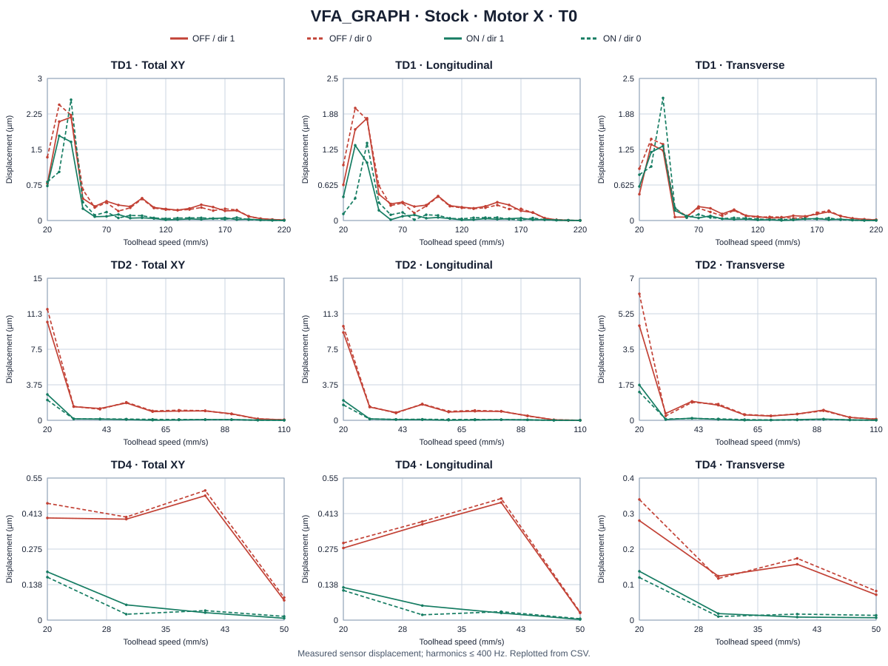

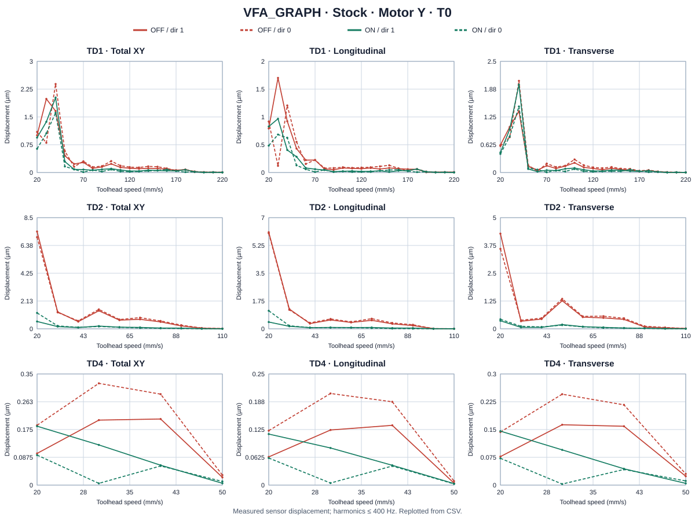

Der frühe Test um 04:16 betraf nur X und verwendete eine andere Methode bzw. einen anderen Bereich; er wurde vom direkten Vergleich ausgeschlossen. Die ursprünglichen CSV-Dateien der Standardsuche lagen nicht vor; die Suchergebnisse wurden aus den Konsolenwerten mit deren ausgegebener Genauigkeit rekonstruiert. Für den unabhängigen Vergleich wurden die ursprünglichen VFA_GRAPH-CSV-Dateien verwendet.

## 4. Was ändert der Algorithmus aus OpenCreator?

Der angepasste Algorithmus nutzt Ideen aus [OpenCreator / Kalico](https://github.com/FlashForge-C5-Modding-Group/kalico/blob/7da732e09d4e213b7766482b6cfdf7e75ee9e191/klippy/extras/stepper_resonance_tester.py), behält jedoch Messcode und Grenzen von Z-Mod bei. Es handelt sich nicht um eine Portierung der gesamten Kalico-Firmware.

Statt bei festen 200 Hz zu kalibrieren, werden Resonanzen zwischen 20 und 300 mm/s gesucht (innerhalb der Geschwindigkeitsgrenze), mit geometrischen Schritten bis 8 % und Verfeinerung von bis zu drei TD2-Spitzen. Bis zu zwei starke erreichbare Frequenzen werden gewählt; ist keine geeignet, wird die konfigurierte Frequenz verwendet. Für jeden Kandidaten werden TD1/TD2/TD4 in beiden Richtungen kalibriert.

Die gemeinsame Amplitude minimiert die Summe der beiden Parabeln der Restbeschleunigung, statt das Maximum der individuellen Amplituden zu verwenden. Eine Verringerung der kombinierten RMS-Amplitude um mindestens 5 % ist erforderlich. Bei zwei Kandidaten wird jeder mit denselben Geschwindigkeiten und Harmonischen geprüft. Die kleinere Summe der quadrierten Restwerte an gemeinsamen gültigen Punkten gewinnt. Diese interne Bewertung ist nicht die unabhängige VFA_GRAPH-Bewertung: Messgröße, Bewegungsbahnen und Frequenzbereich unterscheiden sich.

### Erster X-Versuch

Der erste Versuch fand 270,1 und 82,8 Hz. Die vollständig bestimmten X-Koeffizienten des ersten Kandidaten (270,1 Hz) wurden um 14:20 mit VFA_GRAPH unabhängig bewertet. Dies prüft einen Kandidaten an einem Motor, nicht den vollständigen alternativen Algorithmus.

| Frequenzbereich | Punkte | Algorithmus aus OpenCreator besser | Standard besser | Median Restwertverhältnis: Algorithmus aus OpenCreator / Standard |
|---|---:|---:|---:|---:|
| Bis 400 Hz | 70 | 34 | 36 | 1,012 |
| Über 400 Hz | 64 | 46 | 18 | 0,792 |
| Alle gültigen bis 720 Hz | 134 | 80 | 54 | 0,820 |

Bis 400 Hz sank der Gesamtmedian des Restwerts von 0,027725 auf 0,022088 µm (−20,3 %), aber der Median der paarweisen Verhältnisse lag nahe eins. Der größte Teil des Vorteils bei der Punktzahl stammte aus dem Bereich verminderter Sensorempfindlichkeit. In dieser Phase galten die Algorithmen als vergleichbar.

## 5. Vollständige alternative Kalibrierung

Die alternative Kalibrierung lief für beide Motoren von 20:53:51 bis 22:14:05. Die Zeit vor der Diagrammerstellung betrug 80 min 14 s, etwa das 3,8-Fache des Standarddurchlaufs (gemessen bis SAVE_CONFIG). Andere Drucker oder ein einzelner Kandidat können andere Zeiten ergeben.

| Motor | Hohe Frequenz | Niedrige Frequenz | Bewertung hoch | Bewertung niedrig | Gewählt |
|---|---:|---:|---:|---:|---:|
| X | 269,812 Hz | 86,237 Hz | 3 315 023 | 5 921 932 | 269,812 Hz |
| Y | 243,352 Hz | 80,899 Hz | 2 301 420 | 10 878 684 | 243,352 Hz |

Die Bewertungen sind Summen quadrierter Restamplituden nach dem internen Kriterium des Algorithmus, auf ganze Zahlen gerundet. Sie sind weder Mikrometer noch Prozentwerte der Druckqualitätsverbesserung.

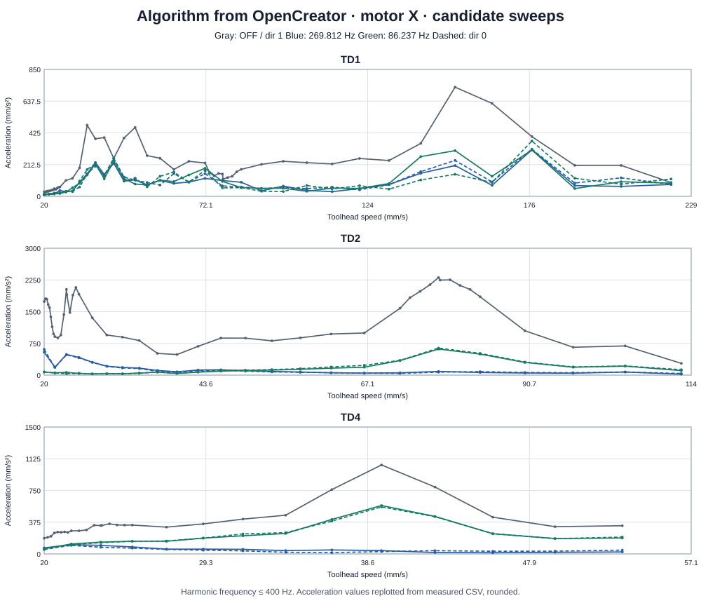

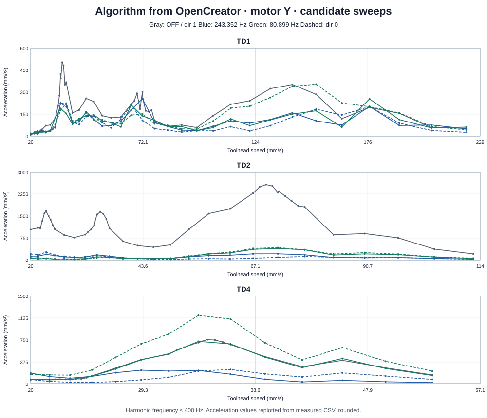

Die Auswahl wurde zusätzlich an übereinstimmenden Kontrollmesspunkten bis 400 Hz geprüft, mit Umrechnung von Geschwindigkeit und Harmonischer in Frequenz. Von 142 Punkten gewinnt der hohe Kandidat bei X 83 gegenüber 59 und bei Y 92 gegenüber 50. Die Mediane der Restwertverhältnisse hoch/niedrig betrugen 0,915 (−8,5 %) und 0,764 (−23,6 %). Das stützt die Auswahl der höheren Frequenz, nicht eine Überlegenheit gegenüber dem Standardalgorithmus.

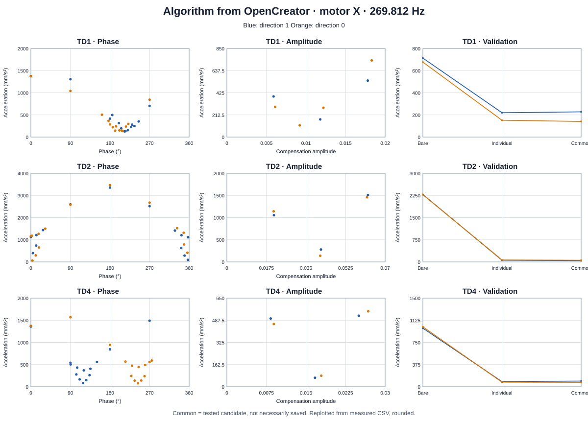

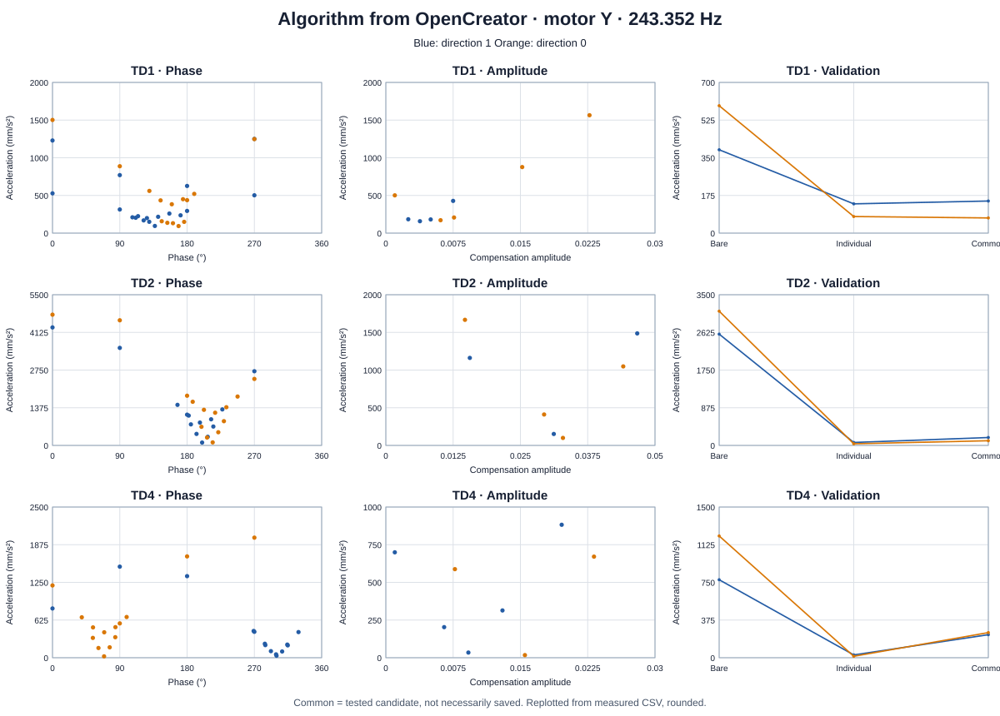

Common bezeichnet den gemessenen Kandidaten der gemeinsamen Amplitude, nicht zwingend den gespeicherten Wert; die angewendeten Werte stehen in calibration.json. Amplitude und zwei Phasen werden in der Konfiguration gespeichert, die gewählten Frequenzen dienen der Diagnose. Die konfigurierte Standardfrequenz bleibt 200 Hz.

### Endgültige Koeffizienten

| Motor / Harmonische | Standard AMP | Standard PHASE1 / PHASE2, rad | AMP (Algorithmus aus OpenCreator) | PHASE1 / PHASE2 (Algorithmus aus OpenCreator), rad |
|---|---:|---:|---:|---:|
| X / TD1 | 0,010 | 3,730 / 3,517 | 0,010 | 3,762 / 3,539 |
| X / TD2 | 0,036 | 6,119 / 0,172 | 0,038 | 6,211 / 0,086 |
| X / TD4 | 0,016 | 2,102 / 4,219 | 0,017 | 2,077 / 4,254 |
| Y / TD1 | 0,005 | 2,721 / 2,191 | 0,005 | 2,854 / 2,389 |
| Y / TD2 | 0,032 | 3,662 / 3,579 | 0,032 | 3,705 / 3,508 |
| Y / TD4 | 0,013 | 1,112 / 5,372 | 0,012 | 1,199 / 5,233 |

Die Koeffizienten liegen nahe beieinander, Amplituden und Phasen sind jedoch nicht identisch. Calibration.json speichert ganzzahlige MCU-Einheiten mit Faktor 1000. Die Tabelle nicht auf andere Drucker übertragen: Sie gilt nur für das getestete Gerät und dessen mechanischen Zustand.

## 6. Unabhängiger Vergleich des Standardalgorithmus und des Algorithmus aus OpenCreator

Verglichen werden VFA_GRAPH um 13:10 (Standard) und um 22:21 (Algorithmus aus OpenCreator). Nach dem Speichern der Konfiguration enthalten die Metadaten von 22:21 exakt die Koeffizienten aus calibration.json der erfolgreichen alternativen Kalibrierung. Die Messbedingungen einschließlich der Bewegungsbahnen stimmen überein. Nur gültige übereinstimmende Punkte werden verglichen.

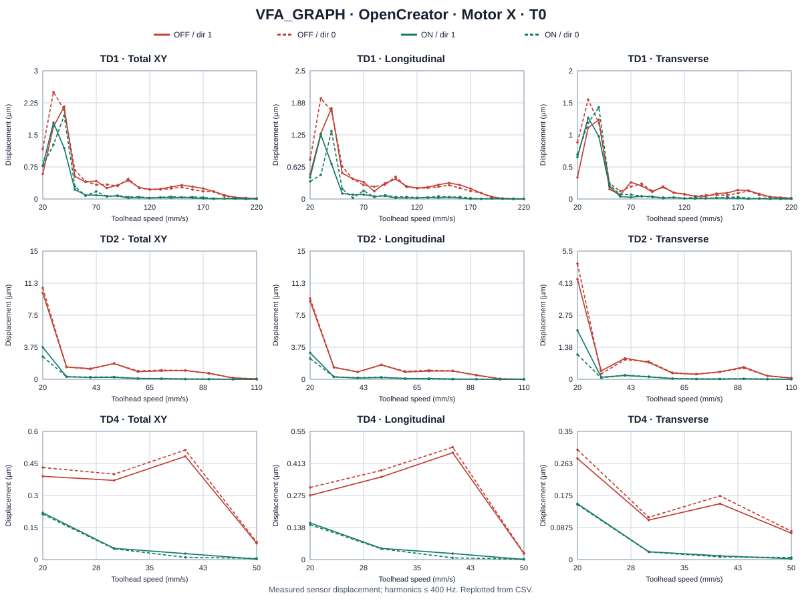

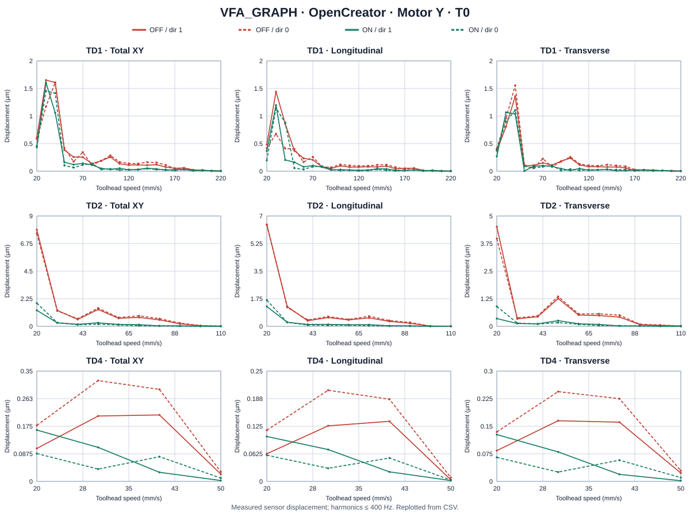

### Bis 400 Hz

| Kennzahl | X Standard | X, Algorithmus aus OpenCreator | Y Standard | Y, Algorithmus aus OpenCreator |
|---|---:|---:|---:|---:|
| OFF-Median, µm | 0,146346 | 0,147090 | 0,123195 | 0,111504 |
| ON-Median, µm | 0,027725 | 0,021465 | 0,042425 | 0,027663 |
| Abnahme innerhalb des Durchlaufs | 81,1 % | 85,4 % | 65,6 % | 75,2 % |
| Verbesserte Punkte gegenüber OFF (von 70) | 64 | 66 | 63 | 62 |

| Direkter Restwertvergleich | X | Y |
|---|---:|---:|
| Algorithmus aus OpenCreator besser | 41/70 | 46/70 |
| Standard besser | 29/70 | 24/70 |
| Abnahme des Gesamtmedians mit dem Algorithmus aus OpenCreator | 22,6 % | 34,8 % |
| Median Restwertverhältnis: Algorithmus aus OpenCreator / Standard | 0,852 | 0,874 |
| Median der paarweisen Abnahme | **14,8 %** | **12,6 %** |

Der Algorithmus aus OpenCreator gewinnt mehr Punkte, aber die paarweise Verbesserung ist kleiner als die beobachtete Wiederholstreuung (etwa 26 %). Auch die OFF-Messungen unterscheiden sich, besonders bei Y. Eine Abnahme des Y-Gesamtmedians um 34,8 % ist daher für sich genommen kein Nachweis eines solchen Gewinns an jedem Punkt oder am fertigen Druckteil.

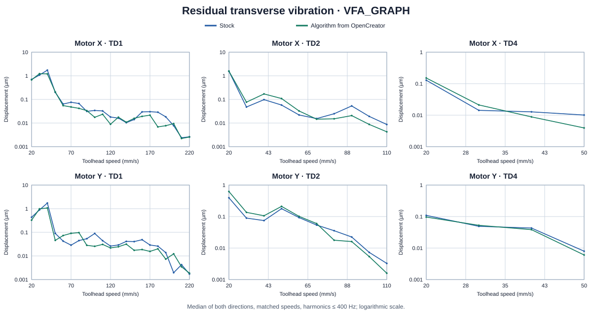

Das Diagramm zeigt den Median beider Richtungen bei jeder Geschwindigkeit und Harmonischen. Eine logarithmische Skala macht kleine Restwerte sichtbar, ohne die Werte zu verändern. Die Auslenkungstabellen in Abschnitt 8 ermöglichen eine Prüfung der einzelnen Richtungen.

### Bei welchen Geschwindigkeiten ist welcher Algorithmus besser?

| Geschwindigkeit, mm/s | Punkte pro Motor | Änderung X-Median | Änderung Y-Median |
|---|---:|---:|---:|
| 20–50 | 24 | +41,6 % | +17,9 % |
| 60–110 | 24 | −30,8 % | −7,0 % |
| 120–220 | 22 | −28,9 % | −43,4 % |

Positiv bedeutet einen größeren Restwert mit dem Algorithmus aus OpenCreator, negativ einen kleineren. Alle Gruppen enthalten nur Frequenzen bis 400 Hz. Mit zunehmender Geschwindigkeit verringert sich die Zahl der Harmonischen: In der letzten Gruppe bleibt nur TD1. Das sind aggregierte Vergleiche, kein Gewinn bei jeder Geschwindigkeit. In diesem Geschwindigkeitsraster bleiben oberhalb von 220 mm/s keine gültigen Punkte bis 400 Hz.

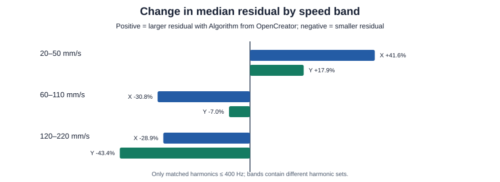

Der Vollständigkeit halber: Oberhalb von 400 Hz gewinnt der Algorithmus aus OpenCreator bei X 52/64 Punkte und bei Y 35/64. Über den gesamten verfügbaren Bereich wären es 93/134 und 81/134. Dabei würden jedoch Messungen mit unterschiedlicher Sensorempfindlichkeit vermischt. Dieser Bereich wird nicht zur Wahl der Voreinstellung herangezogen.

## 7. Praktisches Fazit und Nutzung von Z-Mod

Beide Algorithmen funktionieren. Der korrigierte Standardalgorithmus bietet eine kürzere Kalibrierung, gute Unterdrückung bei niedrigen Geschwindigkeiten und ähnliche endgültige Koeffizienten. Der Algorithmus aus OpenCreator ergänzt eine adaptive Frequenzsuche und einige Vorteile bei mittleren und hohen Geschwindigkeiten. Bei diesem Gerät ist der Vorteil nicht überzeugend genug, um die Voreinstellung zu ändern.

**Für die meisten Anwender empfehlen wir die Standardkalibrierung.** Druckplatte freiräumen, Mechanik und Riemenspannung prüfen und nicht während eines Drucks oder einer Pause kalibrieren. Eine aktuelle Z-Mod-Version mit VFA-Unterstützung verwenden. Standardkalibrierung:

```gcode
CALIBRATE_VFA T=0 ALTERNATIVE=0
```

Für Experimente mit der Alternative:

```gcode
CALIBRATE_VFA T=0 ALTERNATIVE=1
```

Beide Varianten des Makros `CALIBRATE_VFA` führen nach erfolgreicher Kalibrierung und Diagrammerstellung automatisch `SAVE_CONFIG` aus. Anschließend startet Klipper neu. Manuelles Speichern ist nicht erforderlich. Ohne `ALTERNATIVE` gilt die Einstellung aus `[stepper_resonance_tester]` (Standard: `alternative: False`). Mit `ALTERNATIVE=0` wird der Standardalgorithmus ausdrücklich ausgewählt.

Unabhängige Prüfung nach dem Speichern:

```gcode
VFA_GRAPH T=0 MAX_SPEED=400 SHAPER=0 REPEAT=3
```

Diagramme und CSV-Dateien liegen in `mod_data/vfa/`. Die Diagnose verwendet ein Verzeichnis mit Minutenauflösung, die Kalibrierung eines mit Sekundenauflösung und Suffix `_setvfa`. Kalibrierungs-CSV, calibration.json, Suchdiagramme und alternative Kontrollmessungen sind von den unabhängigen VFA_GRAPH-Diagrammen getrennt. Die PNG-Erstellung läuft nach Rückgabe des Werkzeugs im chroot ohne zusätzliche Bewegung.

Weitere Untersuchungen könnten unabhängige Durchläufe in zufälliger Reihenfolge mit REPEAT=3 wiederholen, mehrere C5/C5 Pro testen und reale Druckproben bei identischem Material und Einstellungen vergleichen. Es bringt wenig, Koeffizienten auf kleine relative Änderungen hin zu optimieren, die nicht über die Wiederholbarkeit des Tests hinausgehen.

## 8. Daten zur Überprüfung

Auslenkungstabellen bis 400 Hz je Richtung und Modus, einschließlich Quer-, Längs- und Gesamtauslenkung:

- Standard um 13:10: [X CSV](../assets/vfa/stock-1310-x.csv), [Y CSV](../assets/vfa/stock-1310-y.csv).
- Algorithmus aus OpenCreator um 22:21: [X CSV](../assets/vfa/alternative-2221-x.csv), [Y CSV](../assets/vfa/alternative-2221-y.csv).

Dies sind abgeleitete Auslenkungstabellen in µm, für die Website-Diagramme gerundet, keine ursprünglichen Beschleunigungssensor-Amplituden-CSV. Die Zahlen im Artikel wurden aus den Originalmessungen berechnet, daher können sich letzte Stellen unterscheiden. Die Diagramme der Website wurden aus gespeicherten Messungen als SVG neu erstellt. Vollständige Zeitreihen des Beschleunigungssensors liegen nicht vor. Für den Hauptvergleich Zeilen nach Geschwindigkeit, Richtung und Harmonischer zuordnen und nur `mode=after` zum Algorithmenvergleich verwenden.

### Änderungen in Z-Mod und Quellcode

| PR | Änderung |
|---|---|
| [#14](https://github.com/ghzserg/zmod_klipper_c5/pull/14) | Unabhängiges VFA_GRAPH |
| [#16](https://github.com/ghzserg/zmod_klipper_c5/pull/16) | Input-Shaper-Steuerung während der Messungen |
| [#17](https://github.com/ghzserg/zmod_klipper_c5/pull/17), [#18](https://github.com/ghzserg/zmod_klipper_c5/pull/18) | Korrektur von Standardmessung und Speicherung |
| [#19](https://github.com/ghzserg/zmod_klipper_c5/pull/19) | Alternative Kalibrierung |
| [#20](https://github.com/ghzserg/zmod_klipper_c5/pull/20) | Kalibrierungsdiagramme |
| [#22](https://github.com/ghzserg/zmod_klipper_c5/pull/22) | Standardalgorithmus wieder als Voreinstellung |
