# VFA on Creator 5 Pro: stock algorithm versus the algorithm from OpenCreator

*Z-Mod study, 26 November 2026.*

## What does this mean for everyday printing?

**VFA calibration is worth using, but most users do not need the alternative algorithm from OpenCreator.** VFA helps reduce fine vertical stripes on printed walls caused by motor and mechanical vibrations. They are especially noticeable on smooth surfaces.

- If you see regular fine stripes, run the stock calibration with `CALIBRATE_VFA T=0 ALTERNATIVE=0`. On our C5 Pro it took about 21 minutes. There is no need to repeat it before every print: saved compensation is applied automatically. Recalibrate if you change belt tension or the mechanics, or if stripes reappear.
- Keep your usual speeds and accelerations in OrcaSlicer. VFA does not increase permitted speeds, alter slicer profiles or replace Input Shaper. If stripes remain at a particular speed, try changing the outer-wall speed and compare identical test prints. Check the actual speed in the OrcaSlicer preview; it may differ from the configured value.
- Try the algorithm from OpenCreator if the stock result is unsatisfactory and you can compare the results. On our printer it performed better on average at 60–220 mm/s, while stock performed better at 20–50 mm/s. Given measurement variability, the difference is not convincing enough, and alternative calibration took about 80 minutes.

**Bottom line:** keep the stock algorithm unless you have a specific reason to experiment. With stock compensation, the overall median vibration amplitude fell by about 81% for motor X and 66% for Y. These are accelerometer measurements, not a promise of an equal percentage reduction in stripes on printed parts.

## Study result

We tested the corrected Flashforge stock VFA calibration and the adapted algorithm from OpenCreator on one Flashforge Creator 5 Pro. Both substantially reduced vibration. The algorithm from OpenCreator produced slightly better results at medium and high speeds, but did not establish an advantage beyond the observed variation of repeated measurements. At low speeds stock compensation gave a lower median residual displacement.

Stock calibration took about 21 minutes; the alternative took about 80 minutes. **Z-Mod therefore retains stock as its default algorithm**, with the algorithm from OpenCreator available as an option.

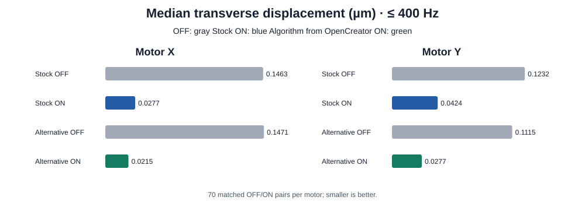

This is a study of one printer, not a statistical survey of the Creator 5 series. It measures accelerometer motion, not the surface roughness of a printed part.

## 1. What VFA is and what Z-Mod measures

VFA (Vertical Fine Artifacts) are fine repeating vertical stripes on printed walls. Their causes include periodic disturbances from motors, belts and printer mechanics. Creator 5 provides motor compensation via `mclib`: one amplitude and two phases, one for each rotation direction, for each of the TD1, TD2 and TD4 harmonics. This setting is separate from Input Shaper.

The test printer uses CoreXY, `rotation_distance=40.4` mm and motion along a 45° diagonal. One motor rotates while the other is ideally stationary. The frequency conversion used in Klipper is:

`f(TD) = 50 × sqrt(2) × v × TD / 40.4 ≈ 1.750264 × v × TD`,

where v is toolhead speed in mm/s and f is harmonic frequency in Hz. The factor depends on kinematics and motor parameters; it is not universal.

For example, the stock frequency of 200 Hz corresponds to three different speeds:

| Harmonic | Toolhead speed, mm/s |
|---|---:|
| TD1 | 114.27 |
| TD2 | 57.13 |
| TD4 | 28.57 |

**Frequency in Hz and speed in mm/s are different quantities.** The LIS2DW has a nominal sample rate of 1600 Hz. Its filter may attenuate measured amplitudes at higher frequencies, so our primary analysis is limited to 400 Hz. The independent test retains valid CSV data up to 720 Hz (no more than 45% of the actual sample rate), while graphs stop at 400 Hz. This is a conservative comparison limit, not a claim that the sensor stops measuring at 401 Hz.

On this printer the 400 Hz limit corresponds to about 228.5 mm/s for TD1, 114.3 for TD2 and 57.1 for TD4. Thus `MAX_SPEED=400` does not mean all three harmonics are reliably measured at 400 mm/s.

We convert acceleration to estimated sensor displacement. For harmonic frequency f and acceleration amplitude A:

`d [µm] = 1000 × A [mm/s²] / (2πf)²`.

This compares residual vibration in displacement units rather than mixing accelerations at different frequencies. The primary metric is the component transverse to toolhead motion; longitudinal and total XY components are also plotted.

## 2. The independent VFA_GRAPH test

Before comparing calibration algorithms, we implemented a separate measurement tool. Calibration searches for coefficients on factory trajectories; `VFA_GRAPH` evaluates the resulting compensation independently in the centre of the working area.

```gcode
VFA_GRAPH T=0 MAX_SPEED=400 SHAPER=0
```

The study used T0, both motors and directions, 20–400 mm/s in 10 mm/s steps, 5000 mm/s² acceleration, adaptive measurement path length, and one repeat per combination. Input Shaper was disabled. Metadata for the 13:10 and 22:21 tests match except for the compensation coefficients. Motion stops fully between passes and the OFF/ON order alternates to reduce order effects.

Adaptive length targets 0.6 seconds of usable measurement and at least 20 TD1 cycles where the path permits. Only constant-speed motion is analysed, excluding transitions. Joint sinusoidal fitting at known harmonic frequencies separates them from the constant component and linear trend. Incomplete, corrupt or too-short measurements are discarded. Acceleration limits and shaper state are restored afterwards. The test does not run SAVE_CONFIG.

We compare `before` (compensation off) and `after` (saved coefficients). Each point is identified by speed, direction, harmonic, frequency and repeat. With one repeat, there are 70 valid pairs per motor up to 400 Hz: TD1 — 42, TD2 — 20, TD4 — 8. Higher-frequency points are retained for reference but excluded from the main conclusion.

Two different metrics are used:

- **Reduction in overall median:** `1 − median(after)/median(before)` within a run; for the algorithm comparison, the two residual medians are used instead.
- **Median paired ratio:** `median(after_alternative / after_stock)` for matching points. A ratio below one means improvement. This is the main between-algorithm metric, supplemented by the number of winning points and repeatability.

A lower overall median does not imply the same improvement at every point. Different amplitude distributions can produce a lower median even with roughly equal numbers of winning points.

For a more robust comparison use `REPEAT=3`; the graphs show medians of valid pairs. The study itself used `REPEAT=1` for each run, with repeatability evaluated in separate measurements.

## 3. Correcting stock calibration and repeatability

Before changing the search algorithm, we corrected the measurement part of Flashforge calibration: use of the whole constant-speed interval rather than a short window, checks for duration and sample integrity, machine coordinates, restoration of limits and shapers, and treatment of results in both directions. The stock amplitude and phase search was retained.

The search runs at a configured frequency (usually 200 Hz): initial uncompensated amplitude, four-point phase probe, phase refinement, amplitude search and final validation. The common amplitude is the maximum of the two individual amplitudes and is validated by an additional pass if necessary. The result is rejected if one direction worsens by more than 20% relative to OFF or neither direction improves.

Independent measurements up to 400 Hz:

| Test time | Shapers | X, OFF → ON, µm | Y, OFF → ON, µm |
|---|---|---:|---:|
| 09:41 | Original state | 0.13719 → 0.02563 | 0.12050 → 0.03408 |
| 11:07 | Disabled | 0.14597 → 0.02851 | 0.12091 → 0.03757 |
| 11:31 | Disabled | 0.14468 → 0.02602 | 0.11562 → 0.04397 |
| 11:48 | Original state | 0.12842 → 0.02848 | 0.11090 → 0.04176 |
| 13:10 | Disabled; new stock calibration | 0.14635 → 0.02773 | 0.12319 → 0.04242 |

Coefficients stayed the same through 11:48. The 11:07 and 11:31 runs used identical compensation with shapers disabled. The median symmetric relative difference in residual amplitudes, `|a−b| / ((a+b)/2)`, was **25.8% for X and 26.4% for Y**. This is observed repeatability, not specified sensor accuracy, a confidence interval or a formal significance test. Relative differences naturally grow for very small residuals.

Corrected stock calibration ran from 12:46:17 to 13:07:38, 21 min 21 s up to SAVE_CONFIG. The log contains 115 X and 130 Y tuning measurements. After saving, the independent 13:10 test showed an overall median reduction of 81.1% on X and 65.6% on Y, with improvement in 64 and 63 of 70 points respectively. It did not demonstrate a radical improvement over the earlier stock compensation, but measurement and saving became controlled.

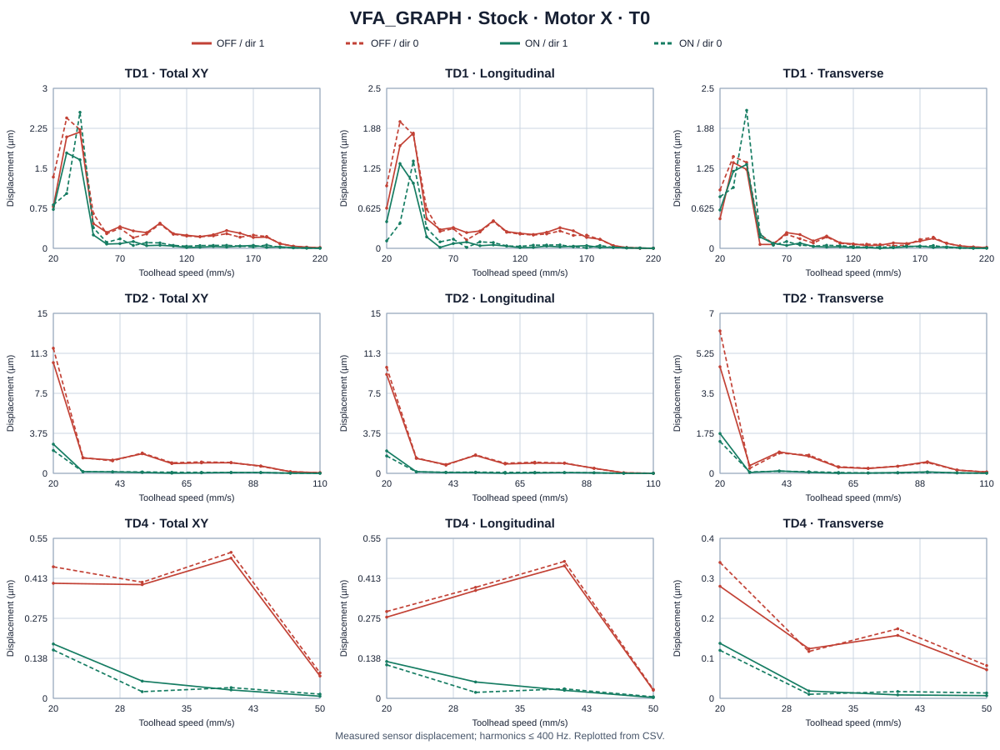

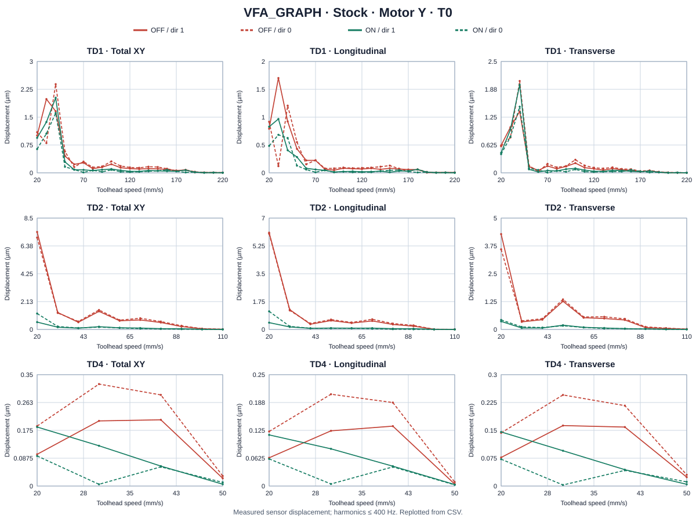

The early 04:16 test covered only X and used a different method/range; it was excluded from direct comparison. Original stock tuning CSVs were unavailable; tuning results were reconstructed from console values at their printed precision. Original VFA_GRAPH CSVs were used for the independent comparison.

## 4. What the algorithm from OpenCreator changes

The adapted algorithm uses ideas from [OpenCreator / Kalico](https://github.com/FlashForge-C5-Modding-Group/kalico/blob/7da732e09d4e213b7766482b6cfdf7e75ee9e191/klippy/extras/stepper_resonance_tester.py) while retaining Z-Mod's measurement code and limits. It is not a port of the entire Kalico firmware.

Instead of tuning at a fixed 200 Hz, it searches resonances from 20 to 300 mm/s (within the velocity limit), with a geometric step up to 8% and refinement of up to three TD2 peaks. Up to two strong reachable frequencies are selected; if none qualifies, the configured frequency is used. TD1/TD2/TD4 are tuned in both directions for each candidate.

The common amplitude minimises the sum of the two residual-acceleration parabolas rather than using the maximum individual amplitude. A combined RMS amplitude reduction of at least 5% is required. If two candidates are present, each is checked at the same speeds and harmonics. The lower sum of squared residuals on matching valid points wins. This internal score is not the independent VFA_GRAPH score: its metric, paths and frequency range differ.

### First X experiment

The first experiment found 270.1 and 82.8 Hz. The fully tuned X coefficients for the first candidate (270.1 Hz) were evaluated with an independent VFA_GRAPH at 14:20. This tests one candidate on one motor, not the full alternative algorithm.

| Frequency range | Points | Algorithm from OpenCreator better | Stock better | Median residual ratio: algorithm from OpenCreator / stock |
|---|---:|---:|---:|---:|
| Up to 400 Hz | 70 | 34 | 36 | 1.012 |
| Above 400 Hz | 64 | 46 | 18 | 0.792 |
| All valid up to 720 Hz | 134 | 80 | 54 | 0.820 |

Up to 400 Hz the overall residual median fell from 0.027725 to 0.022088 µm (−20.3%), but the median paired ratio was close to one. Most of the advantage in winning points came from the region of reduced sensor sensitivity. At this stage the algorithms were considered comparable.

## 5. Full alternative calibration

The alternative calibration ran from 20:53:51 to 22:14:05 for both motors. Time before plotting was 80 min 14 s, roughly 3.8 times the stock run (measured up to SAVE_CONFIG). Other printers or a single candidate may take a different amount of time.

| Motor | High frequency | Low frequency | High score | Low score | Selected |
|---|---:|---:|---:|---:|---:|
| X | 269.812 Hz | 86.237 Hz | 3 315 023 | 5 921 932 | 269.812 Hz |
| Y | 243.352 Hz | 80.899 Hz | 2 301 420 | 10 878 684 | 243.352 Hz |

Scores are sums of squared residual amplitudes under the algorithm's internal criterion, rounded to integers. They are neither micrometres nor percentages of print-quality improvement.

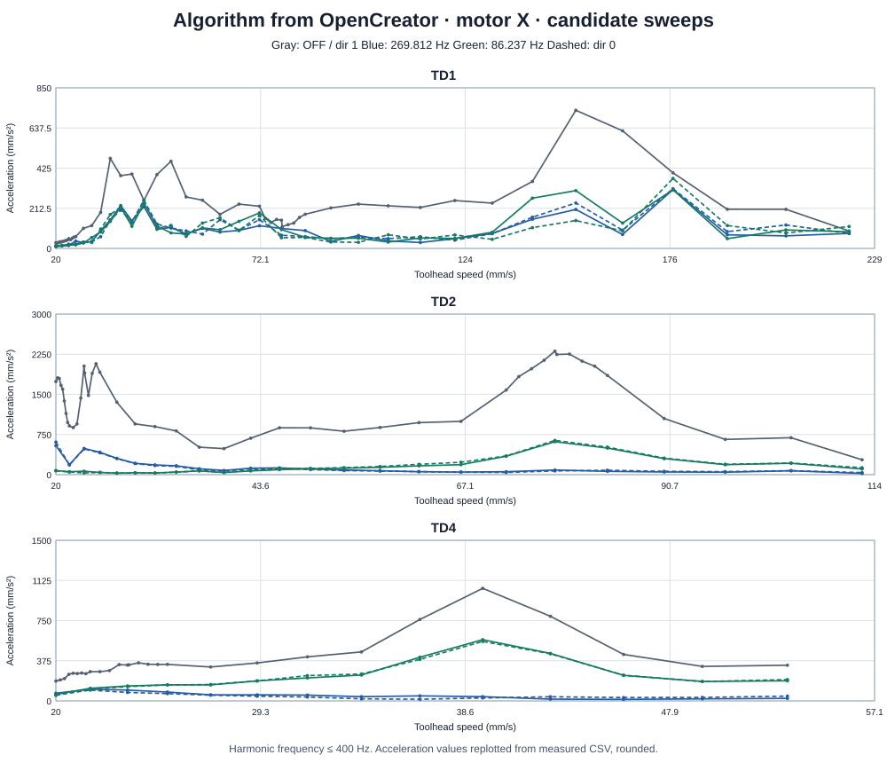

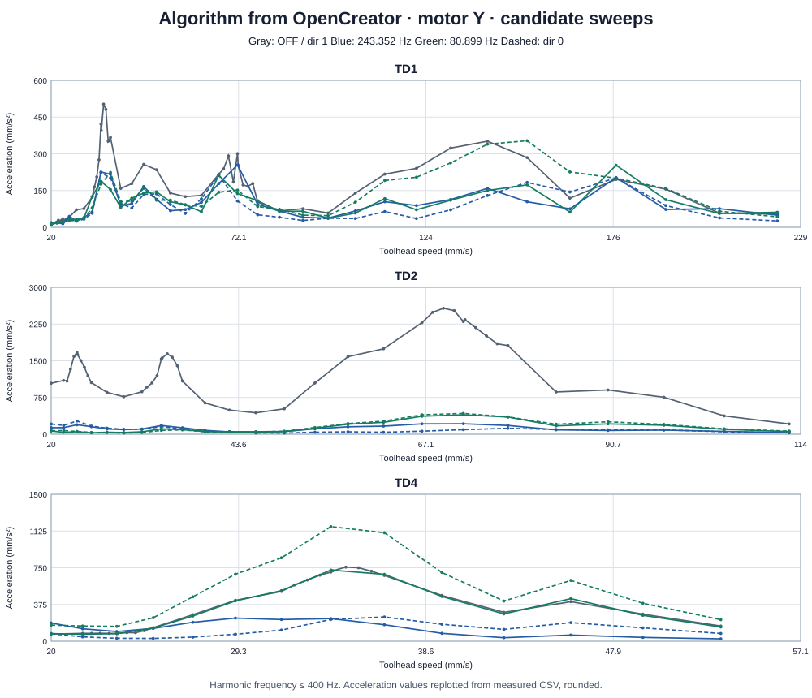

We also checked the selection using matching check-CSV points up to 400 Hz, converting speed and harmonic to frequency. Out of 142 points, the high candidate wins 83 versus 59 on X and 92 versus 50 on Y. The median high/low residual ratios were 0.915 (−8.5%) and 0.764 (−23.6%). This supports the selection of the higher frequency, not superiority to stock.

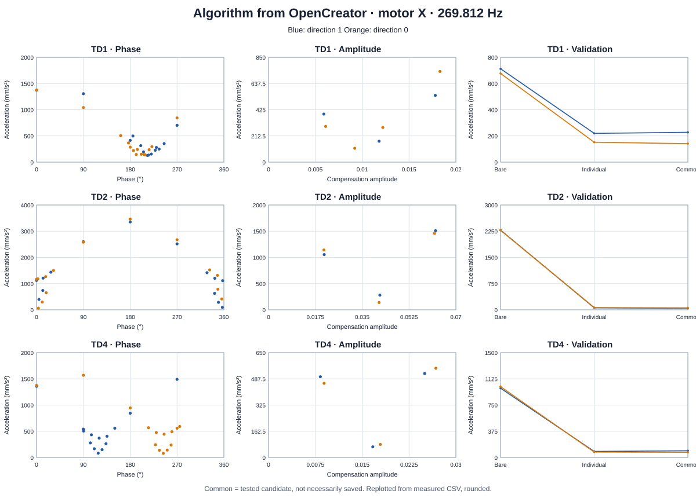

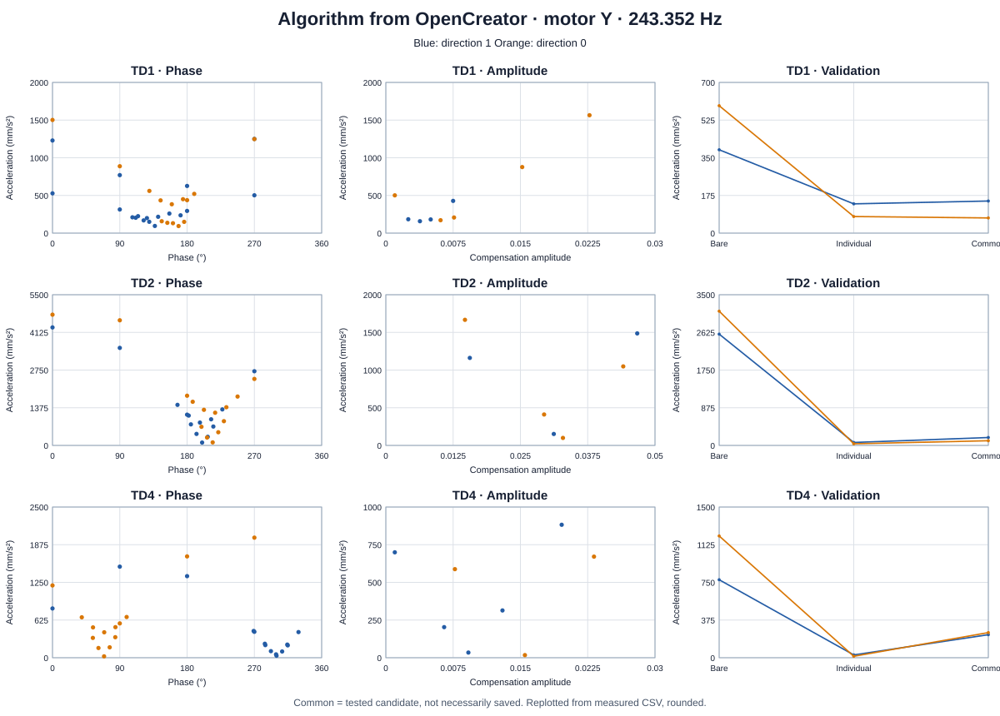

Common is the measured common-amplitude candidate, not necessarily the saved value; actual applied values are in calibration.json. Amplitude and two phases are saved to configuration, while selected frequencies are diagnostic only. The configured stock frequency remains 200 Hz.

### Final coefficients

| Motor / harmonic | Stock AMP | Stock PHASE1 / PHASE2, rad | AMP (algorithm from OpenCreator) | PHASE1 / PHASE2 (algorithm from OpenCreator), rad |
|---|---:|---:|---:|---:|
| X / TD1 | 0.010 | 3.730 / 3.517 | 0.010 | 3.762 / 3.539 |
| X / TD2 | 0.036 | 6.119 / 0.172 | 0.038 | 6.211 / 0.086 |
| X / TD4 | 0.016 | 2.102 / 4.219 | 0.017 | 2.077 / 4.254 |
| Y / TD1 | 0.005 | 2.721 / 2.191 | 0.005 | 2.854 / 2.389 |
| Y / TD2 | 0.032 | 3.662 / 3.579 | 0.032 | 3.705 / 3.508 |
| Y / TD4 | 0.013 | 1.112 / 5.372 | 0.012 | 1.199 / 5.233 |

The coefficients are close, but amplitudes and phases are not identical. Calibration.json stores integer MCU units with a factor of 1000. Do not copy the table to another printer: it applies only to the tested unit and its mechanical condition.

## 6. Independent comparison of the stock algorithm and the algorithm from OpenCreator

We compare VFA_GRAPH 13:10 (stock) with 22:21 (algorithm from OpenCreator). After saving configuration, the 22:21 metadata contains exactly the coefficients from the successful alternative calibration.json. Measurement conditions including paths match. Only valid matching points are compared.

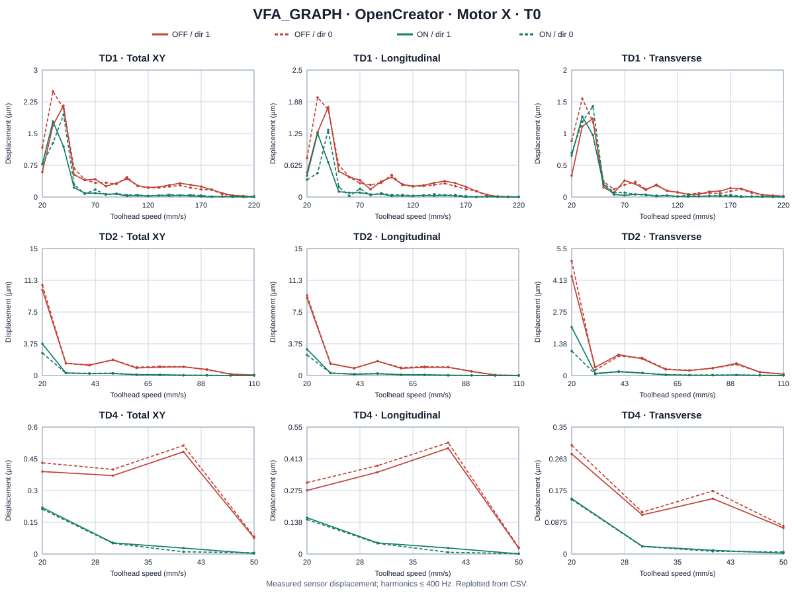

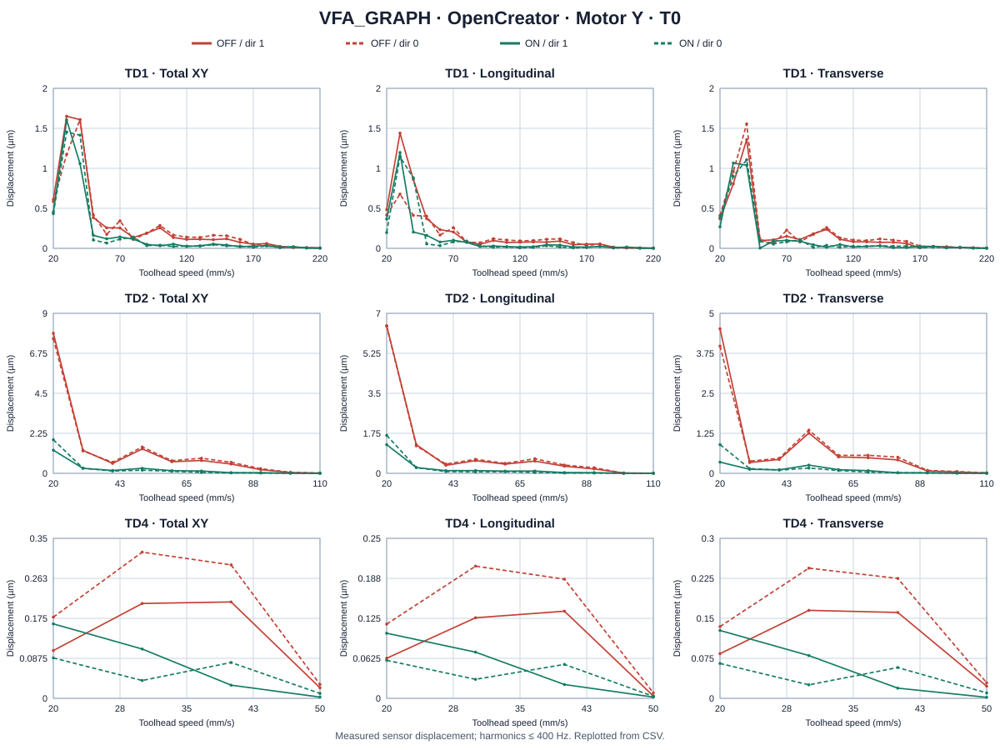

### Up to 400 Hz

| Metric | X stock | X, algorithm from OpenCreator | Y stock | Y, algorithm from OpenCreator |
|---|---:|---:|---:|---:|
| OFF median, µm | 0.146346 | 0.147090 | 0.123195 | 0.111504 |
| ON median, µm | 0.027725 | 0.021465 | 0.042425 | 0.027663 |
| Within-run reduction | 81.1% | 85.4% | 65.6% | 75.2% |
| Points improved versus OFF (of 70) | 64 | 66 | 63 | 62 |

| Direct residual comparison | X | Y |
|---|---:|---:|
| Algorithm from OpenCreator better | 41/70 | 46/70 |
| Stock better | 29/70 | 24/70 |
| Reduction in overall median with the algorithm from OpenCreator | 22.6% | 34.8% |
| Median residual ratio: algorithm from OpenCreator / stock | 0.852 | 0.874 |
| Median paired reduction | **14.8%** | **12.6%** |

The algorithm from OpenCreator wins more points, but the paired effect is smaller than observed repeated-measurement variability (about 26%). The OFF measurements also differ, especially on Y. A 34.8% reduction in the overall Y median alone is therefore not evidence of such a gain at each point or on a finished print.

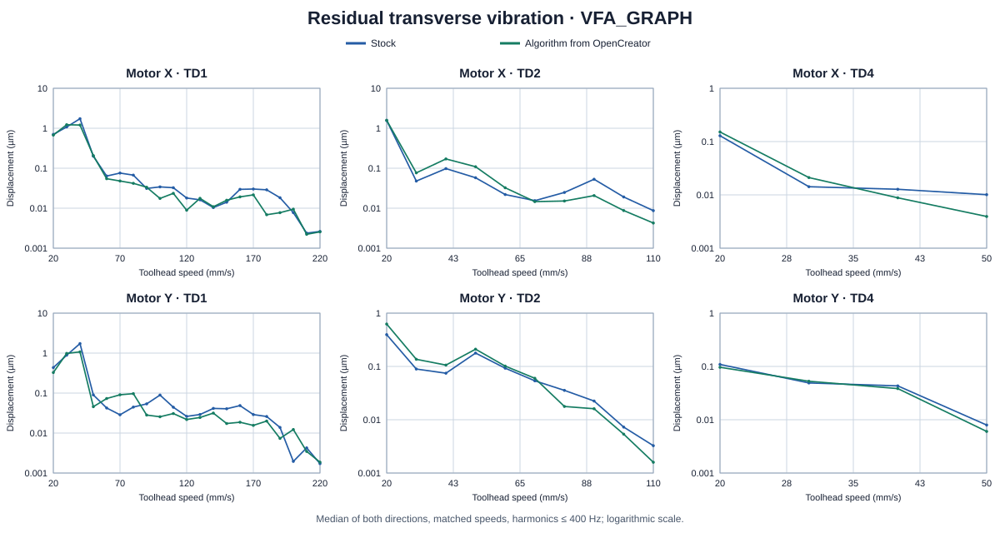

The graph shows the median of both directions at each speed and harmonic. A logarithmic scale makes small residuals visible without changing the values. The displacement tables in section 8 can be used to examine each direction.

### Which speeds favour each algorithm?

| Speed, mm/s | Points per motor | Change in X median | Change in Y median |
|---|---:|---:|---:|
| 20–50 | 24 | +41.6% | +17.9% |
| 60–110 | 24 | −30.8% | −7.0% |
| 120–220 | 22 | −28.9% | −43.4% |

Positive means a larger residual with the algorithm from OpenCreator; negative means smaller. All groups only include frequencies up to 400 Hz. The harmonic set shrinks with speed: only TD1 remains in the last group. These are aggregate comparisons, not a win at every speed. No valid points up to 400 Hz remain above 220 mm/s on this speed grid.

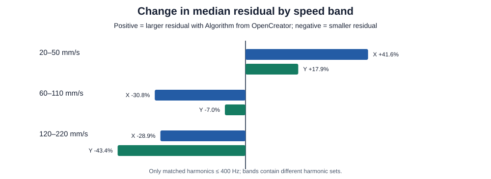

For completeness, above 400 Hz the algorithm from The algorithm from OpenCreator wins 52/64 points on X and 35/64 on Y. Across the full available range this would be 93/134 and 81/134, but it mixes measurements of different sensor sensitivity. We do not use it to select the default algorithm.

## 7. Practical conclusion and using Z-Mod

Both algorithms work. The corrected stock algorithm offers shorter calibration, good low-speed suppression and similar final coefficients. The algorithm from OpenCreator adds adaptive frequency search and some gains at medium/high speeds. On this unit the advantage is not convincing enough to change the default.

**We recommend stock calibration for most users.** Clear the build plate, check mechanics and belt tension, and do not calibrate during printing or pause. Use an up-to-date Z-Mod version supporting VFA. For stock calibration:

```gcode
CALIBRATE_VFA T=0 ALTERNATIVE=0
```

To experiment with the alternative:

```gcode
CALIBRATE_VFA T=0 ALTERNATIVE=1
```

Both variants of the `CALIBRATE_VFA` macro automatically execute `SAVE_CONFIG` after successful calibration and graph generation, then Klipper restarts. There is no need to save manually. Without `ALTERNATIVE`, the setting from `[stepper_resonance_tester]` is used (default: `alternative: False`). Specify `ALTERNATIVE=0` to explicitly select the stock algorithm.

Independent verification after saving:

```gcode
VFA_GRAPH T=0 MAX_SPEED=400 SHAPER=0 REPEAT=3
```

Graphs and CSVs are in `mod_data/vfa/`. Diagnostics use a minute-resolution directory; calibration uses a second-resolution directory with the `_setvfa` suffix. Calibration CSVs, calibration.json, tuning graphs and alternative check sweeps are separate from independent VFA_GRAPH plots. PNG rendering runs in the chroot after tool return without additional motion.

Further study could repeat independent runs in random order with REPEAT=3, test several C5/C5 Pro printers and compare real printed samples with identical material and settings. There is little value in optimising coefficients for small relative changes that do not exceed test reproducibility.

## 8. Data for verification

Displacement tables up to 400 Hz for each direction and mode, including transverse, longitudinal and total displacement:

- Stock at 13:10: [X CSV](../assets/vfa/stock-1310-x.csv), [Y CSV](../assets/vfa/stock-1310-y.csv).
- Algorithm from OpenCreator at 22:21: [X CSV](../assets/vfa/alternative-2221-x.csv), [Y CSV](../assets/vfa/alternative-2221-y.csv).

These are derived displacement tables in µm, rounded for website plotting, not original accelerometer-amplitude CSVs. Article numbers were calculated from the original measurements, so the last digits may differ. Website graphs were replotted from saved measurements as SVGs. Full accelerometer time series are not available. To reproduce the main comparison, match rows by speed, direction and harmonic and use only `mode=after` for comparison between algorithms.

### Z-Mod changes and code sources

| PR | Change |
|---|---|
| [#14](https://github.com/ghzserg/zmod_klipper_c5/pull/14) | Independent VFA_GRAPH |
| [#16](https://github.com/ghzserg/zmod_klipper_c5/pull/16) | Input Shaper control during measurements |
| [#17](https://github.com/ghzserg/zmod_klipper_c5/pull/17), [#18](https://github.com/ghzserg/zmod_klipper_c5/pull/18) | Corrected stock measurement and saving |
| [#19](https://github.com/ghzserg/zmod_klipper_c5/pull/19) | Alternative calibration |
| [#20](https://github.com/ghzserg/zmod_klipper_c5/pull/20) | Calibration plots |
| [#22](https://github.com/ghzserg/zmod_klipper_c5/pull/22) | Stock restored as default |
