# VFA на Creator 5 Pro: сравнение штатного алгоритма и алгоритма из OpenCreator

*Исследование Z-Mod, 26 ноября 2026 г.*

## Что калибровка VFA даёт на практике ?
- Она помогает уменьшить мелкие вертикальные полосы на стенках детали, возникающие из-за вибраций двигателей, ремней, направляющих, рамы и прочей механики. Артефакты особенно хорошо заметны на вертикальных гладких поверхностях.
**Калибровку VFA использовать стоит, но альтернативный алгоритм из OpenCreator большинству пользователей не нужен.**

- Если на вертикальных стенках видны регулярные мелкие полосы, выполните штатную калибровку `CALIBRATE_VFA T=0 ALTERNATIVE=0`. На нашем C5 Pro она заняла около 21 минуты. Перед каждой печатью повторять её не нужно: сохранённая компенсация применяется автоматически. Повторите калибровку, если изменили натяжение ремней, или обслужили механику, либо полосы появились от износа снова.
- В OrcaSlicer продолжайте задавать привычные скорости и ускорения. **VFA не повышает допустимые скорости**, не меняет настройки профиля и **не заменяет Input Shaper**. Если полосы остаются на определённой скорости, попробуйте изменить скорость внешней стенки и сравнить одинаковые тестовые детали. Перед печатью теста проверьте фактическую скорость в предпросмотре OrcaSlicer: она может сильно отличаться от заданной, если в профилях включено "замедлять для охлаждения", "замедляться на изогнутых периметрах" или "замедляться на нависаниях".
- Алгоритм из OpenCreator имеет смысл попробовать, если штатный вариант не устраивает и есть возможность сравнить результаты тестовых отпечатков. На Creator5 алгоритм из OpenCreator по графикам лучше в среднем на скоростях 60–220 мм/с, а штатный на основе Flashforge — на 20–50 мм/с. Разница недостаточно убедительна с учётом разброса измерений, а калибровка из OpenCreator заняла в 4 раза больше времени.

**Итог:** оставьте алгоритм на основе Flashforge, если нет конкретной причины экспериментировать. Вибрации при штатной компенсации снизились по общей медиане примерно на 81% для двигателя X и на 66% для Y. Это измерения акселерометра, а не обещание, что полосы на детали уменьшатся на такой же процент.

## Результат исследования

На одном Flashforge Creator 5 Pro мы проверили исправленный штатный алгоритм калибровки VFA и адаптированный алгоритм из OpenCreator. Оба заметно уменьшают вибрации. Алгоритм из OpenCreator дал немного лучшие результаты на средних и высоких скоростях, но не доказал преимущество, превышающее разброс повторных измерений. На малых скоростях штатная компенсация оказалась лучше по медиане остаточных смещений.

Штатная калибровка заняла около 21 минуты, альтернативная — около 80 минут. Поэтому **в Z-Mod основным остаётся штатный алгоритм на основе Flashforge**, а алгоритм из OpenCreator доступен по желанию.

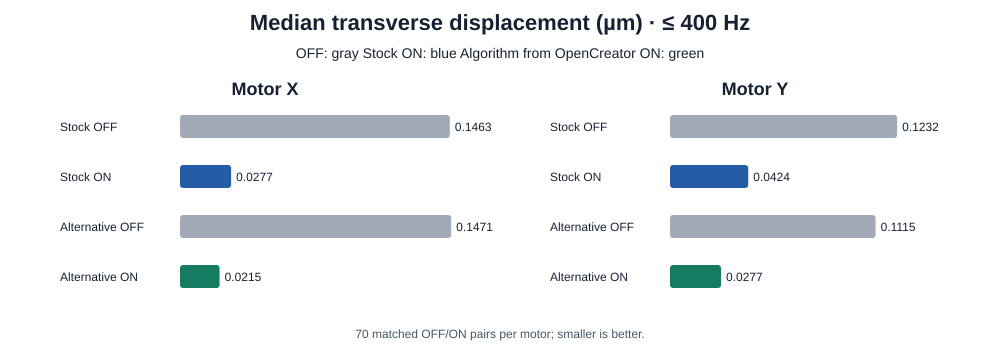

Это исследование одного принтера, а не статистика всей серии Creator 5. Измеряется движение акселерометра, а не шероховатость поверхности напечатанной детали.

## 1. Что такое VFA и что измеряет Z-Mod

VFA (Vertical Fine Artifacts) — мелкие вертикальные повторяющиеся полосы на стенках печатной детали. Среди их причин — периодические возмущения, связанные с работой двигателей, ременной передачей и механикой принтера. В Creator 5 предусмотрена компенсация двигателей через `mclib`: для каждой из гармоник TD1, TD2 и TD4 задаются одна амплитуда и две фазы, по одной для каждого направления вращения. Это отдельная настройка, не заменяющая Input Shaper.

На испытанном принтере кинематика CoreXY, `rotation_distance=40.4` мм, измерение вдоль диагонали 45°. Один двигатель вращается, другой в идеальной кинематике неподвижен. Для применяемого в Klipper пересчёта частоты:

`f(TD) = 50 × sqrt(2) × v × TD / 40.4 ≈ 1.750264 × v × TD`,

где `v` — скорость каретки, мм/с, а `f` — частота гармоники, Гц. Коэффициент зависит от кинематики и параметров двигателя; для других конфигураций его нельзя использовать как универсальную константу.

Например, штатная частота 200 Гц соответствует трём различным скоростям:

| Гармоника | Скорость каретки, мм/с |
|---|---:|
| TD1 | 114,27 |
| TD2 | 57,13 |
| TD4 | 28,57 |

**Частота в Гц и скорость в мм/с — разные величины.** У акселерометра LIS2DW номинальная частота дискретизации 1600 Гц. С ростом частоты измеряемые амплитуды могут занижаться из-за фильтра датчика; основной диапазон анализа ограничиваем 400 Гц. В CSV независимого теста сохраняются валидные данные до 720 Гц (не выше 45% фактической частоты дискретизации); графики ограничены 400 Гц. Это консервативная граница сравнения, а не утверждение, что на 401 Гц датчик перестаёт измерять.

На испытанном принтере до 400 Гц попадают TD1 при скоростях до примерно 228,5 мм/с, TD2 — до 114,3 мм/с, TD4 — до 57,1 мм/с. Поэтому диапазон `MAX_SPEED=400` не означает, что все три гармоники достоверно измерены на 400 мм/с.

Измеренные ускорения преобразуем в оценку амплитуды смещения датчика. Для гармонического колебания с частотой `f` и амплитудой ускорения `A`:

`d [мкм] = 1000 × A [мм/с²] / (2πf)²`.

Это позволяет сопоставлять остаточные вибрации в единицах смещения, а не смешивать ускорения на разных частотах. Основная метрика — поперечная составляющая относительно движения каретки. Продольная и суммарная XY-составляющие также доступны на графиках.

## 2. Как устроен независимый тест VFA_GRAPH

До сравнения алгоритмов мы реализовали отдельный измерительный инструмент. Калибровка ищет коэффициенты на заводских траекториях, а `VFA_GRAPH` оценивает полученную компенсацию в центре рабочей области. Это разные эксперименты.

Команда теста:

```gcode
VFA_GRAPH T=0 MAX_SPEED=400 SHAPER=0
```

В исследовании использовались T0, двигатели X/Y, оба направления, диапазон 20–400 мм/с с шагом 10, ускорение 5000 мм/с², адаптивная длина измерительного участка, один повтор каждой комбинации. Input Shaper отключался на время измерений. Метаданные тестов 13:10 и 22:21 совпадают по всем полям, кроме наборов коэффициентов компенсации. Движение выполняется с полной остановкой между проходами; порядок OFF/ON чередуется, чтобы уменьшить влияние последовательности измерений.

Адаптивная длина выбирается для 0,6 с полезного измерения и не менее 20 периодов TD1, если позволяют границы траектории. Анализируется только участок постоянной скорости, с отсечением переходных участков. Совместная аппроксимация синусоид на известных частотах гармоник отделяет их от постоянной составляющей и линейного тренда. Неполные, повреждённые и недостаточно длинные измерения отбрасываются. Ускорение и состояние шейперов восстанавливаются после теста. Команда не выполняет SAVE_CONFIG.

Для сравнения используем `before` (компенсация отключена) и `after` (сохранённые коэффициенты). Результат одной точки определяется скоростью, направлением, гармоникой, частотой и номером повтора. При одном повторе до 400 Гц получилось 70 валидных пар на двигатель: TD1 — 42, TD2 — 20, TD4 — 8. Частоты выше 400 Гц сохраняем для проверки, но не используем в основном выводе.

Считаем две разные метрики:

- **Снижение общей медианы**: `1 − median(after)/median(before)` — эффект компенсации в пределах одного прогона. Для сравнения алгоритмов знаменатель и числитель — медианы остатка штатного и альтернативного прогона.
- **Медиана попарных отношений**: `median(after_alternative / after_stock)` — сравнение остатка в совпадающих точках. Значение меньше единицы означает улучшение. Это основной критерий межалгоритмического сравнения, дополненный количеством выигранных точек и оценкой повторяемости.

Нельзя считать снижение общей медианы равным улучшению каждой точки. Разные распределения амплитуд могут дать более низкую общую медиану при примерно равном количестве выигранных точек.

Для пользователя, которому нужно более устойчивое сравнение, доступен `REPEAT=3`. Сравниваются медианы валидных пар. Данные исследования ниже получены при `REPEAT=1` за один прогон каждого варианта, а повторяемость оценивается отдельными измерениями.

## 3. Исправление штатного алгоритма и повторяемость

Прежде чем менять алгоритм поиска, мы исправили измерительную часть штатной калибровки Flashforge: использование всего участка равномерного движения вместо ограничения коротким окном, проверку длительности и целостности дискретизации, работу в машинных координатах, восстановление исходных ограничений и шейперов, а также обработку результата двух направлений. Штатная схема поиска амплитуды и фазы сохранена.

Подбор работает на заданной частоте (обычно 200 Гц): исходная амплитуда без компенсации, поиск фазы по четырём точкам, уточнение фазы, подбор амплитуды и окончательная проверка. Общая амплитуда выбирается как максимум индивидуальных амплитуд; при необходимости проверяется дополнительным проходом. Если одно направление ухудшается более чем на 20% относительно измерения без компенсации либо улучшения нет в обоих направлениях, результат отклоняется.

Результаты независимых измерений до 400 Гц:

| Время теста | Шейперы | X, без → с компенсацией, мкм | Y, без → с компенсацией, мкм |
|---|---|---:|---:|
| 09:41 | Исходное состояние | 0,13719 → 0,02563 | 0,12050 → 0,03408 |
| 11:07 | Отключены | 0,14597 → 0,02851 | 0,12091 → 0,03757 |
| 11:31 | Отключены | 0,14468 → 0,02602 | 0,11562 → 0,04397 |
| 11:48 | Исходное состояние | 0,12842 → 0,02848 | 0,11090 → 0,04176 |
| 13:10 | Отключены; новая штатная калибровка | 0,14635 → 0,02773 | 0,12319 → 0,04242 |

До 11:48 коэффициенты оставались одинаковыми. Прогоны 11:07 и 11:31 выполнены без шейперов с одной и той же компенсацией. Медиана симметричного относительного расхождения остаточных амплитуд `|a−b| / ((a+b)/2)` составила **25,8% на X и 26,4% на Y**. Это наблюдавшийся разброс повторных измерений, не паспортная погрешность датчика, не доверительный интервал и не формальный критерий статистической значимости. На очень малых остаточных амплитудах относительное расхождение естественно возрастает.

Исправленная штатная калибровка закончилась в 13:07:38, началась в 12:46:17. Продолжительность до SAVE_CONFIG — 21 мин 21 с. В журнале 115 измерений подбора X и 130 Y. После сохранения выполнен независимый тест 13:10: X — снижение общей медианы 81,1%, Y — 65,6%; улучшение в 64 и 63 из 70 точек соответственно. Итог не показал радикального улучшения относительно прежней штатной компенсации, зато измерения и сохранение стали контролируемыми.

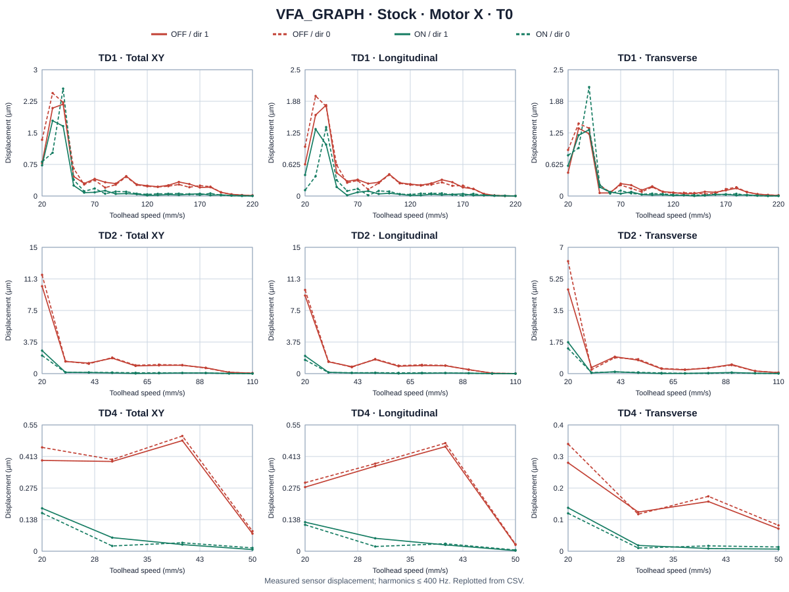

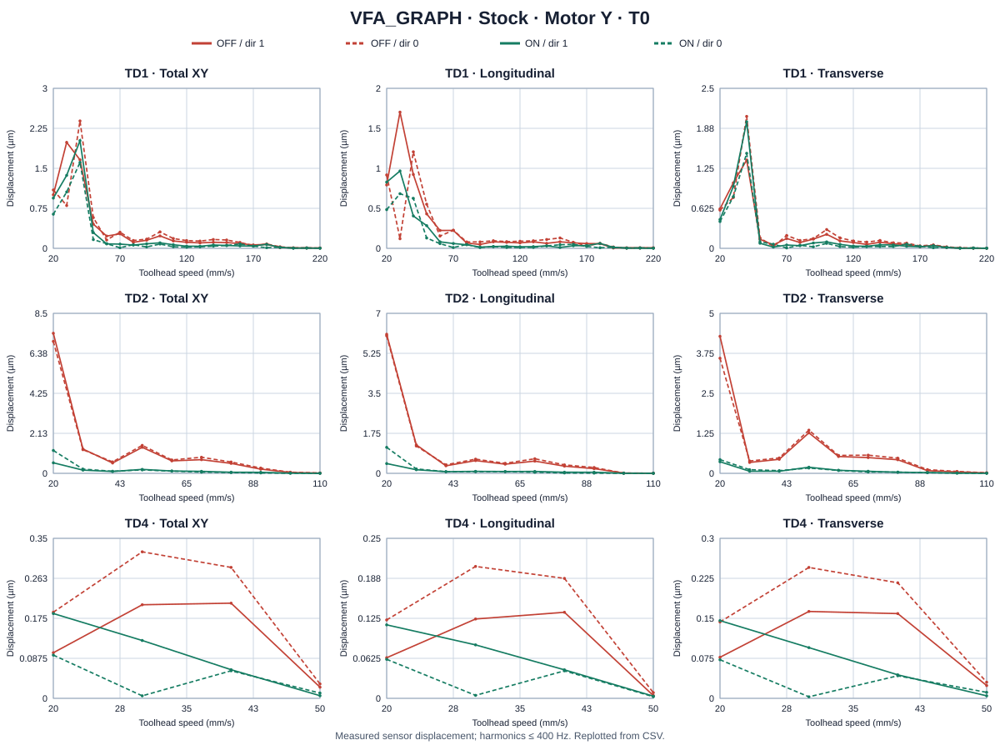

Ранний тест 04:16 содержал только X и другую методику/диапазон, поэтому в прямое сравнение его не включали. Исходные штатные CSV подбора не были предоставлены: результаты подбора восстановлены из консоли с её точностью округления. Для независимого сравнения использовались оригинальные CSV VFA_GRAPH.

## 4. Что меняет алгоритм из OpenCreator

Адаптированный алгоритм использует идеи [OpenCreator / Kalico](https://github.com/FlashForge-C5-Modding-Group/kalico/blob/7da732e09d4e213b7766482b6cfdf7e75ee9e191/klippy/extras/stepper_resonance_tester.py), но сохраняет измерительную часть и ограничения Z-Mod. Это не перенос всей прошивки Kalico.

Вместо настройки на фиксированных 200 Гц выполняется поиск резонансов в диапазоне 20–300 мм/с (не выше лимита скорости), геометрический шаг до 8%, уточнение до трёх пиков TD2. Выбираются до двух выраженных достижимых частот. Если допустимых кандидатов нет, используется заданная частота. Для каждой частоты выполняется подбор TD1/TD2/TD4 в обоих направлениях.

Общая амплитуда выбирается по сумме квадратов двух парабол остаточного ускорения, а не как максимум двух индивидуальных амплитуд. Проверяется снижение суммарной RMS-амплитуды не менее 5%. Если частот-кандидатов две, после каждой калибровки выполняются контрольные проходы на одинаковых скоростях и гармониках. Побеждает меньшая сумма квадратов остатков на совпадающих валидных точках. Эта внутренняя оценка не является оценкой независимого VFA_GRAPH: у неё другая метрика, траектория и частотный диапазон.

### Первый эксперимент X

В первом эксперименте были найдены 270,1 и 82,8 Гц. Для предварительного сравнения использовали полностью подобранные коэффициенты X первого кандидата (270,1 Гц) и измерили их независимым VFA_GRAPH в 14:20. Это проверка одного кандидата на одном двигателе, а не результат полного альтернативного алгоритма.

| Диапазон частот | Точек | Алгоритм из OpenCreator лучше | Штатный лучше | Медиана отношения остатков: алгоритм из OpenCreator / штатный |
|---|---:|---:|---:|---:|
| До 400 Гц | 70 | 34 | 36 | 1,012 |
| Выше 400 Гц | 64 | 46 | 18 | 0,792 |
| Все валидные до 720 Гц | 134 | 80 | 54 | 0,820 |

До 400 Гц общая медиана остатка снизилась с 0,027725 до 0,022088 мкм (−20,3%), но попарная медиана отношения около единицы. Большая часть преимущества по количеству выигранных точек пришлась на диапазон с пониженной чувствительностью датчика. Поэтому на этом этапе эффективность алгоритмов считалась сопоставимой.


## 5. Полная альтернативная калибровка

Альтернативная калибровка началась в 20:53:51, оба двигателя были откалиброваны до 22:14:05. Продолжительность до построения графиков — 80 мин 14 с, приблизительно в 3,8 раза дольше штатного запуска (для которого время измерено до SAVE_CONFIG). Время на других принтерах и при одном найденном кандидате может отличаться.

| Двигатель | Высокая частота | Низкая частота | Оценка высокой | Оценка низкой | Выбрана |
|---|---:|---:|---:|---:|---:|
| X | 269,812 Гц | 86,237 Гц | 3 315 023 | 5 921 932 | 269,812 Гц |
| Y | 243,352 Гц | 80,899 Гц | 2 301 420 | 10 878 684 | 243,352 Гц |

Оценки — сумма квадратов остаточных амплитуд по внутреннему критерию алгоритма, округлённая до целого. Это не микрометры и не проценты улучшения качества печати.

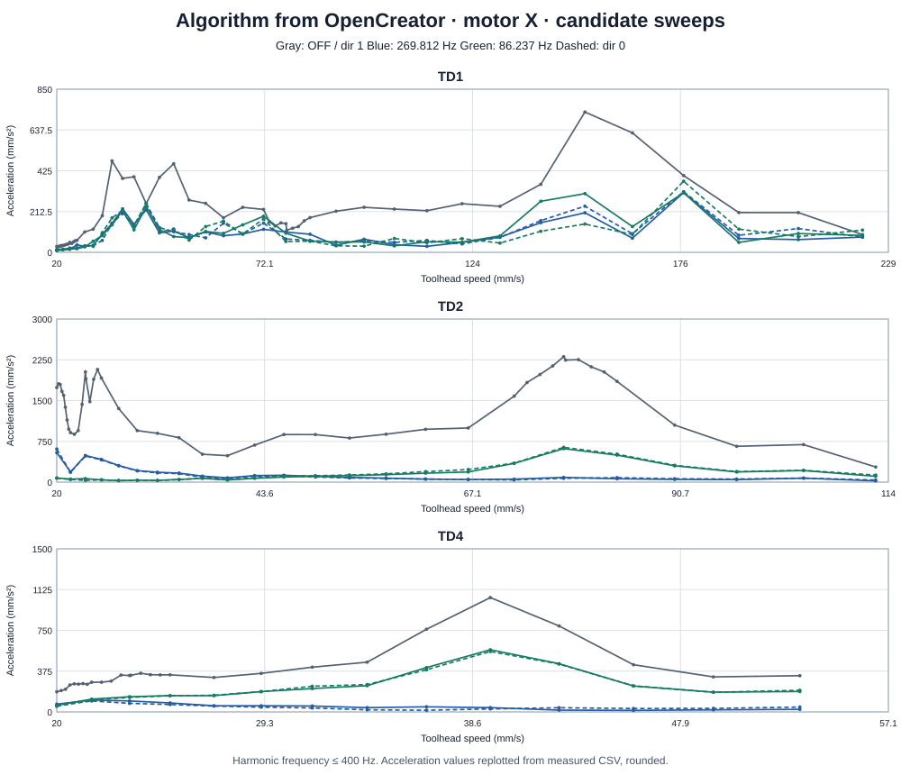

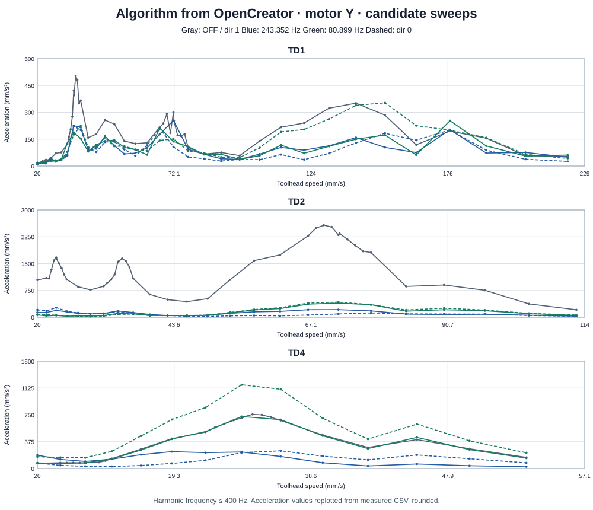

Проверили выбор также по совпадающим точкам контрольных CSV до 400 Гц, пересчитав частоту по скорости, гармонике и кинематике. Из 142 точек для X высокая частота лучше в 83, низкая в 59; для Y — 92 против 50. Медиана отношения остатков высокой частоты к низкой — 0,915 (−8,5%) и 0,764 (−23,6%). Это поддерживает выбор высокой частоты, но не доказывает превосходство над штатным алгоритмом.

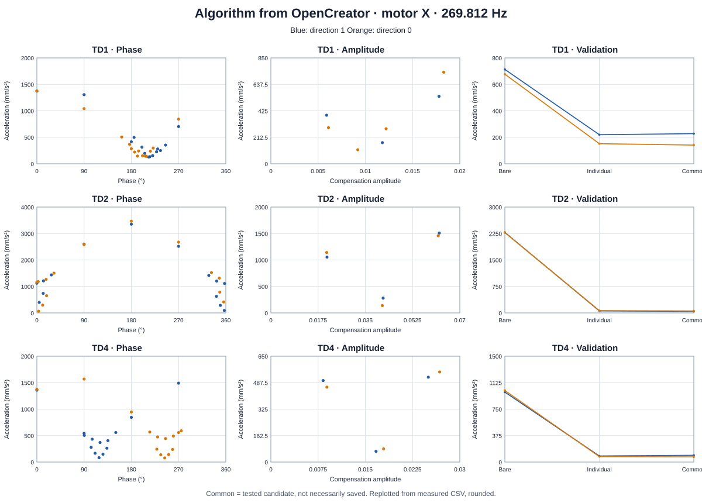

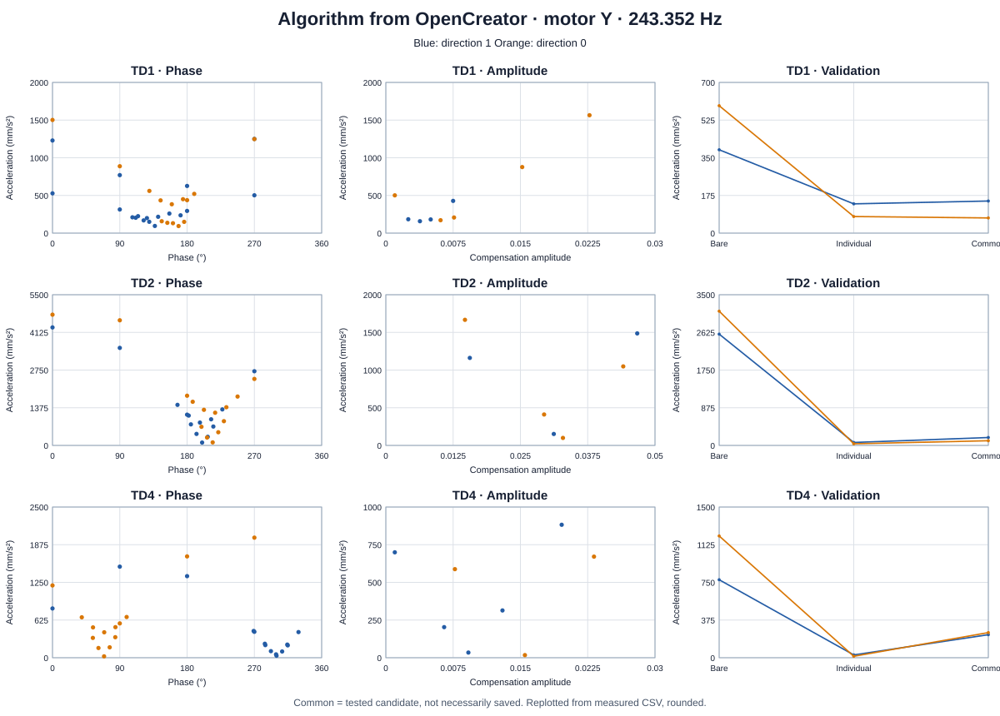

На этих графиках `Common` — измеренный кандидат общей амплитуды; окончательные значения следует брать из `calibration.json`. В итоговой конфигурации сохраняются амплитуда и две фазы, а выбранные частоты остаются диагностическими. Настроенная частота штатного алгоритма остаётся 200 Гц.

### Итоговые коэффициенты

| Двигатель / гармоника | Штатный AMP | Штатные PHASE1 / PHASE2, рад | AMP (алгоритм из OpenCreator) | PHASE1 / PHASE2 (алгоритм из OpenCreator), рад |
|---|---:|---:|---:|---:|
| X / TD1 | 0,010 | 3,730 / 3,517 | 0,010 | 3,762 / 3,539 |
| X / TD2 | 0,036 | 6,119 / 0,172 | 0,038 | 6,211 / 0,086 |
| X / TD4 | 0,016 | 2,102 / 4,219 | 0,017 | 2,077 / 4,254 |
| Y / TD1 | 0,005 | 2,721 / 2,191 | 0,005 | 2,854 / 2,389 |
| Y / TD2 | 0,032 | 3,662 / 3,579 | 0,032 | 3,705 / 3,508 |
| Y / TD4 | 0,013 | 1,112 / 5,372 | 0,012 | 1,199 / 5,233 |

Итоговые коэффициенты близки, но фазы и амплитуды не идентичны. В `calibration.json` они хранятся в целых единицах MCU, масштаб 1000. Не копируйте таблицу в конфигурацию другого принтера: эти коэффициенты относятся к конкретному экземпляру и состоянию его механики.

## 6. Независимое сравнение штатного алгоритма и алгоритма из OpenCreator

Сравниваем VFA_GRAPH 13:10 (штатный) с VFA_GRAPH 22:21 (алгоритм из OpenCreator). После записи конфигурации метаданные 22:21 содержат ровно те коэффициенты, которые указаны в `calibration.json` успешной альтернативной калибровки. Все условия, включая траектории, совпадают. Сопоставлены только валидные совпадающие точки.

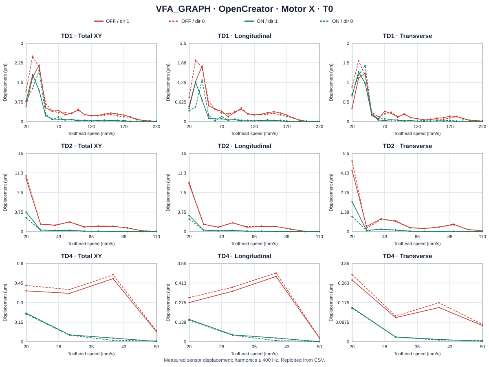

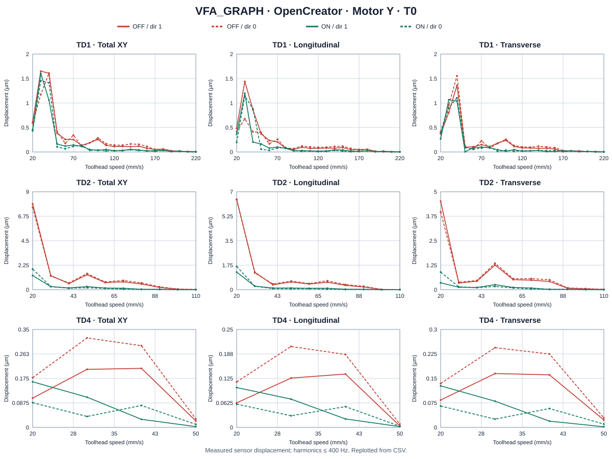

### До 400 Гц

| Метрика | X, штатный | X, алгоритм из OpenCreator | Y, штатный | Y, алгоритм из OpenCreator |
|---|---:|---:|---:|---:|
| Медиана без компенсации, мкм | 0,146346 | 0,147090 | 0,123195 | 0,111504 |
| Медиана с компенсацией, мкм | 0,027725 | 0,021465 | 0,042425 | 0,027663 |
| Снижение внутри прогона | 81,1% | 85,4% | 65,6% | 75,2% |
| Улучшение относительно OFF, точек из 70 | 64 | 66 | 63 | 62 |

| Прямое сравнение остатка | X | Y |
|---|---:|---:|
| Алгоритм из OpenCreator лучше | 41/70 | 46/70 |
| Штатный лучше | 29/70 | 24/70 |
| Снижение общей медианы алгоритма из OpenCreator относительно штатного | 22,6% | 34,8% |
| Медиана отношения остатков: алгоритм из OpenCreator / штатный | 0,852 | 0,874 |
| Медианное попарное снижение | **14,8%** | **12,6%** |

Прямое сравнение показывает, что алгоритм из OpenCreator чаще выигрывает, но эффект по попарной метрике меньше наблюдаемого разброса повторных измерений (около 26%). Различаются и исходные OFF-измерения, особенно у Y. Поэтому снижение общей медианы на 34,8% у Y нельзя само по себе считать доказательством такого же выигрыша для каждой точки или готовой детали.

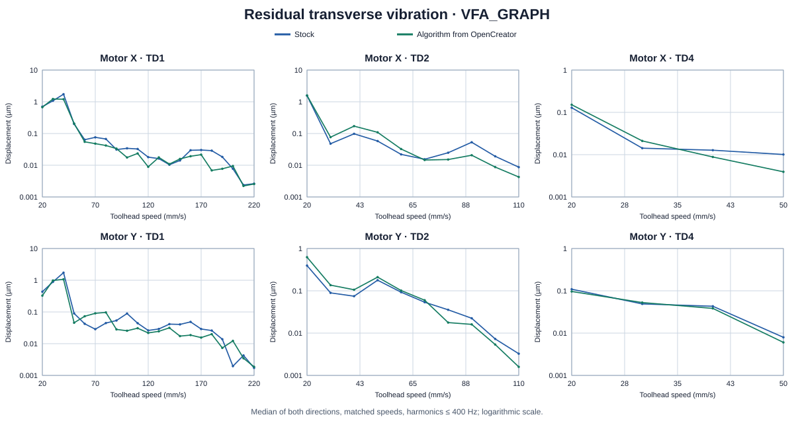

График показывает медиану двух направлений на каждой скорости, отдельно по гармонике. Логарифмическая шкала необходима для видимости малых остатков. Она не меняет исходные величины. Для проверки каждого направления используйте таблицы смещения в разделе 8.

### В каких диапазонах лучше каждый алгоритм

| Скорость, мм/с | Точек на двигатель | Изменение медианы X | Изменение медианы Y |
|---|---:|---:|---:|
| 20–50 | 24 | +41,6% | +17,9% |
| 60–110 | 24 | −30,8% | −7,0% |
| 120–220 | 22 | −28,9% | −43,4% |

Положительное число — алгоритм из OpenCreator даёт больший остаток, отрицательное — меньший. Во всех группах учитываются только частоты до 400 Гц. С ростом скорости число измеряемых гармоник уменьшается: в последней группе остаётся только TD1. Это агрегированное сравнение, а не утверждение о выигрыше на каждой скорости. При скорости выше 220 мм/с в выбранном шаге уже нет валидных точек до 400 Гц.

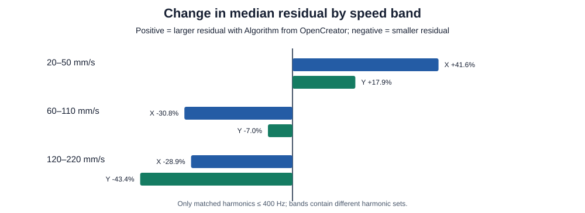

Для полноты: выше 400 Гц алгоритм из OpenCreator выигрывает в 52/64 точках X и 35/64 Y. Если объединить весь доступный диапазон, получится 93/134 и 81/134, но это смешивает измерения с разной чувствительностью датчика. Поэтому такой подсчёт не используем для выбора основного алгоритма.

## 7. Практический вывод и использование Z-Mod

Оба алгоритма работают. У штатного исправленного алгоритма — меньшее время калибровки, хорошее подавление на низких скоростях и близкие итоговые коэффициенты. У алгоритма из OpenCreator — адаптивный поиск частоты и некоторое преимущество в части средних/высоких скоростей. На данном экземпляре преимущество не оказалось достаточно убедительным для смены алгоритма по умолчанию.

**Для большинства пользователей рекомендуем штатную калибровку.** Перед запуском освободите стол, проверьте механику и натяжение ремней. Не запускайте калибровку при печати или паузе. Используйте актуальную версию Z-Mod с соответствующей поддержкой VFA. Для штатной калибровки:

```gcode
CALIBRATE_VFA T=0 ALTERNATIVE=0
```

Для эксперимента с альтернативой:

```gcode
CALIBRATE_VFA T=0 ALTERNATIVE=1
```

Оба варианта макроса `CALIBRATE_VFA` автоматически выполняют `SAVE_CONFIG` после успешной калибровки и построения графиков, затем Klipper перезапускается. Вручную сохранять конфигурацию не нужно. Без параметра `ALTERNATIVE` используется настройка из секции `[stepper_resonance_tester]` (по умолчанию `alternative: False`). Для явного выбора штатного алгоритма укажите `ALTERNATIVE=0`.

Проверка после сохранения:

```gcode
VFA_GRAPH T=0 MAX_SPEED=400 SHAPER=0 REPEAT=3
```

Графики и CSV находятся в `mod_data/vfa/`. Диагностика сохраняется в каталоге с датой и временем до минут, калибровка — с суффиксом `_setvfa` и временем до секунд. Калибровочные CSV, `calibration.json`, графики подбора и (для альтернативы) контрольные проходы генерируются отдельно от независимых графиков VFA_GRAPH. Генерация PNG запускается в chroot после возврата инструмента, без новых движений.

Следующее исследование, если оно необходимо: повторить независимые замеры в случайном порядке с `REPEAT=3`, провести проверку на нескольких C5/C5 Pro и сравнить реальные печатные образцы при одинаковом материале и режимах. Не стоит оптимизировать коэффициенты ради небольшого относительного изменения, которое не превосходит воспроизводимость теста.

## 8. Данные для проверки

Для проверки основного сравнения доступны таблицы поперечного, продольного и суммарного смещения до 400 Гц, по каждому направлению и режиму:

- Штатная компенсация 13:10: [X CSV](../assets/vfa/stock-1310-x.csv), [Y CSV](../assets/vfa/stock-1310-y.csv).
- Алгоритм из OpenCreator 22:21: [X CSV](../assets/vfa/alternative-2221-x.csv), [Y CSV](../assets/vfa/alternative-2221-y.csv).

Это производные таблицы смещения в мкм, округлённые при подготовке графиков для сайта; они не заменяют исходные CSV акселерометрических амплитуд. Числа в статье рассчитаны по исходным измерениям, поэтому последние знаки могут отличаться. Графики на сайте перестроены из сохранённых измерений в SVG. Полные временные ряды акселерометра в материалах исследования отсутствуют. Повторить основное сравнение можно, сопоставив строки по скорости, направлению и гармонике, используя только `mode=after` для сравнения алгоритмов.

### Изменения Z-Mod и источники кода

| PR | Изменение |
|---|---|
| [№14](https://github.com/ghzserg/zmod_klipper_c5/pull/14) | Независимый VFA_GRAPH |
| [№16](https://github.com/ghzserg/zmod_klipper_c5/pull/16) | Управление Input Shaper при измерении |
| [№17](https://github.com/ghzserg/zmod_klipper_c5/pull/17), [№18](https://github.com/ghzserg/zmod_klipper_c5/pull/18) | Исправление измерений и сохранения штатной калибровки |
| [№19](https://github.com/ghzserg/zmod_klipper_c5/pull/19) | Альтернативная калибровка |
| [№20](https://github.com/ghzserg/zmod_klipper_c5/pull/20) | Графики калибровки |
| [№22](https://github.com/ghzserg/zmod_klipper_c5/pull/22) | Возврат штатного алгоритма по умолчанию |
